**Software Design Document:**

**Web Application for Managing Technical Documentation of Enterprise Applications**

Design Document (Version 1.0)

Camila Castillo Porras

October 13, 2026

**Table 1**

*Document Version History*

| **Version** | **Date**       | **Description of Change**                                                                                                                                                                                                                                                                                                                                                                                                   | **Author**             |
|-------------|----------------|-----------------------------------------------------------------------------------------------------------------------------------------------------------------------------------------------------------------------------------------------------------------------------------------------------------------------------------------------------------------------------------------------------------------------------|------------------------|
| 0.1         | Sept. 26, 2026 | Initial SDD structure by IEEE 1016 viewpoints, physical tables.                                                                                                                                                                                                                                                                                                                                                             | Camila Castillo Porras |
| 0.2         | Sept. 26, 2026 | Foreign keys, associative entities, domains, CHECK constraints, and integrity triggers, added application, environment presence, collection fields, and saved reports, design decision log and draft traceability matrix.                                                                                                                                                                                                   | Camila Castillo Porras |
| 0.3         | Sept. 26, 2026 | Jira hierarchy Epic (one per screen) → Story → Subtask enforced in the model, dashboard definitions for undocumented collections and pending tickets, collection fields confirmed, ticket-creation rule (Story chosen or created by the user, Epic created on first ticket).                                                                                                                                                | Camila Castillo Porras |
| 0.4         | Sept. 26, 2026 | Analysis of polymorphic references: criteria, alternatives, adopted designs for dependency, comment, and audit, supertype completeness trigger, comparative referential-integrity validation.                                                                                                                                                                                                                               | Camila Castillo Porras |
| 0.5         | Sept. 27, 2026 | Audit mechanism, indexes, migrations and database roles, physical entity-relationship diagram (Figures 1 and 2), schema.prisma and migrations executed and verified on PostgreSQL 18.3 with Prisma ORM 7.10.0.                                                                                                                                                                                                              | Camila Castillo Porras |
| 0.6         | Sept. 27, 2026 | API conventions, error catalog, and contracts of Modules 1 to 3 and the Applications resource, OpenAPI 3.1 contract validated, appendices.                                                                                                                                                                                                                                                                                  | Camila Castillo Porras |
| 0.7         | Sept. 27, 2026 | Contracts of Modules 4 to 11 and the Jira webhook: 50 operations in OpenAPI, documentation workflow and other state machines (Section 9, Figure 3), decisions D-29 to D-35, endpoint column of the traceability matrix completed.                                                                                                                                                                                           | Camila Castillo Porras |
| 0.8         | Sept. 27, 2026 | Security viewpoint: threats and controls, JWT and refresh-token design, authorization generated from the contract with the full matrix of 50 operations, secrets and integration accounts, verification (A01–A25), decisions D-36 to D-41.                                                                                                                                                                                  | Camila Castillo Porras |
| 0.9         | Sept. 28, 2026 | Architecture: context, containers, backend by layers, frontend, module dependencies, and four interaction sequences (Jira ticket, Jira webhook, session, reports), also in Miro, request validation against the contract, 12-hour session and confirmed password policy, decisions D-42 to D-46.                                                                                                                            | Camila Castillo Porras |
| 0.10        | Sept. 28, 2026 | Algorithm viewpoint (dependency-graph query, verified, audit capture), conclusions, complete traceability of FR and NFR, appendices reorganized, clean re-execution of all artifacts (131 checks passed).                                                                                                                                                                                                                   | Camila Castillo Porras |
| 0.11        | Sept. 28, 2026 | Verification on the development machine (Windows, PostgreSQL 18.3, Node.js 22): the 131 automated checks passed and the drift check with the native Prisma CLI found no difference (Section 6.7), test scripts made portable to Windows.                                                                                                                                                                                    | Camila Castillo Porras |
| 0.12        | Oct. 12, 2026  | Interface changes incorporated into the model (enum review_decision, context-variable trigger, migrations 5 and 6), the contracts, the error catalog and the decision log (D-47 to D-58), user-interface design with the navigable Figma prototype, role variants, flows, states and message catalog (Section 7.3), complete traceability matrix with the UI column, inconsistencies of v0.11 corrected, baseline SRS v1.3. | Camila Castillo Porras |
| 0.13        | Oct. 13, 2026  | Validation session of October 13, 2026 with the Enterprise Architecture Department recorded (Section 13): four observations on the interface, accepted and applied to the prototype, no change to requirements, data model, or contracts.                                                                                                                                                                                   | Camila Castillo Porras |
| 1.0         | Oct. 13, 2026  | Final version of the design: contract 0.3.0, schema.prisma, migrations 5 and 6, reference code, and 22 new tests applied, clean run from scratch on PostgreSQL 18.3 with 153 of 153 checks passed, drift check without differences, and contract valid and consistent with the database (Sections 6.3.6, 6.5.4, 6.7, 11.5, Table 74), cascade detection corrected (D-59).                                                   | Camila Castillo Porras |

**Table of Contents**

[1. Introduction [7](#introduction)](#introduction)

[1.1 Purpose [7](#purpose)](#purpose)

[1.2 Scope [7](#scope)](#scope)

[1.3 Design Baseline and Reference Standard [7](#design-baseline-and-reference-standard)](#design-baseline-and-reference-standard)

[1.4 Definitions [8](#definitions)](#definitions)

[1.5 Document Status [8](#document-status)](#document-status)

[2. Design Stakeholders, Concerns, and Viewpoints [9](#design-stakeholders-concerns-and-viewpoints)](#design-stakeholders-concerns-and-viewpoints)

[3. Context Viewpoint [10](#context-viewpoint)](#context-viewpoint)

[4. Composition Viewpoint [11](#composition-viewpoint)](#composition-viewpoint)

[4.1 Backend: Express API by Layers [12](#backend-express-api-by-layers)](#backend-express-api-by-layers)

[4.2 Frontend: React SPA [14](#frontend-react-spa)](#frontend-react-spa)

[4.3 Database [15](#database)](#database)

[5. Dependency Viewpoint [15](#dependency-viewpoint)](#dependency-viewpoint)

[6. Information Viewpoint (Physical Data Model) [17](#information-viewpoint-physical-data-model)](#information-viewpoint-physical-data-model)

[6.1 Platform, Versions, and Conventions [17](#platform-versions-and-conventions)](#platform-versions-and-conventions)

[6.2 Physical Tables [18](#physical-tables)](#physical-tables)

[6.3 Keys, Relationships, and Domain Constraints [27](#keys-relationships-and-domain-constraints)](#keys-relationships-and-domain-constraints)

[*6.3.1 Enumerated Types or CHECK Constraints* [27](#enumerated-types-or-check-constraints)](#enumerated-types-or-check-constraints)

[*6.3.2 Foreign Keys and Referential Actions* [28](#foreign-keys-and-referential-actions)](#foreign-keys-and-referential-actions)

[*6.3.3 Associative Entities and the Meaning of used_in* [29](#associative-entities-and-the-meaning-of-used_in)](#associative-entities-and-the-meaning-of-used_in)

[*6.3.4 Supertype and Subtype Coherence* [30](#supertype-and-subtype-coherence)](#supertype-and-subtype-coherence)

[*6.3.5 Cross-Table Rules Made Declarative* [30](#cross-table-rules-made-declarative)](#cross-table-rules-made-declarative)

[*6.3.6 Verification* [33](#verification)](#verification)

[6.4 Analysis of Polymorphic References [34](#analysis-of-polymorphic-references)](#analysis-of-polymorphic-references)

[*6.4.1 Dependency* [35](#dependency)](#dependency)

[*6.4.2 Comment* [37](#comment)](#comment)

[*6.4.3 Audit* [38](#audit)](#audit)

[*6.4.4 Validation of Referential Integrity* [38](#validation-of-referential-integrity)](#validation-of-referential-integrity)

[6.5 Audit Mechanism [39](#audit-mechanism)](#audit-mechanism)

[*6.5.1 Capture* [40](#capture)](#capture)

[*6.5.2 Propagation of the Acting User* [41](#propagation-of-the-acting-user)](#propagation-of-the-acting-user)

[*6.5.3 Protection and Business Events* [42](#protection-and-business-events)](#protection-and-business-events)

[*6.5.4 Verification* [42](#verification-1)](#verification-1)

[6.6 Indexes [43](#indexes)](#indexes)

[6.7 Migrations and Database Roles [44](#migrations-and-database-roles)](#migrations-and-database-roles)

[6.8 Physical Entity-Relationship Diagram [47](#physical-entity-relationship-diagram)](#physical-entity-relationship-diagram)

[7. Interface Viewpoint [50](#interface-viewpoint)](#interface-viewpoint)

[7.1 API Conventions [50](#api-conventions)](#api-conventions)

[7.2 Contracts by Module [53](#contracts-by-module)](#contracts-by-module)

[*7.2.1 Module 1: Authentication and Users* [53](#module-1-authentication-and-users)](#module-1-authentication-and-users)

[*7.2.2 Applications* [54](#applications)](#applications)

[*7.2.3 Module 2: Variables* [54](#module-2-variables)](#module-2-variables)

[*7.2.4 Module 3: Collections* [55](#module-3-collections)](#module-3-collections)

[*7.2.5 Module 4: Screens* [57](#module-4-screens)](#module-4-screens)

[*7.2.6 Modules 5 to 8: Dependency Map, Search, Dashboard, and Audit* [58](#modules-5-to-8-dependency-map-search-dashboard-and-audit)](#modules-5-to-8-dependency-map-search-dashboard-and-audit)

[*7.2.7 Modules 9 to 11: Reports, Comments and Review, and Onboarding* [59](#modules-9-to-11-reports-comments-and-review-and-onboarding)](#modules-9-to-11-reports-comments-and-review-and-onboarding)

[*7.2.8 Jira Cloud Webhook* [61](#section)](#section)

[7.3 User Interface [62](#user-interface)](#user-interface)

[8. Interaction Viewpoint [84](#interaction-viewpoint)](#interaction-viewpoint)

[8.1 Creating a Jira Ticket from "Future To Do" [85](#section-2)](#section-2)

[8.2 Status Update from Jira [86](#status-update-from-jira)](#status-update-from-jira)

[8.3 Session: Login, Refresh, and Logout [87](#session-login-refresh-and-logout)](#session-login-refresh-and-logout)

[8.4 Asynchronous Report Generation [89](#section-4)](#section-4)

[9. State Dynamics Viewpoint [91](#state-dynamics-viewpoint)](#state-dynamics-viewpoint)

[10. Algorithm Viewpoint [92](#algorithm-viewpoint)](#algorithm-viewpoint)

[10.1 Dependency Graph Assembly [93](#section-5)](#section-5)

[10.2 Audit Capture [94](#audit-capture)](#audit-capture)

[11. Security Viewpoint [94](#security-viewpoint)](#security-viewpoint)

[11.1 Threats and Controls [94](#threats-and-controls)](#threats-and-controls)

[11.2 Authentication [95](#authentication)](#authentication)

[11.3 Authorization [96](#authorization)](#authorization)

[11.4 Secrets and Integration Accounts [99](#secrets-and-integration-accounts)](#secrets-and-integration-accounts)

[11.5 Verification [100](#verification-2)](#verification-2)

[12. Design Rationale [101](#design-rationale)](#design-rationale)

[14. Traceability Matrix [108](#traceability-matrix)](#traceability-matrix)

[15. Conclusions [111](#conclusions)](#conclusions)

[Appendices [112](#appendices)](#appendices)

[References [114](#section-6)](#section-6)

# 1. Introduction

## 1.1 Purpose

This document is the Software Design Document (SDD) for the project "Design and Development of a Web Application for Managing Technical Documentation of Enterprise Applications," carried out in the Enterprise Architecture Department during the third quarter of 2026 as part of the Supervised Business Practice of the Bachelor's Degree in Software Engineering at Universidad Latina de Costa Rica. It translates the requirements baseline of the Software Requirements Specification (SRS v1.3) into a technical design that serves as the blueprint for the development of the system.

## 1.2 Scope

The SDD covers the design deliverables defined in specific objective 2 of the project: the physical data model in PostgreSQL, the REST API contracts of all modules, the authentication and role-based authorization mechanisms, the architecture diagrams, and the user-interface design based on navigable prototypes. This version (1.0) contains all of them: the complete physical data model (tables, keys, constraints, the analysis of polymorphic references, the audit mechanism, indexes, migrations, database roles, and the physical entity-relationship diagram), the API contracts, the security and architecture viewpoints, and the user-interface design with its navigable prototype (Section 7.3).

## 1.3 Design Baseline and Reference Standard

The requirements baseline is SRS v1.3 (FR-01 to FR-27, NFR-01 to NFR-20). Every design element in this document is traceable to at least one requirement (Section 14). The physical-model decisions approved after the requirements review are incorporated as given. Where the design adds or corrects something, the change is recorded in the design rationale (Section 12). The document is organized by design viewpoints following IEEE Std 1016-2009, Standard for Information Technology—Systems Design—Software Design Descriptions (IEEE, 2009), in the same way the SRS followed IEEE Std 830-1998.

## 1.4 Definitions

**Table 2**

*Design Terms Used in This Document*

| **Term**             | **Definition**                                                                                                                                                        |
|----------------------|-----------------------------------------------------------------------------------------------------------------------------------------------------------------------|
| SDD                  | Software Design Document, the design description required by IEEE Std 1016-2009.                                                                                      |
| Design viewpoint     | A specification of the conventions for constructing and using a design view to address a set of stakeholder concerns (IEEE, 2009).                                    |
| Physical model       | Database-engine-level specification: tables, columns, data types, keys, constraints, indexes, and triggers.                                                           |
| Supertype / subtype  | documented_element (supertype) and screen, variable, collection, component (subtypes), which share the same primary key value in a 1:1 relationship.                  |
| Associative entity   | A table that represents a many-to-many relationship carrying attributes of its own (e.g., screen_variable).                                                           |
| used_in              | The exact Power Apps event or property, inside a given screen, where an access occurs (e.g., OnVisible, btnGuardar.OnSelect, galClientes.Items).                      |
| Application          | A departmental application whose documentation the system manages. SAR is the first one (NFR-16).                                                                     |
| Environment presence | The record of the environments (DEV, PROD) in which a documented variable or collection exists. The element itself is documented once.                                |
| Manual migration     | A SQL migration created with prisma migrate dev --create-only and edited by hand for objects Prisma does not declare (CHECK constraints, triggers, functions, roles). |

## 1.5 Document Status

Version 1.0 is the complete design. It contains every viewpoint, including the user-interface design with its navigable prototype (Section 7.3), the interface changes approved on October 12, 2026 (CP-01 and CP-03 to CP-11), the validation session held with the department on October 13, 2026, with its observations and the adjustments applied (Section 13), and the complete traceability matrix (Section 14). After the two new migrations, every automated check was executed again from scratch on PostgreSQL 18.3 and the 153 passed (Table 74). The executable artifacts that support this document are delivered with it (Appendices).

# 2. Design Stakeholders, Concerns, and Viewpoints

IEEE Std 1016-2009 requires identifying the design stakeholders and their concerns and then selecting the viewpoints that address them. Table 3 lists the stakeholders. Table 4 lists the viewpoints used, the concerns each one answers, and those omitted with their justification.

**Table 3**

*Design Stakeholders and Their Concerns*

| **Stakeholder**                                                             | **Main Design Concerns**                                                                                             |
|-----------------------------------------------------------------------------|----------------------------------------------------------------------------------------------------------------------|
| Enterprise Architecture Department (Administrator, Developer, Reader roles) | The design covers all 27 functional requirements, documentation is traceable, permissions match Table 26 of the SRS. |
| Developer building the system                                               | Unambiguous schema, API contracts, and architecture, enforceable integrity, low rework.                              |
| Future maintainers                                                          | Modularity (NFR-15), standards (NFR-17), new applications without redesign (NFR-16).                                 |
| Faculty Advisor and External Coordinator                                    | Standards compliance (IEEE 1016, APA) and justification of design decisions.                                         |

**Table 4**

*Selected and Omitted Design Viewpoints (IEEE Std 1016-2009)*

| **Viewpoint**           | **Used** | **Concerns Addressed / Justification**                                                                                                                           | **Section** |
|-------------------------|----------|------------------------------------------------------------------------------------------------------------------------------------------------------------------|-------------|
| Context                 | Yes      | System boundary, actors, and external systems (Jira, Miro, SAR ecosystem).                                                                                       | 3           |
| Composition             | Yes      | Decomposition into React SPA, layered Express API, and PostgreSQL, the eleven modules.                                                                           | 4           |
| Dependency              | Yes      | Dependencies among modules and on external services and libraries.                                                                                               | 5           |
| Information             | Yes      | Physical data model: tables, keys, constraints, audit, indexes, migrations.                                                                                      | 6           |
| Interface               | Yes      | REST API contracts, Jira webhook, and user interface.                                                                                                            | 7           |
| Interaction             | Yes      | Sequences: login/refresh, audited write, Jira ticket creation and webhook, asynchronous reports.                                                                 | 8           |
| State dynamics          | Yes      | Documentation status workflow (FR-14, FR-24), report and ticket states.                                                                                          | 9           |
| Algorithm               | Yes      | Dependency-graph assembly (FR-15) and the generic audit trigger (FR-20).                                                                                         | 10          |
| Security (user-defined) | Yes      | JWT, refresh tokens, per-endpoint RBAC, database roles. IEEE 1016 allows user-defined viewpoints.                                                                | 11          |
| Logical                 | No       | The backend is JavaScript without a class hierarchy. Domain types are the Prisma models already specified in the Information viewpoint.                          | —           |
| Structure               | No       | Internal structure of components is covered by the Composition viewpoint at the level of detail the project needs.                                               | —           |
| Patterns use            | No       | Patterns (layered architecture, supertype/subtype, associative entity, trigger-based audit) are named and justified inside the viewpoint where they are applied. | —           |
| Resource                | No       | Deployment infrastructure is still undefined (SRS 2.4). Performance targets (NFR-10 to NFR-12) are verified during testing.                                      | —           |

# 3. Context Viewpoint

Figure 1 places the system in its environment. Three roles use it through a web browser. It integrates with one external system, Jira Cloud, in both directions: the API creates issues through the Jira REST API with the department's technical account, and Jira notifies status changes through a signed webhook. Miro is referenced only through links stored in each screen (FR-13, FR-16). There is no programmatic integration. The SAR ecosystem (Power Apps, Power Automate, ServiceNow) is the subject of the documentation, not a connected system: developers analyze it and record what they find, as established in SRS Section 2.4.

**Figure 1**

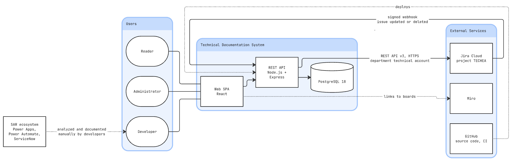*System Context*

[View the live, editable diagram on Miro →](https://miro.com/app/board/uXjVHm4trbw=/?moveToWidget=3458764685852863782)

**Table 5**

*External Systems and Interfaces*

| **System**          | **Interaction**                                                                                    | **Protocol and Credentials**                                                                    | **Req.**              |
|---------------------|----------------------------------------------------------------------------------------------------|-------------------------------------------------------------------------------------------------|-----------------------|
| Jira Cloud (TECHEA) | API → Jira: create Epic, Story, Subtask, read issues on demand. Jira → API: issue updated/deleted. | HTTPS REST v3 with e-mail + API token of the technical account, webhook signed with HMAC-SHA256 | FR-12, NFR-06, NFR-14 |
| Miro                | Link stored per screen, opened from the screen and from the dependency map                         | HTTPS link, no credentials                                                                      | FR-13, FR-16          |
| SAR ecosystem       | Analyzed and documented manually, no runtime connection                                            | —                                                                                               | SRS 2.4               |
| GitHub              | Source code, pull requests, CI, deploys the API and runs prisma migrate deploy                     | Repository access of the team                                                                   | NFR-17                |

# 4. Composition Viewpoint

The system is composed of three runtime containers (Figure 2): a single-page application that runs in the browser, an Express API that holds all the business logic, and a PostgreSQL database that also enforces integrity and audit rules. Report generation runs in a worker inside the API process, and the Jira client is a separate component of the API so that its failures are isolated (NFR-14). The deployment infrastructure is still undefined (SRS 2.4). Nothing in the design depends on a particular host.

**Figure 2**

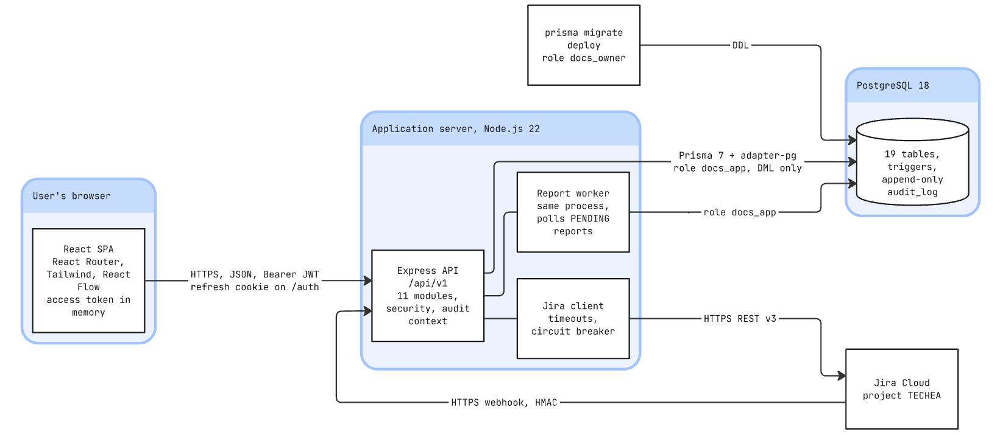*Runtime Containers*

[View the live, editable diagram on Miro →](https://miro.com/app/board/uXjVHm4trbw=/?moveToWidget=3458764685852863783)

## 4.1 Backend: Express API by Layers

The backend is organized in two directions (Figure 3). Horizontally, a fixed middleware chain runs before any business code: security headers and limits, rate limiting on /auth, authentication, authorization from the contract (Section 11), and request validation against the same openapi.yaml. Vertically, each functional module lives in its own folder with four layers, so modules can be maintained independently (NFR-15). Table 6 states the responsibility of each layer and what it must not do.

**Figure 3**

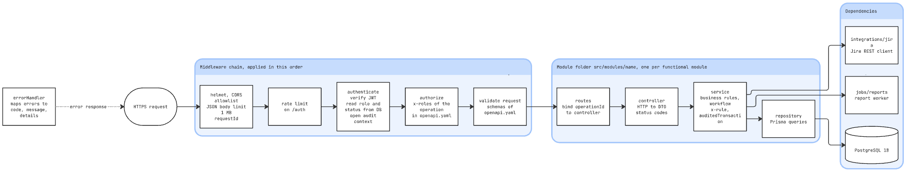*Backend: Middleware Chain and Module Layers*

[View the live, editable diagram on Miro →](https://miro.com/app/board/uXjVHm4trbw=/?moveToWidget=3458764685852863784)

**Table 6**

*Responsibilities of the Backend Layers*

| **Layer**    | **Responsibility**                                                                                                                                                          | **Must Not**                                      |
|--------------|-----------------------------------------------------------------------------------------------------------------------------------------------------------------------------|---------------------------------------------------|
| Middleware   | Security headers (Helmet), CORS allowlist, body limit, rate limit, authentication, authorization from x-roles, validation against openapi.yaml (express-openapi-validator). | Contain business rules.                           |
| routes       | Bind each operationId of the contract to its controller.                                                                                                                    | Declare roles (they come from the contract).      |
| controller   | Translate HTTP to a call: read parameters, call the service, choose status code, Location, and ETag.                                                                        | Access Prisma or decide rules.                    |
| service      | Business rules: documentation workflow, x-rule data rules, Jira orchestration, nested-item matching by id, transactions (auditedTransaction), business events.              | Know about HTTP (req/res).                        |
| repository   | Prisma queries of the module, including the graph and indicator queries.                                                                                                    | Decide rules or call other modules' repositories. |
| errorHandler | Translate every error into { code, message, details } (Table on the error catalog, Section 7.1), including PostgreSQL errors.                                               | Expose stack traces or SQL.                       |

*Note.* Folder layout: src/modules/\<module\>/{routes,controller,service,repository}.ts, plus src/security, src/db, src/integrations/jira, and src/jobs/reports. Request validation was verified with express-openapi-validator 5.6.2 against the OpenAPI 3.1 contract (tests V1–V11). Tests V12 to V14 (CP-03, CP-11) passed with the rest: 14 of 14.

Validating requests against the contract exposed an error in it that the linter could not detect: request bodies built with allOf (for example, applicationId plus the editable fields) accepted undeclared properties, because additionalProperties: false cannot be used across a composition. The composed schemas now declare unevaluatedProperties: false, the OpenAPI 3.1 mechanism for this case, and test V9 confirms that a client can no longer change a screen's status through PUT /screens/:id, bypassing the review workflow (D-43).

## 4.2 Frontend: React SPA

The frontend (Figure 4) is a React single-page application with React Router, Tailwind CSS, and React Flow for the dependency map. Two providers hold the cross-cutting state: the session, with the access token in memory and a single refresh in flight at a time, shared across tabs (rule R-4), and the selected application, which every module sends as applicationId. A route guard hides what the user's role cannot do, only for usability: the API enforces every permission regardless (NFR-03). All HTTP calls go through one client that adds the token, renews it once on a 401, and shows the user the message of the uniform error. The screens, their design system and the navigable prototype are specified in Section 7.3.

**Figure 4**

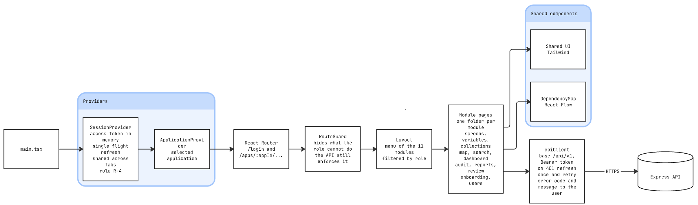*Frontend Structure*

[View the live, editable diagram on Miro →](https://miro.com/app/board/uXjVHm4trbw=/?moveToWidget=3458764685852863785)

## 4.3 Database

PostgreSQL 18 is a container with responsibilities of its own, not only storage: it enforces referential integrity, type coherence, and the cross-table rules of Section 6.3, and it captures the audit (Section 6.5). The API connects with the runtime role docs_app through Prisma Client 7.10 and the @prisma/adapter-pg driver adapter. Only the deployment pipeline connects as docs_owner, to run prisma migrate deploy (Section 6.7).

# 5. Dependency Viewpoint

Figure 5 shows how the eleven modules depend on each other. Dependencies point in one direction only, from consumers to the documentation core and from there to the foundation, so there are no cycles. Modules 5, 6, 7, 9, and 11 only read documentation. Modules 2, 3, 4, and 10 write it. The audit (Module 8) depends on nothing, because it lives in the database. A module uses another only through its service, never through its repository.

**Figure 5**

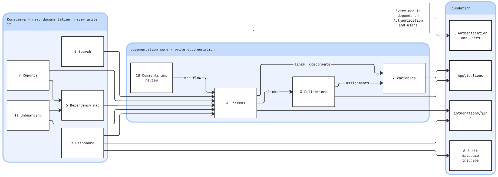*Dependencies Between Modules*

[View the live, editable diagram on Miro →](https://miro.com/app/board/uXjVHm4trbw=/?moveToWidget=3458764685852863786)

**Table 7**

*Technologies and Libraries*

| **Component**                                | **Version**     | **Use**                                      | **Status** |
|----------------------------------------------|-----------------|----------------------------------------------|------------|
| PostgreSQL                                   | 18.3            | Database                                     | Verified   |
| Node.js                                      | 22              | Runtime of the API                           | Verified   |
| prisma / @prisma/client / @prisma/adapter-pg | 7.10.0          | ORM, migrations, driver adapter              | Verified   |
| express                                      | 4.22.3          | HTTP framework                               | Verified   |
| express-openapi-validator                    | 5.6.2           | Request validation against openapi.yaml      | Verified   |
| jsonwebtoken / bcryptjs                      | 9.0.3 / 3.0.3   | JWT and password hashing                     | Verified   |
| cookie-parser / express-rate-limit           | 1.4.7 / 8.7.0   | Refresh cookie and rate limiting             | Verified   |
| helmet / cors                                | 8.3.0 / 2.8.6   | Security headers and CORS                    | Verified   |
| pdfkit / exceljs                             | 0.20.2 / 4.4.0  | PDF and Excel reports                        | Proposed   |
| react / react-router                         | 19.3.0 / 8.4.0  | SPA and routing                              | Proposed   |
| tailwindcss / @xyflow/react (React Flow)     | 4.3.3 / 12.12.0 | Styles and dependency map                    | Proposed   |
| vite                                         | 8.3.2           | Frontend build                               | Proposed   |
| lucide-react                                 | —               | Interface icons (design system, Section 7.3) | Proposed   |

*Note.* Verified = executed in the tests of this design. Proposed = latest stable version on September 28, 2026, to be fixed in package.json at the start of development. Versions are pinned exactly, not with ranges, so that every environment installs the same code. lucide-react is pinned together with the other frontend libraries.

# 6. Information Viewpoint (Physical Data Model)

This viewpoint specifies how the conceptual model of SRS Section 3.4 is implemented in PostgreSQL through Prisma ORM. The decisions approved after the requirements review are the source of truth for the physical model. The additions introduced in this design are identified in each table and justified in Section 12.

## 6.1 Platform, Versions, and Conventions

**Table 8**

*Physical Design Conventions*

| **Aspect** | **Decision**                                                                                                             | **Rationale**                                                                                                                                                                                                                                          |
|------------|--------------------------------------------------------------------------------------------------------------------------|--------------------------------------------------------------------------------------------------------------------------------------------------------------------------------------------------------------------------------------------------------|
| Versions   | PostgreSQL 18.3, Prisma ORM 7.10.0 with the partialIndexes preview feature.                                              | 7.10.0 was the latest stable Prisma release on September 28, 2026 (8.0 was a release candidate). Every DDL fragment in this section was executed on PostgreSQL 18.3, and the Prisma relation patterns were validated with the 7.10.0 schema validator. |
| Names      | Tables and columns in singular snake_case, Prisma models in PascalCase mapped with @map/@@map, enum types in snake_case. | SRS 3.7, Table 27.                                                                                                                                                                                                                                     |
| User table | app_user (model User)                                                                                                    | user is a reserved word in PostgreSQL (verified with pg_get_keywords()). Using it would require quoting in every trigger and query.                                                                                                                    |
| Keys       | SERIAL for domain tables, BIGSERIAL for audit_log and refresh_token, subtypes reuse the supertype key (no default).      | Department scale (NFR-11) fits INTEGER. Append-only logs grow without bound. Prisma cannot declare identity columns, so BIGSERIAL is used (D-17).                                                                                                      |
| Timestamps | TIMESTAMPTZ(3) (@db.Timestamptz(3))                                                                                      | Prisma's default timestamp(3) has no time zone. Audit history and recent activity (FR-19, FR-20) need unambiguous instants.                                                                                                                            |
| Text       | VARCHAR(n) for names and identifiers, TEXT for documentation content.                                                    | Bounded names produce clear validation errors (NFR-08).                                                                                                                                                                                                |

## 6.2 Physical Tables

The approved model has thirteen tables derived from the conceptual entities. Six more are added: application and element_environment, which answer NFR-16 and the environment classification of variables and collections, collection_field, which stores the field structure required by FR-08, report and report_file, which store saved reports (FR-22), and refresh_token, which supports NFR-01. Table 9 lists them. Table 10 to Table 28 specify their columns.

**Table 9**

*Physical Tables and Their Origin*

| **Table**           | **Conceptual Entity (SRS Table 24)** | **Kind**                 | **Status**           |
|---------------------|--------------------------------------|--------------------------|----------------------|
| app_user            | User                                 | Entity                   | Approved             |
| application         | —                                    | Entity                   | New (NFR-16)         |
| documented_element  | Documented Element                   | Supertype                | Approved             |
| screen              | Screen                               | Subtype                  | Approved             |
| variable            | Variable                             | Subtype                  | Approved             |
| collection          | Collection                           | Subtype                  | Approved             |
| collection_field    | (Collection field structure)         | Weak entity              | New (FR-08)          |
| component           | Component                            | Subtype                  | Approved             |
| element_environment | —                                    | Associative              | New (FR-07)          |
| screen_variable     | Screen–Variable                      | Associative              | Approved             |
| screen_collection   | Screen–Collection                    | Associative              | Approved             |
| variable_collection | Variable–Collection                  | Associative              | Approved + screen_id |
| dependency          | Dependency                           | Entity                   | Approved             |
| jira_ticket         | Jira Ticket                          | Entity                   | Approved             |
| comment             | Comment                              | Entity                   | Approved             |
| report              | —                                    | Entity                   | New (FR-22)          |
| report_file         | —                                    | Weak entity              | New (FR-22)          |
| audit_log           | Audit Log                            | Entity (loose reference) | Approved             |
| refresh_token       | —                                    | Technical                | New (NFR-01)         |

Legend for the column tables: PK = primary key, NN = NOT NULL, UQ = unique, FK = foreign key (detailed in Table 30). An enum type is written in italics and its values are in Table 29. All tables except documented_element, element_environment, report_file, audit_log, and refresh_token also carry created_at and updated_at (TIMESTAMPTZ(3), NN), omitted below for brevity.

**Table 10**

*Columns of* app_user

| **Column**    | **Type**       | **Constraints**    | **Notes**                                                                   |
|---------------|----------------|--------------------|-----------------------------------------------------------------------------|
| id            | SERIAL         | PK                 |                                                                             |
| name          | VARCHAR(120)   | NN                 |                                                                             |
| email         | VARCHAR(254)   | NN, UQ             | Stored in lowercase (CHECK), so uniqueness is effectively case-insensitive. |
| password_hash | VARCHAR(255)   | NN                 | bcrypt (NFR-02).                                                            |
| role          | *user_role*    | NN                 | FR-03                                                                       |
| status        | *user_status*  | NN, default ACTIVE | Users are deactivated, never physically deleted (Section 12, D-09).         |
| last_login_at | TIMESTAMPTZ(3) |                    |                                                                             |

**Table 11**

*Columns of* application

| **Column**       | **Type**             | **Constraints**    | **Notes**                                                     |
|------------------|----------------------|--------------------|---------------------------------------------------------------|
| id               | SERIAL               | PK                 |                                                               |
| name             | VARCHAR(120)         | NN, UQ             | e.g., SAR.                                                    |
| description      | TEXT                 |                    |                                                               |
| platform         | VARCHAR(60)          | NN                 | Free text (e.g., Power Apps).                                 |
| jira_project_key | VARCHAR(20)          | CHECK format       | NULL = department default project (TECHEA).                   |
| status           | *application_status* | NN, default ACTIVE | Applications are archived, not deleted.                       |
| created_by       | INTEGER              | NN, FK → app_user  | Becomes the author of the application's App (OnStart) screen. |

**Table 12**

*Columns of* documented_element

| **Column**                 | **Type**       | **Constraints**      | **Notes**                                                       |
|----------------------------|----------------|----------------------|-----------------------------------------------------------------|
| id                         | SERIAL         | PK                   | Shared by exactly one subtype row.                              |
| type                       | *element_type* | NN                   |                                                                 |
| application_id             | INTEGER        | NN, FK → application | Every documented element belongs to one application.            |
| created_at                 | TIMESTAMPTZ(3) | NN                   |                                                                 |
| (id, type)                 | —              | UQ                   | Target of the dependency and element_environment composite FKs. |
| (id, type, application_id) | —              | UQ                   | Target of the subtype composite FKs.                            |

**Table 13**

*Columns of* screen

| **Column**                                                                             | **Type**               | **Constraints**               | **Notes**                                                                                                     |
|----------------------------------------------------------------------------------------|------------------------|-------------------------------|---------------------------------------------------------------------------------------------------------------|
| id                                                                                     | INTEGER                | PK, FK → documented_element   | Shared key.                                                                                                   |
| element_type                                                                           | *element_type*         | NN, CHECK = SCREEN            | Constant column that makes type coherence declarative (Section 6.3.4).                                        |
| application_id                                                                         | INTEGER                | NN                            | Part of the composite FK to the supertype.                                                                    |
| name                                                                                   | VARCHAR(150)           | NN, UQ (application_id, name) |                                                                                                               |
| is_app_context                                                                         | BOOLEAN                | NN, default false             | Marks the reserved App (OnStart) screen, one per application.                                                 |
| documentation_status                                                                   | *documentation_status* | NN, default UNDOCUMENTED      | FR-14                                                                                                         |
| on_start, working_process, architecture, data_model, requirements, known_issues, risks | TEXT                   | nullable                      | Seven template fields (SRS 3.8). The eighth, "future to do", is the screen's list of jira_ticket rows (D-06). |
| miro_link                                                                              | VARCHAR(2048)          | CHECK https                   | FR-13                                                                                                         |
| author_id                                                                              | INTEGER                | NN, FK → app_user             | **FK → User.** There is no Author table. The column is named after the role the user plays.                   |

**Table 14**

*Columns of* variable

| **Column**       | **Type**         | **Constraints**                  | **Notes**                                          |
|------------------|------------------|----------------------------------|----------------------------------------------------|
| id               | INTEGER          | PK, FK → documented_element      |                                                    |
| element_type     | *element_type*   | NN, CHECK = VARIABLE             |                                                    |
| application_id   | INTEGER          | NN                               |                                                    |
| name             | VARCHAR(150)     | NN                               | Uniqueness by scope (Table 31).                    |
| data_type        | *data_type*      | NN                               | Power Fx data types.                               |
| scope            | *variable_scope* | NN                               | FR-07                                              |
| description      | TEXT             |                                  | FR-05                                              |
| origin_screen_id | INTEGER          | nullable, FK → screen (SET NULL) | NULL = variable without full traceability (FR-19). |
| (id, scope)      | —                | UQ                               | Target of the variable_collection composite FK.    |

**Table 15**

*Columns of* collection

| **Column**         | **Type**       | **Constraints**               | **Notes** |
|--------------------|----------------|-------------------------------|-----------|
| id                 | INTEGER        | PK, FK → documented_element   |           |
| element_type       | *element_type* | NN, CHECK = COLLECTION        |           |
| application_id     | INTEGER        | NN                            |           |
| name               | VARCHAR(150)   | NN, UQ (application_id, name) |           |
| creation_condition | TEXT           |                               | FR-08     |
| description        | TEXT           |                               |           |

**Table 16**

*Columns of* collection_field

| **Column**    | **Type**     | **Constraints**               | **Notes**                                                               |
|---------------|--------------|-------------------------------|-------------------------------------------------------------------------|
| id            | SERIAL       | PK                            |                                                                         |
| collection_id | INTEGER      | NN, FK → collection (CASCADE) |                                                                         |
| name          | VARCHAR(150) | NN, UQ (collection_id, name)  | A column of the collection, e.g., Correo in colClientes.                |
| data_type     | *data_type*  | NN                            |                                                                         |
| description   | TEXT         |                               |                                                                         |
| position      | SMALLINT     | NN, CHECK ≥ 0                 | Display order, not unique so reordering needs no deferrable constraint. |

**Table 17**

*Columns of* component

| **Column**     | **Type**       | **Constraints**             | **Notes**                         |
|----------------|----------------|-----------------------------|-----------------------------------|
| id             | INTEGER        | PK, FK → documented_element |                                   |
| element_type   | *element_type* | NN, CHECK = COMPONENT       |                                   |
| application_id | INTEGER        | NN                          |                                   |
| screen_id      | INTEGER        | NN, FK → screen (CASCADE)   |                                   |
| name           | VARCHAR(150)   | NN, UQ (screen_id, name)    |                                   |
| type           | VARCHAR(60)    | NN                          | Control type, free text (D-05).   |
| on_select      | TEXT           |                             | OnSelect behavior (SRS Table 24). |
| description    | TEXT           |                             |                                   |

**Table 18**

*Columns of* element_environment

| **Column**   | **Type**       | **Constraints**                    | **Notes**                                             |
|--------------|----------------|------------------------------------|-------------------------------------------------------|
| element_id   | INTEGER        | PK (with environment), FK          |                                                       |
| element_type | *element_type* | NN, CHECK ∈ {VARIABLE, COLLECTION} |                                                       |
| environment  | *environment*  | PK                                 | DEV / PROD                                            |
| notes        | TEXT           |                                    | Known differences of the element in that environment. |
| created_at   | TIMESTAMPTZ(3) | NN                                 |                                                       |

*Note.* A deferred constraint trigger guarantees at least one environment per variable or collection (Table 33).

**Table 19**

*Columns of* screen_variable

| **Column**                        | **Type**      | **Constraints**             | **Notes**                                                        |
|-----------------------------------|---------------|-----------------------------|------------------------------------------------------------------|
| id                                | SERIAL        | PK                          |                                                                  |
| screen_id                         | INTEGER       | NN, FK → screen (CASCADE)   |                                                                  |
| variable_id                       | INTEGER       | NN, FK → variable (CASCADE) |                                                                  |
| access_mode                       | *access_mode* | NN                          | FR-11                                                            |
| used_in                           | VARCHAR(200)  | NN                          | origin is reserved for the row maintained by the origin trigger. |
| (screen_id, variable_id, used_in) | —             | UQ                          |                                                                  |

**Table 20**

*Columns of* screen_collection

| **Column**                          | **Type**      | **Constraints**               | **Notes** |
|-------------------------------------|---------------|-------------------------------|-----------|
| id                                  | SERIAL        | PK                            |           |
| screen_id                           | INTEGER       | NN, FK → screen (CASCADE)     |           |
| collection_id                       | INTEGER       | NN, FK → collection (CASCADE) |           |
| access_mode                         | *access_mode* | NN                            | FR-11     |
| used_in                             | VARCHAR(200)  | NN                            |           |
| (screen_id, collection_id, used_in) | —             | UQ                            |           |

**Table 21**

*Columns of* variable_collection

| **Column**                                       | **Type**              | **Constraints**               | **Notes**                                                                        |
|--------------------------------------------------|-----------------------|-------------------------------|----------------------------------------------------------------------------------|
| id                                               | SERIAL                | PK                            |                                                                                  |
| variable_id                                      | INTEGER               | NN                            | With variable_scope, composite FK → variable(id, scope), ON UPDATE CASCADE.      |
| variable_scope                                   | *variable_scope*      | NN                            | Copy of the variable's scope kept in sync by the FK.                             |
| collection_id                                    | INTEGER               | NN, FK → collection (CASCADE) |                                                                                  |
| screen_id                                        | INTEGER               | NN, FK → screen (CASCADE)     | New: screen where the assignment fires (D-07).                                   |
| assignment_function                              | *assignment_function* | NN                            | FR-09                                                                            |
| table_function                                   | VARCHAR(200)          |                               | Aggregation or table-selection function, \[SUPUESTO\] nullable for Set(v, coll). |
| used_in                                          | VARCHAR(200)          | NN                            |                                                                                  |
| (variable_id, collection_id, screen_id, used_in) | —                     | UQ                            |                                                                                  |

**Table 22**

*Columns of* dependency

| **Column**                            | **Type**                | **Constraints**                                 | **Notes**                         |
|---------------------------------------|-------------------------|-------------------------------------------------|-----------------------------------|
| id                                    | SERIAL                  | PK                                              |                                   |
| source_id, source_type                | INTEGER, *element_type* | NN, composite FK → documented_element(id, type) |                                   |
| target_id, target_type                | INTEGER, *element_type* | NN, composite FK → documented_element(id, type) |                                   |
| relation_type                         | *relation_type*         | NN                                              | Allowed combinations in Table 32. |
| description                           | TEXT                    |                                                 |                                   |
| (source_id, target_id, relation_type) | —                       | UQ                                              |                                   |

**Table 23**

*Columns of* jira_ticket

| **Column**                     | **Type**                        | **Constraints**                                            | **Notes**                                                                                                                          |
|--------------------------------|---------------------------------|------------------------------------------------------------|------------------------------------------------------------------------------------------------------------------------------------|
| id                             | SERIAL                          | PK                                                         |                                                                                                                                    |
| screen_id                      | INTEGER                         | NN, FK → screen (CASCADE)                                  | The screen's Subtasks are its "future to do" items.                                                                                |
| jira_issue_id                  | VARCHAR(32)                     | NN, UQ                                                     | Stable Jira id, used to match webhook events.                                                                                      |
| jira_issue_key                 | VARCHAR(32)                     | NN, UQ, CHECK format                                       | e.g., TECHEA-123, can change if the issue is moved.                                                                                |
| hierarchy_level                | *jira_hierarchy_level*          | NN                                                         | From Jira's hierarchyLevel (1 Epic, 0 Story, −1 Subtask), drives all rules.                                                        |
| issue_type                     | VARCHAR(50)                     | NN                                                         | Display name as returned by Jira, not used in logic.                                                                               |
| parent_ticket_id, parent_level | INTEGER, *jira_hierarchy_level* | composite FK → jira_ticket(id, screen_id, hierarchy_level) | Parent in the same screen with the right level: Story → Epic, Subtask → Story (CHECK). One Epic per screen (partial unique index). |
| summary                        | VARCHAR(255)                    | NN                                                         | Jira summary limit.                                                                                                                |
| status                         | VARCHAR(100)                    | NN                                                         | Workflow status name.                                                                                                              |
| status_category                | *jira_status_category*          | NN                                                         | Pending = Subtask whose category is not DONE (FR-19).                                                                              |
| created_by                     | INTEGER                         | NN, FK → app_user                                          |                                                                                                                                    |
| last_synced_at                 | TIMESTAMPTZ(3)                  | NN                                                         | Staleness indicator during a Jira outage (NFR-14).                                                                                 |

**Table 24**

*Columns of* comment

| **Column**      | **Type**          | **Constraints**           | **Notes**                                                                                                                                         |
|-----------------|-------------------|---------------------------|---------------------------------------------------------------------------------------------------------------------------------------------------|
| id              | SERIAL            | PK                        |                                                                                                                                                   |
| screen_id       | INTEGER           | NN, FK → screen (CASCADE) | Comments only on screens (FR-23).                                                                                                                 |
| user_id         | INTEGER           | NN, FK → app_user         |                                                                                                                                                   |
| text            | TEXT              | NN                        |                                                                                                                                                   |
| created_at      | TIMESTAMPTZ(3)    | NN                        |                                                                                                                                                   |
| updated_at      | TIMESTAMPTZ(3)    | nullable                  | NULL = never edited (PUT /comments/:id). Review comments cannot be edited.                                                                        |
| review_decision | *review_decision* | nullable                  | CP-11: APPROVE or RETURN when the comment records a review decision, written only by POST /screens/:id/review, NULL for ordinary comments (D-56). |

**Table 25**

*Columns of* report

| **Column**                          | **Type**                    | **Constraints**      | **Notes**                                          |
|-------------------------------------|-----------------------------|----------------------|----------------------------------------------------|
| id                                  | SERIAL                      | PK                   |                                                    |
| application_id                      | INTEGER                     | NN, FK → application |                                                    |
| title                               | VARCHAR(200)                | NN                   |                                                    |
| format                              | *report_format*             | NN                   | PDF / XLSX                                         |
| parameters                          | JSONB                       | NN                   | Selection made by the user (FR-22).                |
| status                              | *report_status*             | NN, default PENDING  | Asynchronous generation (NFR-12).                  |
| is_published                        | BOOLEAN                     | NN, default false    | Readers only see published reports (SRS Table 26). |
| file_name, file_size, error_message | VARCHAR(255), INTEGER, TEXT |                      |                                                    |
| generated_by                        | INTEGER                     | NN, FK → app_user    |                                                    |
| completed_at, published_at          | TIMESTAMPTZ(3)              |                      |                                                    |

**Table 26**

*Columns of* report_file

| **Column** | **Type**     | **Constraints**           | **Notes**                                             |
|------------|--------------|---------------------------|-------------------------------------------------------|
| report_id  | INTEGER      | PK, FK → report (CASCADE) |                                                       |
| mime_type  | VARCHAR(100) | NN                        |                                                       |
| content    | BYTEA        | NN                        | Kept apart so listing reports never loads the binary. |

**Table 27**

*Columns of* audit_log

| **Column**           | **Type**       | **Constraints**                | **Notes**                                                    |
|----------------------|----------------|--------------------------------|--------------------------------------------------------------|
| id                   | BIGSERIAL      | PK                             |                                                              |
| actor_user_id        | INTEGER        | nullable, FK → app_user        | NULL when the write did not come through the API.            |
| db_role              | VARCHAR(63)    | NN                             | session_user                                                 |
| action               | TEXT           | NN, CHECK                      | CREATE / UPDATE / DELETE / EVENT                             |
| event_name           | VARCHAR(100)   | CHECK: required only for EVENT | Business events such as DOCUMENTATION_APPROVED (D-12).       |
| entity_type          | TEXT           | NN, CHECK                      | Name of the audited table.                                   |
| entity_id            | TEXT           | NN                             | TEXT also covers composite keys (e.g., element_environment). |
| entity_label         | VARCHAR(300)   |                                | Name snapshot.                                               |
| application_id       | INTEGER        |                                | Loose reference, no FK (filter by application).              |
| old_value, new_value | JSONB          |                                |                                                              |
| changed_fields       | TEXT\[\]       |                                |                                                              |
| created_at           | TIMESTAMPTZ(3) | NN                             |                                                              |

*Note.* No FK to the audited entity on purpose: records must survive the deletion of the element (NFR-20). The capture mechanism is specified in Section 6.5.

**Table 28**

*Columns of* refresh_token

| **Column**                         | **Type**       | **Constraints**             | **Notes**                                        |
|------------------------------------|----------------|-----------------------------|--------------------------------------------------|
| id                                 | BIGSERIAL      | PK                          |                                                  |
| user_id                            | INTEGER        | NN, FK → app_user (CASCADE) |                                                  |
| token_hash                         | CHAR(64)       | NN, UQ                      | SHA-256, the token itself is never stored.       |
| family_id                          | UUID           | NN                          | Rotation chain for reuse detection (Section 11). |
| expires_at, revoked_at, created_at | TIMESTAMPTZ(3) | expires_at, created_at NN   |                                                  |

## 6.3 Keys, Relationships, and Domain Constraints

### *6.3.1 Enumerated Types or CHECK Constraints*

The design uses native PostgreSQL enumerated types, declared as Prisma enums, for every closed vocabulary written by the application. Both options reject invalid values in the database. Enums are preferred here because Prisma turns them into TypeScript types, so an invalid value is also caught when the backend is compiled, and because the vocabulary is defined once and reused by several tables. Their known cost, that a value cannot be removed without recreating the type, is acceptable for vocabularies that only grow. CHECK constraints are reserved for rules that an enum cannot express: conditions involving several columns, formats, and constants. The two domains of audit_log (action and entity type) are also CHECK constraints on TEXT, as approved, because that table is written only by database functions and must not depend on types that Prisma migrations may alter.

**Table 29**

*Enumerated Types*

| **Enum Type**        | **Values**                                                                                                                                                             | **Used By**                                          | **Req.** |
|----------------------|------------------------------------------------------------------------------------------------------------------------------------------------------------------------|------------------------------------------------------|----------|
| user_role            | ADMINISTRATOR, DEVELOPER, READER                                                                                                                                       | app_user                                             | FR-03    |
| user_status          | ACTIVE, INACTIVE                                                                                                                                                       | app_user                                             | FR-02    |
| application_status   | ACTIVE, ARCHIVED                                                                                                                                                       | application                                          | NFR-16   |
| element_type         | SCREEN, VARIABLE, COLLECTION, COMPONENT                                                                                                                                | supertype, subtypes, dependency, element_environment | FR-15    |
| environment          | DEV, PROD                                                                                                                                                              | element_environment                                  | FR-07    |
| variable_scope       | GLOBAL, CONTEXT                                                                                                                                                        | variable, variable_collection                        | FR-07    |
| data_type            | BOOLEAN, CHOICE, COLOR, CURRENCY, DATE, DATE_TIME, DECIMAL, DYNAMIC, FLOAT, GUID, HYPERLINK, IMAGE, MEDIA, NUMBER, RECORD, RECORD_REFERENCE, TABLE, TEXT, TIME, YES_NO | variable, collection_field                           | FR-05    |
| documentation_status | UNDOCUMENTED, DRAFT, IN_PROGRESS, IN_REVIEW, APPROVED                                                                                                                  | screen                                               | FR-14    |
| access_mode          | READ, WRITE, READ_WRITE                                                                                                                                                | screen_variable, screen_collection                   | FR-11    |
| assignment_function  | SET, UPDATE_CONTEXT                                                                                                                                                    | variable_collection                                  | FR-09    |
| relation_type        | USES, DERIVES_FROM, NAVIGATES_TO                                                                                                                                       | dependency                                           | FR-15    |
| jira_status_category | TO_DO, IN_PROGRESS, DONE                                                                                                                                               | jira_ticket                                          | FR-19    |
| jira_hierarchy_level | EPIC, STANDARD, SUBTASK                                                                                                                                                | jira_ticket                                          | FR-12    |
| report_format        | PDF, XLSX                                                                                                                                                              | report                                               | FR-22    |
| report_status        | PENDING, READY, FAILED                                                                                                                                                 | report                                               | NFR-12   |
| review_decision      | APPROVE, RETURN                                                                                                                                                        | comment                                              | FR-24    |

*Note.* data_type follows the Power Fx data types documented by Microsoft (2025), excluding Void, which is only a function return type. jira_status_category maps Jira's fixed status categories (new, indeterminate, done).

### *6.3.2 Foreign Keys and Referential Actions*

**Table 30**

*Foreign Keys and Their Delete Behavior*

| **From**                                                     | **To**                                       | **ON DELETE**               | **Rationale**                                                     |
|--------------------------------------------------------------|----------------------------------------------|-----------------------------|-------------------------------------------------------------------|
| documented_element.application_id                            | application.id                               | RESTRICT                    | Applications are archived, not deleted.                           |
| application.created_by                                       | app_user.id                                  | RESTRICT                    | Users are never physically deleted (D-09).                        |
| \<subtype\>(id, element_type, application_id)                | documented_element(id, type, application_id) | CASCADE                     | Shared key plus type and application coherence (6.3.4).           |
| screen.author_id                                             | app_user.id                                  | RESTRICT                    | FK → User, history keeps its author.                              |
| variable.origin_screen_id                                    | screen.id                                    | SET NULL                    | Approved decision 3.5, the audit trigger records the change.      |
| component.screen_id                                          | screen.id                                    | CASCADE                     | A component exists only inside its screen.                        |
| collection_field.collection_id                               | collection.id                                | CASCADE                     |                                                                   |
| element_environment(element_id, element_type)                | documented_element(id, type)                 | CASCADE                     | Only variables and collections (CHECK).                           |
| screen_variable.screen_id / variable_id                      | screen.id / variable.id                      | CASCADE                     | Approved decision 3.4.                                            |
| screen_collection.screen_id / collection_id                  | screen.id / collection.id                    | CASCADE                     | Approved decision 3.4.                                            |
| variable_collection(variable_id, variable_scope)             | variable(id, scope)                          | CASCADE (ON UPDATE CASCADE) | Makes the Set/UpdateContext rule enforceable (6.3.5).             |
| variable_collection.collection_id / screen_id                | collection.id / screen.id                    | CASCADE                     |                                                                   |
| dependency(source_id, source_type)                           | documented_element(id, type)                 | CASCADE                     | Real FK, type declared and verified.                              |
| dependency(target_id, target_type)                           | documented_element(id, type)                 | CASCADE                     |                                                                   |
| jira_ticket.screen_id                                        | screen.id                                    | CASCADE                     | The Jira issue remains in Jira, the audit keeps the local record. |
| jira_ticket(parent_ticket_id, screen_id, parent_level)       | jira_ticket(id, screen_id, hierarchy_level)  | CASCADE                     | Hierarchy inside one screen, level verified (6.3.5 technique).    |
| jira_ticket.created_by, comment.user_id, report.generated_by | app_user.id                                  | RESTRICT                    |                                                                   |
| comment.screen_id                                            | screen.id                                    | CASCADE                     | Approved decision 3.1.                                            |
| report.application_id                                        | application.id                               | RESTRICT                    |                                                                   |
| report_file.report_id                                        | report.id                                    | CASCADE                     |                                                                   |
| audit_log.actor_user_id                                      | app_user.id                                  | RESTRICT                    | Nullable, the only FK of audit_log.                               |
| refresh_token.user_id                                        | app_user.id                                  | CASCADE                     |                                                                   |

*Note.* audit_log.entity_id and audit_log.application_id are deliberately loose references (no FK) so that audit records survive the deletion of what they describe.

### *6.3.3 Associative Entities and the Meaning of used_in*

The three associative entities follow the approved pattern: a surrogate primary key plus a uniqueness constraint that includes used_in, so the same pair can appear once per event or property where the access occurs. To make used_in unambiguous in all three tables, it always designates a location inside a specific screen. For that reason variable_collection gains a screen_id column: a value such as OnVisible or btnFiltrar.OnSelect now identifies exactly one place in the application. When the assignment runs at the application level, screen_id points to the application's App (OnStart) screen and used_in is OnStart.

### *6.3.4 Supertype and Subtype Coherence*

Each subtype carries a constant element_type column (a CHECK fixes its value) and its application_id, and references documented_element(id, type, application_id) with a composite FK. A row in screen can therefore only share its key with an element of type SCREEN of the same application. The constraint is declarative and cannot be bypassed. Prisma 7.10.0 supports this pattern but requires an explicit unique constraint on the referencing columns of a one-to-one relation, so each subtype also declares UQ (id, element_type, application_id). The extra index is negligible at department scale. Because a cascade only travels from the referenced row to the referencing one, deleting a subtype row (for example, components removed together with their screen) would leave its supertype row behind. An AFTER DELETE trigger on each subtype removes it (Table 33).

### *6.3.5 Cross-Table Rules Made Declarative*

A CHECK constraint in PostgreSQL cannot read another table, so the rule "Set applies to global variables and UpdateContext to context variables" cannot be a plain CHECK. It is enforced by copying the variable's scope into variable_collection.variable_scope through the composite FK (variable_id, variable_scope) → variable(id, scope) with ON UPDATE CASCADE, and then checking both columns of the same row. If a variable's scope is changed while inconsistent links exist, the cascade reaches those rows, the CHECK fails, and the change is rejected. The same technique enforces the allowed dependency types: dependency stores source_type and target_type, validated against documented_element by composite FKs, and a CHECK restricts the combinations listed in Table 32.

**Table 31**

*Uniqueness Rules*

| **Table**            | **Unique Columns**                           | **Rule**                                                  |
|----------------------|----------------------------------------------|-----------------------------------------------------------|
| application          | name                                         | One record per departmental application.                  |
| screen               | application_id, name                         | Unique within its application.                            |
| screen               | application_id WHERE is_app_context          | One App (OnStart) screen per application (partial index). |
| collection           | application_id, name                         | Unique within its application.                            |
| variable             | application_id, name WHERE scope = GLOBAL    | A global variable is visible in the whole app.            |
| variable             | origin_screen_id, name WHERE scope = CONTEXT | A context variable exists only in its screen.             |
| component            | screen_id, name                              |                                                           |
| collection_field     | collection_id, name                          |                                                           |
| associative entities | pair (+ screen_id) + used_in                 | Once per exact location.                                  |
| dependency           | source_id, target_id, relation_type          |                                                           |
| jira_ticket          | jira_issue_id, jira_issue_key                |                                                           |
| jira_ticket          | screen_id WHERE hierarchy_level = EPIC       | One Epic per screen.                                      |
| app_user             | email                                        |                                                           |

*Note.* Variable scoping follows Microsoft's documentation: Set creates global variables available throughout the app, and UpdateContext creates context variables scoped to one screen (Microsoft, n.d.). Partial unique indexes are declared in schema.prisma with the partialIndexes preview feature, validated on Prisma 7.10.0.

**Table 32**

*Allowed Dependency Types*

| **Source** | **Target** | **relation_type** | **Example**                           |
|------------|------------|-------------------|---------------------------------------|
| COMPONENT  | VARIABLE   | USES              | btnGuardar uses gUsuario.             |
| COMPONENT  | COLLECTION | USES              | galClientes shows colClientes.        |
| COLLECTION | COLLECTION | DERIVES_FROM      | colActivos is built from colClientes. |
| SCREEN     | SCREEN     | NAVIGATES_TO      | Inicio navigates to Detalle.          |

*Note.* dependency stores only relationships the associative entities cannot express, the dependency graph (FR-15) joins these rows with the associative entities and component.screen_id. COMPONENT → COLLECTION was added in this design by symmetry with the approved COMPONENT → VARIABLE (D-08).

**Table 33**

*Integrity Triggers*

| **Function / Trigger**        | **Event**                                                                                     | **Purpose**                                                                                                                                       |
|-------------------------------|-----------------------------------------------------------------------------------------------|---------------------------------------------------------------------------------------------------------------------------------------------------|
| delete_parent_element         | AFTER DELETE on each subtype                                                                  | Removes the supertype row, and with it the element's dependencies.                                                                                |
| enforce_same_application      | BEFORE INSERT/UPDATE on associative entities, dependency, variable, component                 | Rejects links between elements of different applications.                                                                                         |
| ensure_origin_write_link      | AFTER INSERT / UPDATE OF origin_screen_id on variable                                         | Keeps the origin row of screen_variable in sync. Also removes the previous row when the origin changes (correction of the approved sketch, D-11). |
| create_app_context_screen     | AFTER INSERT on application                                                                   | Creates the App (OnStart) screen of each new application.                                                                                         |
| protect_app_context           | BEFORE DELETE / UPDATE OF is_app_context on screen                                            | The App (OnStart) screen cannot be deleted or unflagged.                                                                                          |
| check_element_has_subtype     | Deferred constraint trigger (at COMMIT) on documented_element                                 | Every supertype row has its subtype row (Section 6.4.1).                                                                                          |
| check_element_has_environment | Deferred constraint trigger (at COMMIT)                                                       | Every variable and collection exists in at least one environment.                                                                                 |
| check_context_screen_links    | Deferred constraint trigger (at COMMIT) on screen_variable, variable_collection, and variable | A context variable is used only in its origin screen. WRITE links from other screens (Navigate) are allowed (D-52).                               |

*Note.* These objects are not expressible in schema.prisma and are delivered as manual migrations (Section 6.7). Migration 6 contains check_context_screen_links. The audit trigger is specified in Section 6.5.

Context variables belong to their origin screen (CP-07, D-52). For a variable with scope CONTEXT and origin screen S, the database rejects any variable_collection row with a screen other than S (UpdateContext elsewhere), any screen_variable row with a screen other than S and access mode READ or READ_WRITE, and any link at all when the variable has no origin. WRITE links from other screens are allowed, because Navigate can set the context variables of the target screen. Changing the scope or the origin re-checks every row of the variable. The rule is enforced by check_context_screen_links() through three constraint triggers DEFERRABLE INITIALLY DEFERRED (migration 20261005000500_context_screen_rule), because one PUT /variables can change scope and origin together and the origin row is moved inside the same transaction. When the origin becomes NULL because the origin screen was deleted (ON DELETE SET NULL), the check on variable is skipped, so the screen can be deleted and the variable is left without traceability. This case is detected from the data, as “the origin went from S to NULL and screen S no longer exists”, because pg_trigger_depth() returns 1 for the triggers queued by a referential cascade and cannot distinguish them, as verified on PostgreSQL 18.3 (D-59). The exception uses SQLSTATE 23514, the constraint name context_screen_mismatch, and a JSON detail, which the error middleware translates into 422 CONTEXT_SCREEN_MISMATCH (Table 45).

### *6.3.6 Verification*

The complete DDL (the six migrations of Section 6.7) was executed on PostgreSQL 18.3, followed by a suite of 37 integrity tests (03_backend/tests/01_integrity_tests.sql). Each test attempts to violate one rule, or checks one automatic action, and all 37 passed. Tests T27 to T36 were added for the interface changes: T27 to T35 verify the context-screen rule of CP-07 (Section 6.3.5), and T36 the review-decision type of CP-11. The suite was run again on a clean installation created from scratch, with the same result. Table 34 summarizes them.

**Table 34**

*Integrity Test Results on PostgreSQL 18.3*

| **ID** | **Case**                                                                                                                                                             | **Result (all PASS)** |
|--------|----------------------------------------------------------------------------------------------------------------------------------------------------------------------|-----------------------|
| T01    | App (OnStart) screen created for each new application                                                                                                                | Done automatically    |
| T02    | Origin screen generates the screen_variable row (WRITE, origin)                                                                                                      | Done automatically    |
| T03    | Screen row sharing the key of a VARIABLE element                                                                                                                     | Rejected              |
| T04    | Subtype with an element_type different from its table                                                                                                                | Rejected              |
| T05    | Dependency outside the allowed combinations                                                                                                                          | Rejected              |
| T06    | Dependency declaring a wrong type for an existing element                                                                                                            | Rejected              |
| T07    | Valid dependency COMPONENT → VARIABLE                                                                                                                                | Accepted              |
| T08    | UpdateContext on a global variable                                                                                                                                   | Rejected              |
| T09    | Link declaring a scope different from the variable's                                                                                                                 | Rejected              |
| T10    | Changing a variable's scope while a SET link exists                                                                                                                  | Rejected              |
| T11    | Same screen name in another application                                                                                                                              | Accepted              |
| T12    | Linking elements of two different applications                                                                                                                       | Rejected              |
| T13    | Variable without any environment (checked at commit)                                                                                                                 | Rejected              |
| T14    | Removing the last environment of a collection                                                                                                                        | Rejected              |
| T15    | Duplicate global variable name in the same application                                                                                                               | Rejected              |
| T16    | Deleting the App (OnStart) screen                                                                                                                                    | Rejected              |
| T17a   | Changing the origin screen moves the origin row                                                                                                                      | Done automatically    |
| T17b   | Deleting a screen removes its components, their supertype rows and dependencies, and sets the variable's origin to NULL                                              | Done automatically    |
| T18    | Physically deleting a referenced user                                                                                                                                | Rejected              |
| T19    | E-mail with uppercase letters                                                                                                                                        | Rejected              |
| T20    | Valid chain Epic → Story → Subtask                                                                                                                                   | Accepted              |
| T21    | Second Epic for the same screen                                                                                                                                      | Rejected              |
| T22    | Subtask hanging directly from the Epic                                                                                                                               | Rejected              |
| T23    | Subtask whose parent Story belongs to another screen                                                                                                                 | Rejected              |
| T24    | Story without a parent Epic                                                                                                                                          | Rejected              |
| T25    | Supertype row without its subtype row (checked at commit)                                                                                                            | Rejected              |
| T26    | Changing the type of an element that has its subtype                                                                                                                 | Rejected              |
| T27    | UpdateContext of a context variable from a screen other than its origin                                                                                              | Rejected              |
| T28    | READ link to a context variable from another screen                                                                                                                  | Rejected              |
| T29    | READ_WRITE link to a context variable from another screen                                                                                                            | Rejected              |
| T30    | WRITE link to a context variable from another screen (Navigate)                                                                                                      | Accepted              |
| T31    | Any link to a context variable without an origin screen, even WRITE                                                                                                  | Rejected              |
| T32    | Moving the origin so that existing READ links become invalid                                                                                                         | Rejected              |
| T33    | Changing the scope from GLOBAL to CONTEXT with READ links in other screens                                                                                           | Rejected              |
| T34    | The same links, assignment, and origin change on a global variable                                                                                                   | Accepted              |
| T35    | Deleting the origin screen of a context variable that has WRITE links elsewhere: the variable is kept without origin, its links are kept, and new links are rejected | Done automatically    |
| T36    | Invalid value of comment.review_decision                                                                                                                             | Rejected              |

*Note.* Evidence: 03_backend/test-results/01.txt (37/37 PASS). The first run of the suite exposed an error in the environment trigger (a PL/pgSQL CASE expression referenced a column absent from some tables). It was corrected and the suite was re-run. T27–T36 were added on October 12, 2026, for CP-07 and CP-11.

## 6.4 Analysis of Polymorphic References

The conceptual model in SRS v1.0 identified the target of three relationships by a pair of columns, a type and an identifier, with no real foreign key: DEPENDENCY (source_type/source_id and target_type/target_id), COMMENT (element_type/element_id), and AUDIT (entity_type/entity_id). This pattern, known as a polymorphic association, lets one column point to rows of several tables, but PostgreSQL cannot enforce it with a foreign key, because a foreign key references exactly one table. The three references answer different needs, so they were resolved case by case against the criteria in Table 35.

**Table 35**

*Evaluation Criteria for the Polymorphic References*

| **ID** | **Criterion**                          | **Why It Matters**                                                                                                                               |
|--------|----------------------------------------|--------------------------------------------------------------------------------------------------------------------------------------------------|
| K1     | Declarative referential integrity      | The database itself rejects references to rows that do not exist, whatever path the write takes (NFR-20 applies the same principle to auditing). |
| K2     | Type coherence                         | The declared type of the referenced element matches its real type.                                                                               |
| K3     | Correct behavior on deletion           | What happens to the reference when its target is deleted matches the requirement (cascade, or survive).                                          |
| K4     | Extensibility                          | A new kind of documented element can be added without restructuring the table (NFR-16).                                                          |
| K5     | Prisma support and implementation cost | The design is expressible in schema.prisma or needs little manual SQL.                                                                           |
| K6     | Graph query simplicity                 | The dependency graph (FR-15) can be built with simple joins (NFR-11).                                                                            |

### *6.4.1 Dependency*

A dependency must be able to start and end at any of the four kinds of documented element, so it genuinely needs to point to "one of several tables". Five alternatives were evaluated (Table 36).

**Table 36**

*Alternatives Evaluated for DEPENDENCY*

| **Alternative**                                                         | **K1** | **K2** | **K3** | **K4** | **K5** | **K6** | **Main Drawback / Advantage**                                                                                                                          |
|-------------------------------------------------------------------------|--------|--------|--------|--------|--------|--------|--------------------------------------------------------------------------------------------------------------------------------------------------------|
| A. Polymorphic columns (type + id), no FK                               | N      | N      | N      | Y      | Y      | P      | Accepts references to non-existent elements and leaves orphans (validated in Table 38).                                                                |
| B. Polymorphic columns + triggers that emulate the FK                   | P      | Y      | P      | Y      | N      | P      | Re-implements in code what a foreign key already does, including every delete case, error-prone and invisible to Prisma.                               |
| C. Exclusive arc (one nullable FK per type and side, 8 columns + CHECK) | Y      | Y      | Y      | N      | Y      | N      | Real FKs, but a new element type adds two columns and changes the CHECK. Queries need COALESCE over 4 columns per side. Discarded for now.             |
| D. One table per combination (e.g., component_variable_dependency)      | Y      | Y      | Y      | N      | Y      | N      | Real FKs, but the graph must UNION several tables, and every new combination is a new table.                                                           |
| E. Supertype documented_element with shared key (adopted)               | Y      | Y      | Y      | Y      | P      | Y      | Two real FKs to a single table, a new element type is one more subtype, the graph is a single join. Costs: nested writes and a few manual SQL objects. |

*Note.* Y = satisfies the criterion, N = does not satisfy it, P = satisfies it only partially, with additional code or with limitations. The adopted alternative is the approved database decision 3.3. The exclusive arc is kept as the documented fallback.

Alternative E was adopted. screen, variable, collection, and component share their primary key with documented_element, and dependency references that table through two real foreign keys, source_id and target_id. The type coherence that the approved decision required ("a CHECK or composite FK") is implemented with composite FKs (source_id, source_type) and (target_id, target_type) toward documented_element(id, type), so a dependency cannot declare a type different from the real one. The accepted costs are that Prisma has no table inheritance, so creating an element is a nested write (supertype and subtype in one transaction), and that some rules live in manual SQL. dependency stores only what the associative entities cannot express (Table 32). The graph is assembled by joining it with those entities and with component.screen_id.

Adopting a supertype introduces an integrity obligation of its own: every supertype row must have exactly one subtype row of its type. Table 37 shows how each part of that obligation is guaranteed. The last guarantee was added after the analysis showed that nothing prevented a documented_element row without its subtype, which a dependency could then reference as a phantom element (D-16).

**Table 37**

*Integrity Guarantees of the Supertype/Subtype Structure*

| **Guarantee**                                                               | **Mechanism**                                                                     | **Verified by** |
|-----------------------------------------------------------------------------|-----------------------------------------------------------------------------------|-----------------|
| A subtype row points to an existing element of its own type and application | Composite FK (id, element_type, application_id) + CHECK on the constant column    | T03, T04        |
| An element has at most one subtype row                                      | Primary key of each subtype + the type constraint above (an element has one type) | T03             |
| An element has at least one subtype row                                     | Deferred constraint trigger check_element_has_subtype (checked at COMMIT)         | T25, D5         |
| The type of an element cannot change                                        | The subtype FK (ON UPDATE NO ACTION) rejects the update                           | T26             |
| Deleting a subtype row leaves no orphan supertype or dependency             | Trigger delete_parent_element + ON DELETE CASCADE on dependency                   | T17b, D4        |

*Note.* Test identifiers T01–T26 refer to the integrity suite in Section 6.3.6, D4 and D5 refer to the comparative validation in Table 38.

### *6.4.2 Comment*

Three alternatives were considered for COMMENT: keeping the polymorphic columns, referencing the documented_element supertype so that any element could be commented, or referencing screen directly. The department decided that comments are made only on screens, which SRS v1.1 records as FR-23. With a single possible target, the polymorphism has no reason to exist: a direct foreign key comment.screen_id → screen.id satisfies K1 to K3 and K5 with no additional mechanism. Referencing the supertype would have allowed comments on variables or components, contradicting FR-23 unless a further type check were added. Deleting a screen deletes its comments in cascade (approved decision 3.1). Traceability is not lost because the audit log keeps the deleted rows (Section 6.4.3). If comments on other element types are required in the future, the change is limited to pointing the FK at documented_element.

### *6.4.3 Audit*

The audit reference has the opposite requirement from the other two: NFR-20 requires that audit records be retained after the audited element is deleted. Any real foreign key contradicts that requirement. With RESTRICT, the element could no longer be deleted while it had history. With CASCADE, deleting the element would erase its history. With SET NULL, the record would survive but would no longer say which element it described. Referencing the supertype does not help either, because audited rows also include users, applications, associative entities, and other tables outside the supertype. Separate audit tables per audited table (shadow tables) were also considered and discarded: they multiply the tables to maintain and still cannot hold foreign keys, for the same reason.

The adopted design therefore keeps a loose reference on purpose, entity_type + entity_id, as the single deliberate loose reference of the model. Its integrity is compensated by other controls: entity_type is restricted by a CHECK to the names of the audited tables, entity_id is TEXT so it also represents composite keys, entity_label stores a snapshot of the element's name, so the record stays readable after deletion, the rows are written only by the audit trigger from the actual row being changed, never from user input, and the API role has read-only access to the table. The capture mechanism and its protection are specified in Section 6.5.

### *6.4.4 Validation of Referential Integrity*

To validate the decisions, the polymorphic design left open by the SRS was built in a separate schema (baseline), and the same scenarios were run against it and against the adopted physical model on PostgreSQL 18.3 (Table 38). In the baseline every invalid reference was accepted, and orphan rows accumulated after deletions. In the adopted model every invalid reference was rejected by the database, deletions left no orphans, and the audit record survived the deletion of its element, as required.

**Table 38**

*Comparative Validation: Polymorphic Baseline Versus Adopted Model*

| **ID** | **Scenario**                                               | **Polymorphic Baseline** | **Adopted Model**                     |
|--------|------------------------------------------------------------|--------------------------|---------------------------------------|
| D1     | Dependency to a non-existent element                       | Accepted                 | Rejected (FK)                         |
| D2     | Dependency declaring the wrong type of an existing element | Accepted                 | Rejected (composite FK)               |
| D3     | Dependency with a misspelled type value                    | Accepted                 | Rejected (enum)                       |
| D4     | Target deleted: orphan dependencies left                   | 3 orphans                | 0 (cascade)                           |
| D5     | Phantom element (supertype without subtype) used as target | N/A                      | Rejected (deferred trigger)           |
| C1     | Comment on a non-existent screen                           | Accepted                 | Rejected (FK)                         |
| C2     | Comment on an element that is not a screen (FR-23)         | Accepted                 | Rejected (FK)                         |
| C3     | Screen deleted: orphan comments left                       | 2 orphans                | 0 (cascade)                           |
| A1     | Audit record after deleting the audited element            | —                        | Survives                              |
| A2     | Same audit with a real FK (RESTRICT): delete the element   | —                        | Delete blocked (alternative rejected) |
| A3     | Audit entity type outside the audited tables               | —                        | Rejected (CHECK)                      |

*Note.* Baseline orphan counts include the invalid rows it had accepted in earlier scenarios, which shows how inconsistencies accumulate without foreign keys. Script: 03_backend/tests/10_polymorphic_comparison.sql, evidence: 03_backend/test-results/10.txt.

## 6.5 Audit Mechanism

NFR-20 requires every write to be logged automatically and immutably, whatever path it takes, identifying who performed it, and keeping the record after the audited element is deleted. Only a mechanism that cannot be bypassed turns that requirement into a guarantee, so auditing is implemented inside PostgreSQL with triggers (approved decision 3.2). A Prisma Client extension on its own was discarded because it does not capture \$queryRaw, scripts, or direct SQL, and it cannot provide exact old and new values for updateMany and deleteMany. Figure 6 shows the complete path, from the JWT of the request to the audit_log record.

**Figure 6**

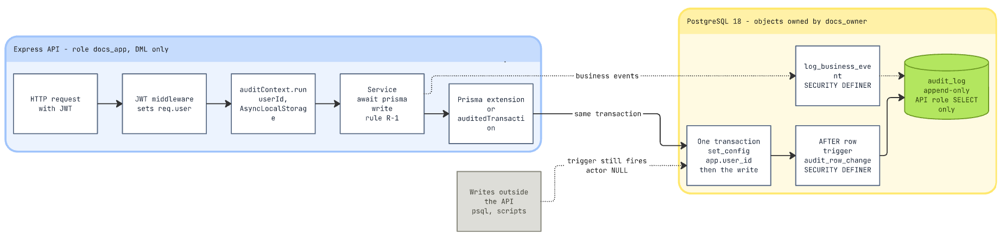*Audit Mechanism: From the Request to the Audit Record*

*Note.* Flow diagram. Blue area: the Express API, connected with the runtime role docs_app. Yellow area: PostgreSQL objects owned by docs_owner. Dashed arrows: business events and writes made outside the API, which the trigger also captures.

[View the live, editable diagram on Miro →](https://miro.com/app/board/uXjVHm4trbw=/?moveToWidget=3458764685305172796)

### *6.5.1 Capture*

A single generic function, audit_row_change(), runs AFTER INSERT, UPDATE, or DELETE FOR EACH ROW on every audited table. It is declared SECURITY DEFINER with a fixed search_path (pg_catalog, public), so it writes to audit_log with the owner's rights while the API role cannot, and a malicious object in another schema cannot hijack its name resolution. It converts OLD and NEW to JSONB, computes the changed fields by comparing both images (ignoring updated_at), and skips updates that change nothing. Each trigger passes three arguments: the key columns of the row (composite keys become, for example, 12:DEV), the column used as a readable label, and the columns whose values must never be stored. The column app_user.password_hash is recorded as a changed field name, but its value is removed from both images. The application is derived from the row or, for associative entities, from the referenced element, and is stored as a loose reference like entity_id.

**Table 39**

*Audited Tables and Trigger Arguments*

| **Table**                                                 | **Key Column(s)**       | **Label Column** | **Redacted**  |
|-----------------------------------------------------------|-------------------------|------------------|---------------|
| app_user                                                  | id                      | name             | password_hash |
| application                                               | id                      | name             | —             |
| screen, variable, collection, component, collection_field | id                      | name             | —             |
| element_environment                                       | element_id, environment | environment      | —             |
| screen_variable, screen_collection, variable_collection   | id                      | used_in          | —             |
| dependency                                                | id                      | relation_type    | —             |
| jira_ticket                                               | id                      | jira_issue_key   | —             |
| comment                                                   | id                      | text             | —             |
| report                                                    | id                      | title            | —             |

*Note.* Not audited on purpose: documented_element (its data is repeated in the subtype record), report_file (binary, the report row is audited), refresh_token (security material, logins can be recorded as business events), and audit_log itself (D-18). The column comment.review_decision added by migration 5 is captured by the existing comment trigger, without changes to migration 3.

### *6.5.2 Propagation of the Acting User*

The trigger reads the acting user with current_setting('app.user_id', true). The backend sets it with set_config('app.user_id', \<id from the JWT\>, true) inside the same transaction as the write. The third argument makes the value transaction-local, so it can never leak to another request through the connection pool. In the backend, an Express middleware opens an AsyncLocalStorage context with the user id after validating the JWT, and a Prisma Client extension (audit-context) wraps every write operation, including nested writes and \*Many operations, in a batch transaction that first sets the value. Multi-step operations and raw SQL writes use the helper auditedTransaction(), an interactive transaction that sets the value once and receives the non-extended transaction client. A malformed value is ignored rather than trusted, and a write without a context is still recorded with actor_user_id NULL and the database role that made it.

The end-to-end tests exposed one coding rule that the design must state explicitly (rule R-1): Prisma queries are lazy promises that run only when awaited. A query returned without await from inside auditContext.run() executes later, outside the context, and its record loses the actor (test E11). Every write must therefore be awaited inside the request's context. With the middleware pattern above this is the natural way of writing Express handlers, and it will be enforced with the ESLint rule @typescript-eslint/no-floating-promises during development.

### *6.5.3 Protection and Business Events*

The runtime role docs_app has only SELECT on audit_log and is not the owner of any object, so it can neither write records directly nor disable, drop, or alter the triggers. In addition, the trigger trg_audit_log_immutable rejects UPDATE, DELETE, and TRUNCATE on audit_log for every role, the owner included. Removing that protection would require a reviewed migration versioned in Git. Business events that are not row writes, such as the approval of a screen's documentation, are recorded through the SECURITY DEFINER function log_business_event(), the only entry point granted to the API. It validates the event name, requires the acting user in the transaction, and writes the record with action EVENT and its event_name.

### *6.5.4 Verification*

The mechanism was verified on the database created by the migrations of Section 6.7, connecting as the real roles: 22 SQL tests as docs_app, 3 as docs_owner, and 11 end-to-end tests with Prisma Client 7.10.0 and the @prisma/adapter-pg driver adapter, also as docs_app. All 36 passed (Table 40). Test AU25 confirms that the new column comment.review_decision (CP-11) is captured by the existing audit trigger, so the audit migration did not need to change.

**Table 40**

*Audit and Privilege Test Results*

| **ID**     | **Verified Behavior (all PASS)**                                                                                                                                                          |
|------------|-------------------------------------------------------------------------------------------------------------------------------------------------------------------------------------------|
| AU01–AU03  | CREATE records carry the application user and the database role, rows created by other triggers are audited with the same actor, writes without app.user_id are recorded with actor NULL. |
| AU04, AU07 | The password value is never stored. A password change is recorded by field name only.                                                                                                     |
| AU05–AU06  | UPDATE records contain exact old and new values and the changed fields. No-op updates are not recorded.                                                                                   |
| AU08–AU09  | The setting does not leak across transactions. A malformed value is ignored.                                                                                                              |
| AU10–AU12  | Cascaded deletes are audited, including the SET NULL on variable.origin_screen_id (decision 3.5). The record survives and remains readable after the deletion.                            |
| AU13–AU19  | The API role cannot insert, update, or delete audit records, disable or drop triggers, read the migration history, or create objects.                                                     |
| AU20–AU21  | Business events are recorded as EVENT with the actor, and are rejected without an acting user.                                                                                            |
| AU22–AU24  | Even the owner role cannot UPDATE, DELETE, or TRUNCATE audit_log.                                                                                                                         |
| E01–E04    | Prisma nested writes (supertype + subtype, variable + environments) work with the composite FKs and the deferred checks, and are audited with the actor.                                  |
| E05        | updateMany is audited row by row with exact old values, which a Prisma-only audit could not provide.                                                                                      |
| E06–E07    | Raw SQL writes and business events inside auditedTransaction() carry the actor.                                                                                                           |
| E08        | 20 concurrent writes by two users: every record carries its own actor (0 mismatches).                                                                                                     |
| E09–E11    | A write without context is recorded with actor NULL, auditedTransaction() refuses to run without a context, the un-awaited query of rule R-1 loses the actor.                             |
| AU25       | A review comment is audited with its review_decision in new_value and with the acting user (CP-11).                                                                                       |

*Note.* Scripts: 03_backend/tests/02_audit_privilege_tests.sql (22/22), 03_backend/tests/03_owner_immutability_tests.sql (3/3), 03_backend/tests/04_prisma_audit_e2e.test.ts (11/11).

## 6.6 Indexes

PostgreSQL creates indexes for primary keys and unique constraints, but not for foreign key columns. Secondary indexes were therefore defined from the queries the requirements imply and from the cascades that must find referencing rows quickly. An index whose leading columns are already covered by a unique constraint was not duplicated. Table 41 lists the secondary indexes. Together with the primary keys and unique constraints the database holds 64 indexes.

**Table 41**

*Secondary Indexes and Their Purpose*

| **Table**           | **Columns**                                     | **Query or Operation Supported**                                    | **Req.**     |
|---------------------|-------------------------------------------------|---------------------------------------------------------------------|--------------|
| documented_element  | (application_id, type)                          | Elements of an application by type (lists, graph, dashboard).       | FR-15, FR-19 |
| screen              | (application_id, documentation_status)          | Percentage of screens per status, status filter.                    | FR-17, FR-19 |
| variable            | (origin_screen_id)                              | Variables created in a screen, SET NULL when the screen is deleted. | FR-05        |
| variable            | (application_id) WHERE origin_screen_id IS NULL | Partial: variables without full traceability.                       | FR-19        |
| element_environment | (environment)                                   | Environment filter.                                                 | FR-17        |
| screen_variable     | (variable_id)                                   | Where a variable is used, cascade on delete.                        | FR-15        |
| screen_collection   | (collection_id)                                 | Consumers of a collection, undocumented collections.                | FR-15, FR-19 |
| variable_collection | (collection_id), (screen_id)                    | Graph edges from collections and screens, cascades.                 | FR-15        |
| dependency          | (target_id)                                     | Incoming dependencies of an element.                                | FR-15        |
| jira_ticket         | (screen_id, hierarchy_level, status_category)   | Pending Subtasks per screen, Epic/Story lookup.                     | FR-12, FR-19 |
| jira_ticket         | (parent_ticket_id)                              | Children of an Epic or Story, cascade.                              | FR-12        |
| comment             | (screen_id, created_at)                         | Comments of a screen in order (approved decision 3.1).              | FR-23        |
| report              | (application_id, is_published, created_at DESC) | Saved and published reports, newest first.                          | FR-22        |
| audit_log           | (entity_type, entity_id, created_at)            | History of one element (approved).                                  | FR-21        |
| audit_log           | (actor_user_id, created_at)                     | Actions of a user, Developer sees own actions (approved).           | FR-21        |
| audit_log           | (application_id, created_at), (created_at DESC) | History per application, recent team activity.                      | FR-19, FR-21 |
| refresh_token       | (user_id), (family_id)                          | Revoke all tokens of a user or a rotation chain.                    | NFR-01       |

*Note.* Deliberately not indexed: foreign keys to app_user used only for display (author_id, created_by, generated_by, comment.user_id), because users are never deleted (D-09) and no requirement queries by them, and trigram indexes for text search, because at department scale (NFR-11) a sequential scan answers in milliseconds. Both decisions are revisited if the performance measurements taken during testing require it (D-22).

## 6.7 Migrations and Database Roles

The schema is delivered as six versioned migrations (Table 42). The first and the fifth are generated by Prisma from schema.prisma. The other four contain what Prisma does not declare and were created with prisma migrate dev --create-only and then written by hand, as the approved decision requires. An applied migration is never edited: any later change is a new migration, so the migration history in Git is also the history of the design.

**Table 42**

*Migrations*

| **Order** | **Migration**                      | **Origin** | **Contents**                                                                                                                       |
|-----------|------------------------------------|------------|------------------------------------------------------------------------------------------------------------------------------------|
| 1         | 20260928000000_init                | Generated  | 15 enums, 19 tables, primary and foreign keys (including composite), unique and partial unique indexes, secondary indexes.         |
| 2         | 20260928000100_integrity_rules     | Manual     | 34 CHECK constraints, updated_at maintained by the database, integrity triggers of Section 6.3, including the deferred checks.     |
| 3         | 20260928000200_audit               | Manual     | audit_row_change(), 15 audit triggers, log_business_event(), append-only protection.                                               |
| 4         | 20260928000300_privileges          | Manual     | Least-privilege grants for docs_app and default privileges for future tables.                                                      |
| 5         | 20261005000400_review_decision     | Generated  | Enum review_decision (APPROVE and RETURN, 16 enums in total) and the nullable column comment.review_decision (CP-11).              |
| 6         | 20261005000500_context_screen_rule | Manual     | check_context_screen_links() and three deferred constraint triggers on screen_variable, variable_collection, and variable (CP-07). |

*Note.* Roles and the database are created beforehand by bootstrap/01_roles_and_database.sql, run once per environment by a DBA. It is not a Prisma migration because roles are cluster-wide and passwords must not be stored in Git. After the six migrations the database has 19 tables, 16 enums, 64 indexes, 34 CHECK constraints, and 51 triggers. No index was added, so Section 6.6 and Figure 7 do not change.

**Table 43**

*Database Roles*

| **Role**   | **Used By**                | **Privileges**                                                                                                                                                                                                       |
|------------|----------------------------|----------------------------------------------------------------------------------------------------------------------------------------------------------------------------------------------------------------------|
| docs_owner | prisma migrate deploy only | Owner of the database, the public schema, and every object. Needs CREATEDB only in development, for the shadow database of prisma migrate dev.                                                                       |
| docs_app   | The Express API at runtime | CONNECT, SELECT, INSERT, UPDATE, DELETE on domain tables, SELECT only on audit_log, EXECUTE on log_business_event(), no access to \_prisma_migrations, cannot create objects, change ownership, or disable triggers. |

Two findings from executing the migrations are recorded as design decisions. First, the grant migration must not reference \_prisma_migrations unconditionally, because that table does not exist in the shadow database that prisma migrate dev uses to replay migrations. The unguarded statement made the replay fail with error P3006, and it is now guarded by an existence check (D-21). Second, Prisma's own schema engine was used to generate and apply the migrations. In the validation environment it ran as @prisma/schema-engine-wasm 7.10.0 because the native engine could not be downloaded, which exposed two defects of @prisma/adapter-pg 7.10.0 in that path (scripts split on every semicolon, and the shadow database dropped before its pool is closed) that do not affect the Prisma CLI used in development. The drift check (migrations versus schema.prisma) was then run with the native Prisma CLI 7.10.0 on the development machine (Windows, PostgreSQL 18.3): npx prisma migrate diff --from-migrations prisma/migrations --to-schema prisma/schema.prisma --exit-code reported "No difference detected". Prisma therefore will not try to remove the manual objects (CHECK constraints, triggers, functions, grants) when future migrations are created. The check needs an existing shadow database (docs_shadow, owned by docs_owner), because Prisma does not create the one configured in shadowDatabaseUrl.

Migrations 5 and 6 were added for the interface changes without editing any of the first four. After applying them, the drift check (npx prisma migrate diff --from-migrations prisma/migrations --to-schema prisma/schema.prisma --exit-code) reported “No difference detected” on the development machine, so Prisma will not try to drop any of the objects created by hand. Migration 5 was also compared with the SQL that the Prisma 7.10.0 schema engine generates between the previous and the new schema.prisma: they are identical.

## 6.8 Physical Entity-Relationship Diagram

Figure 7 shows the physical model with its keys and the 30 foreign keys. It was generated directly from the catalog of the database created by the migrations, so it reflects what exists in PostgreSQL rather than a manual transcription. The complete columns of every table are specified in Section 6.2. The version with all columns is maintained on the project's Miro board, next to the conceptual model of the SRS.

**Figure 7**

*Physical Entity-Relationship Diagram (Keys and Relationships)*

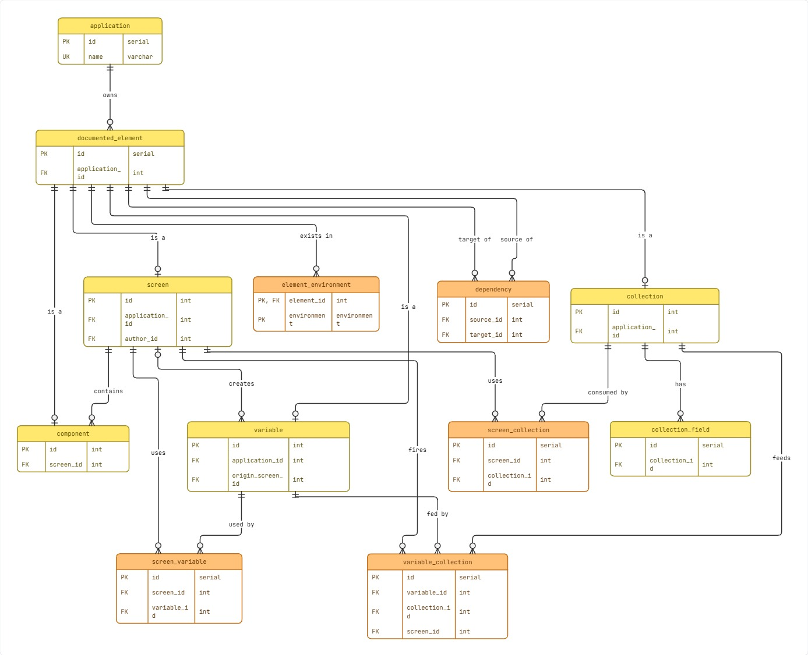

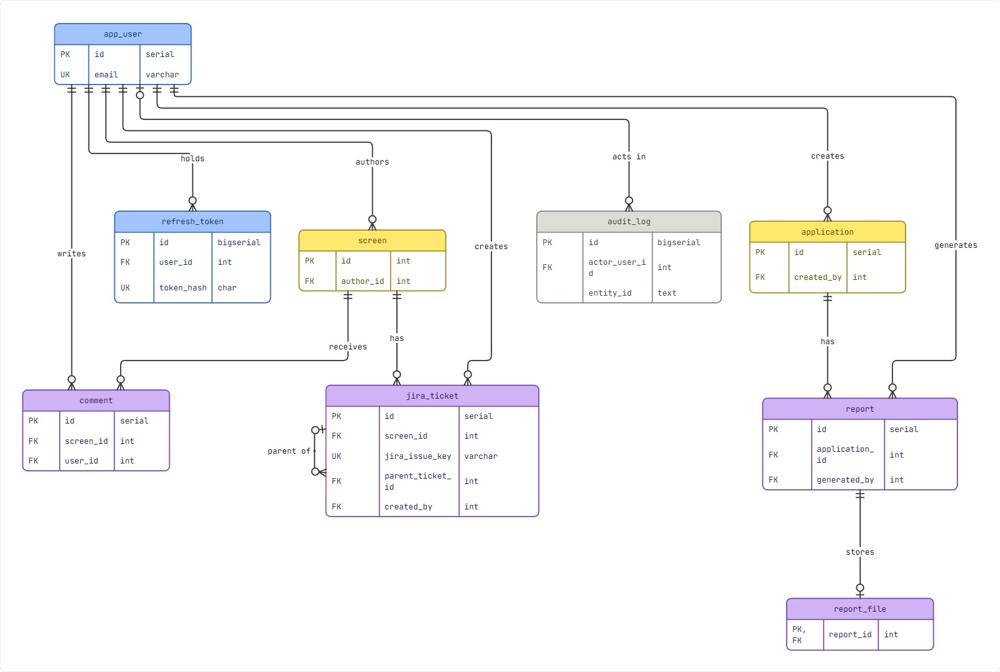*Note.* Only primary and foreign key columns are shown. NN = NOT NULL. Groups: identity and access (blue), documented elements (yellow), associative entities and dependency (orange), Jira, comments and reports (purple), audit (grey). screen.author_id is an FK to User. There is no Author table. audit_log has no FK to the audited entity on purpose. Generated from the PostgreSQL 18 catalog with 05_diagramas/er_from_catalog.py. Migration 5 adds a column that is neither a key nor a foreign key, so this figure does not change. The version with all columns on Miro shows comment.review_decision.

[View the live, editable diagram on Miro →](https://miro.com/app/board/uXjVHm4trbw=/?moveToWidget=3458764685304999606)

# 7. Interface Viewpoint

This viewpoint specifies the contracts of the REST API that the React frontend consumes. The authoritative, machine-readable specification is the OpenAPI 3.1 document 04_api/openapi.yaml (Appendix C), which Bruno imports directly to build the per-module test collections required by SRS Section 3.7. The tables in this section summarize it. Where they differ, the OpenAPI document prevails. The contracts were validated with Redocly CLI 2.57.0 (structure, required 4xx responses, and conformance of every example to its schema), and a script checks that their enumerations and length limits match the migrated database exactly.

## 7.1 API Conventions

**Table 44**

*Conventions Applied to Every Endpoint*

| **Aspect**            | **Convention**                                                                                                                             | **Origin / Rationale**                                               |
|-----------------------|--------------------------------------------------------------------------------------------------------------------------------------------|----------------------------------------------------------------------|
| Base and transport    | https://\<host\>/api/v1, JSON in UTF-8, HTTPS only.                                                                                        | SRS 3.7, NFR-04                                                      |
| Routes                | kebab-case, plural nouns. The routes of SRS Table 25 are kept as listed (not nested under applications).                                   | SRS 3.7, Table 27                                                    |
| Field names           | camelCase in JSON (originScreenId), snake_case only in the database.                                                                       | JavaScript convention of SRS Table 27, matches Prisma fields (D-23). |
| Response envelope     | Collection: { data: \[...\], page, pageSize, total }. Single resource: { data: {...} }. Errors: { code, message, details }.                | SRS 3.7                                                              |
| Pagination            | page (default 1) and pageSize (default 20, maximum 100). Out-of-range values return 400.                                                   | SRS 3.7, FR-18                                                       |
| Filtering and sorting | Filters as query parameters, q for text, sort=field or sort=-field over a per-endpoint whitelist.                                          | FR-17                                                                |
| Application scope     | Listings of documented elements require applicationId. Creation bodies carry it and it cannot change afterwards.                           | NFR-16 (D-23)                                                        |
| Write semantics       | POST creates (201 + Location), PUT replaces the whole editable representation, including nested arrays, matched by id, DELETE returns 204. | SRS Table 25 uses PUT                                                |
| Concurrency           | Every GET returns an ETag. A PUT with If-Match is rejected with 412 if the resource changed since it was read.                             | Several developers edit documentation (D-24).                        |
| Dates and identifiers | ISO 8601 in UTC with milliseconds, integer identifiers.                                                                                    | Matches TIMESTAMPTZ(3)                                               |
| Authorization         | Bearer access token on every endpoint except login and refresh. The role and status are read from the database on each request.            | NFR-03 (D-25, detailed in Section 11)                                |
| Limits                | Request body up to 1 MB (413), rate limit on /auth/\* (429 with Retry-After).                                                              | NFR-05                                                               |
| Language              | Messages in English. Clients act on code, never on the message text.                                                                       | NFR-08 (D-49)                                                        |

SRS v1.3 Section 3.7 lists the fourteen status codes the design uses. Seven of them were added by this design to the original 200, 201, 400, 401, 403, 404, and 500, because none of those covers their meaning, and were incorporated into the SRS in version 1.2: 202 for accepted asynchronous work (reports), 204 for successful deletions and logout, 409 for conflicts, 412 for concurrent-modification conflicts, 422 for well-formed requests that break a business or integrity rule, 429 for rate limiting, and 502 when Jira fails (D-24). Table 45 lists the error codes. Their messages are written in English, like the whole interface, and say what to do next (NFR-08, D-49).

**Table 45**

*Error Catalog*

| **Code**                                   | **HTTP** | **When**                                                                                                                            |
|--------------------------------------------|----------|-------------------------------------------------------------------------------------------------------------------------------------|
| VALIDATION_ERROR                           | 400      | Malformed body or parameters. Details.fields lists each field, the failed rule, and a message.                                      |
| INVALID_CREDENTIALS                        | 401      | Wrong e-mail or password, or inactive account (same response, so e-mails cannot be enumerated).                                     |
| UNAUTHENTICATED / TOKEN_EXPIRED            | 401      | Missing or invalid access token / expired access token.                                                                             |
| REFRESH_INVALID                            | 401      | Refresh token missing, expired, revoked, or reused (reuse revokes the whole family).                                                |
| FORBIDDEN                                  | 403      | The role does not allow the operation, details.requiredRoles.                                                                       |
| NOT_FOUND                                  | 404      | The resource or a referenced resource does not exist.                                                                               |
| DUPLICATE_NAME / EMAIL_TAKEN               | 409      | Uniqueness rule (Table 31).                                                                                                         |
| PRECONDITION_FAILED                        | 412      | If-Match does not match the current ETag.                                                                                           |
| PAYLOAD_TOO_LARGE                          | 413      | Body larger than 1 MB.                                                                                                              |
| SCOPE_MISMATCH                             | 422      | Set used with a context variable, or UpdateContext with a global one.                                                               |
| SCOPE_CONFLICT                             | 422      | Changing a variable's scope while incompatible assignments exist.                                                                   |
| CROSS_APPLICATION                          | 422      | Linking elements of different applications.                                                                                         |
| INVALID_ORIGIN_SCREEN                      | 422      | A context variable whose origin is the App (OnStart) screen, or an origin screen of another application.                            |
| CONTEXT_SCREEN_MISMATCH                    | 422      | A context variable assigned with UpdateContext, or read, outside its origin screen, or linked while it has no origin screen (D-52). |
| LAST_ACTIVE_ADMIN / CANNOT_DEACTIVATE_SELF | 422      | Demoting or deactivating the last active administrator, an administrator deactivating themself.                                     |
| RESERVED_ACCOUNT                           | 422      | Modifying, changing the role of, or deactivating the reserved account “Integración Jira” (D-51).                                    |
| INVALID_SIGNATURE                          | 401      | Jira webhook delivery whose X-Hub-Signature does not match.                                                                         |
| REPORT_NOT_READY                           | 409      | Downloading or publishing a report that is PENDING or FAILED.                                                                       |
| INVALID_TRANSITION / NOT_IN_REVIEW         | 422      | Documentation status change not allowed (Section 9), review of a screen that is not IN_REVIEW.                                      |
| TEMPLATE_INCOMPLETE / COMMENT_REQUIRED     | 422      | Submitting with empty template fields, returning a screen without a comment.                                                        |
| APP_CONTEXT_PROTECTED                      | 422      | Deleting the App (OnStart) screen.                                                                                                  |
| APPLICATION_ARCHIVED                       | 422      | Writing documentation of an archived application: elements, links, status, review, Jira tickets, comments (D-47).                   |
| SCREEN_IN_REVIEW                           | 422      | Editing a screen that is IN_REVIEW (D-53).                                                                                          |
| REVIEW_COMMENT_LOCKED                      | 422      | Editing a comment that records a review decision (D-56).                                                                            |
| STORY_NOT_IN_SCREEN                        | 422      | storyId is not a Story of the screen's Epic.                                                                                        |
| JIRA_UNAVAILABLE / JIRA_PARTIAL_FAILURE    | 502      | Jira could not be reached / failed after creating part of the hierarchy (details lists what was created).                           |
| RATE_LIMITED                               | 429      | Too many authentication attempts, Retry-After header.                                                                               |
| INTERNAL_ERROR                             | 500      | Unexpected error. Only a requestId is exposed, never internal details.                                                              |

*Note.* Database errors are translated by the error middleware, never forwarded: PostgreSQL code 23505 (unique) becomes 409, 23503 (foreign key) becomes 404 for a missing reference or 422 when a referenced row cannot be deleted, 23514 (CHECK) and the exceptions raised by integrity triggers become 422, with the specific code chosen from the constraint name (for example, variable_collection_function_scope_chk becomes SCOPE_MISMATCH). The exception raised by check_context_screen_links becomes CONTEXT_SCREEN_MISMATCH, with the variable and the screens involved in details. The English text of every message is fixed in the message catalog (Table 59).

## 7.2 Contracts by Module

Each table lists the operations of one module with the roles that may call them (from SRS Table 26), the request, the success response, and the specific errors. Errors common to all authenticated endpoints (401, and 500) are not repeated. 403 applies whenever the role column does not include the caller.

### *7.2.1 Module 1: Authentication and Users*

**Table 46**

*Contracts of Module 1 (FR-01 to FR-04, NFR-01 to NFR-03)*

| **Operation**       | **Roles**      | **Request**                                   | **Success**                                                                | **Specific Errors**                                                  |
|---------------------|----------------|-----------------------------------------------|----------------------------------------------------------------------------|----------------------------------------------------------------------|
| POST /auth/login    | Public         | { email, password }                           | 200 { data: { accessToken, tokenType, expiresIn, user } } + refresh cookie | 400, 401 INVALID_CREDENTIALS, 429                                    |
| POST /auth/refresh  | Refresh cookie | (cookie)                                      | 200 new access token, rotated cookie                                       | 401 REFRESH_INVALID, 429                                             |
| POST /auth/logout   | Refresh cookie | (cookie)                                      | 204, cookie cleared                                                        | 429                                                                  |
| GET /users          | Admin          | page, pageSize, q, role, status, sort         | 200 page of User                                                           | 400                                                                  |
| POST /users         | Admin          | { name, email, password, role }               | 201 User + Location                                                        | 400, 409 EMAIL_TAKEN                                                 |
| GET /users/:id      | Admin or self  | —                                             | 200 User + ETag                                                            | 404                                                                  |
| PUT /users/:id      | Admin          | { name, email, status, password? } + If-Match | 200 User                                                                   | 400, 404, 409, 412, 422 LAST_ACTIVE_ADMIN, RESERVED_ACCOUNT          |
| DELETE /users/:id   | Admin          | —                                             | 204 (status INACTIVE, sessions revoked)                                    | 404, 422 CANNOT_DEACTIVATE_SELF, LAST_ACTIVE_ADMIN, RESERVED_ACCOUNT |
| PUT /users/:id/role | Admin          | { role }                                      | 200 User                                                                   | 400, 404, 422 LAST_ACTIVE_ADMIN, RESERVED_ACCOUNT                    |

*Note.* User = { id, name, email, role, status, lastLoginAt, createdAt, updatedAt }. The password hash is never returned. Password policy (confirmed by the department): 12 to 128 characters with letters and digits. DELETE /users/:id is a logical deactivation (D-09). Reserved account (D-51): the user “Integración Jira” (role Reader, created inactive) is identified by the INTEGRATION_USER_EMAIL variable, with no schema change. PUT /users/:id, PUT /users/:id/role, and DELETE /users/:id on it return 422 RESERVED_ACCOUNT. A login with its e-mail returns the standard 401 INVALID_CREDENTIALS even if the account were active, GET /users never lists it, GET /users/:id returns 404 for its id, and the Jira webhook finds it through the same variable (Section 7.2.8).

### *7.2.2 Applications*

**Table 47**

*Contracts of the Applications Resource (FR-27, NFR-16)*

| **Operation**         | **Roles** | **Request**                                                        | **Success**                                         | **Specific Errors**     |
|-----------------------|-----------|--------------------------------------------------------------------|-----------------------------------------------------|-------------------------|
| GET /applications     | All       | page, pageSize, q, status                                          | 200 page of Application                             | 400                     |
| POST /applications    | Admin     | { name, description?, platform, jiraProjectKey? }                  | 201 Application (includes its App (OnStart) screen) | 400, 409 DUPLICATE_NAME |
| GET /applications/:id | All       | —                                                                  | 200 Application + ETag                              | 404                     |
| PUT /applications/:id | Admin     | { name, description, platform, jiraProjectKey, status } + If-Match | 200 Application                                     | 400, 404, 409, 412      |

*Note.* Resource added by this design and incorporated into SRS Table 25 in version 1.2 (D-28). Applications are archived (status ARCHIVED), never deleted, so there is no DELETE operation. An archived application's documentation is read-only for every role until it is unarchived (D-47): every write on its elements, links, statuses, reviews, Jira tickets, and comments returns 422 APPLICATION_ARCHIVED, while reports can still be generated and downloaded. A PUT with status ACTIVE restores editing.

### *7.2.3 Module 2: Variables*

**Table 48**

*Contracts of Module 2 (FR-05 to FR-07)*

| **Operation**                   | **Roles**  | **Request**                                                                                               | **Success**                                                                  | **Specific Errors**                                                                                          |
|---------------------------------|------------|-----------------------------------------------------------------------------------------------------------|------------------------------------------------------------------------------|--------------------------------------------------------------------------------------------------------------|
| GET /variables                  | All        | applicationId (required), page, pageSize, q, scope, dataType, environment, originScreenId, untraced, sort | 200 page of VariableSummary                                                  | 400                                                                                                          |
| POST /variables                 | Admin, Dev | { applicationId, name, dataType, scope, description?, originScreenId?, environments\[\] }                 | 201 Variable                                                                 | 400, 404, 409 DUPLICATE_NAME, 422 INVALID_ORIGIN_SCREEN, CROSS_APPLICATION, APPLICATION_ARCHIVED             |
| GET /variables/:id              | All        | —                                                                                                         | 200 Variable + ETag                                                          | 404                                                                                                          |
| PUT /variables/:id              | Admin, Dev | Same as POST without applicationId + If-Match                                                             | 200 Variable                                                                 | 400, 404, 409, 412, 422 SCOPE_CONFLICT, INVALID_ORIGIN_SCREEN, CONTEXT_SCREEN_MISMATCH, APPLICATION_ARCHIVED |
| DELETE /variables/:id           | Admin, Dev | —                                                                                                         | 204 (links and dependencies cascade)                                         | 404, 422 APPLICATION_ARCHIVED                                                                                |
| GET /variables/:id/dependencies | All        | —                                                                                                         | 200 { variable, originScreen, screens\[\], collections\[\], components\[\] } | 404                                                                                                          |

*Note.* environments holds one or two items (DEV, PROD) with optional notes (D-04). untraced=true returns variables without an origin screen (FR-19). fullTraceability in the response is true when originScreen is set. The dependencies endpoint is bounded to one node and its neighbors, so it is not paginated. Writes on an archived application return 422 APPLICATION_ARCHIVED (D-47). A change of scope or origin that would leave links forbidden by check_context_screen_links returns 422 CONTEXT_SCREEN_MISMATCH (D-52).

### *7.2.4 Module 3: Collections*

**Table 49**

*Contracts of Module 3 (FR-08, FR-09)*

| **Operation**               | **Roles**  | **Request**                                                                                                        | **Success**                                      | **Specific Errors**                                                                                                |
|-----------------------------|------------|--------------------------------------------------------------------------------------------------------------------|--------------------------------------------------|--------------------------------------------------------------------------------------------------------------------|
| GET /collections            | All        | applicationId (required), page, pageSize, q, environment, undocumented, sort                                       | 200 page of CollectionSummary                    | 400                                                                                                                |
| POST /collections           | Admin, Dev | { applicationId, name, creationCondition?, description?, environments\[\], fields\[\]?, variableAssignments\[\]? } | 201 Collection                                   | 400, 404, 409 DUPLICATE_NAME, 422 SCOPE_MISMATCH, CROSS_APPLICATION, CONTEXT_SCREEN_MISMATCH, APPLICATION_ARCHIVED |
| GET /collections/:id        | All        | —                                                                                                                  | 200 Collection + ETag                            | 404                                                                                                                |
| PUT /collections/:id        | Admin, Dev | Same as POST without applicationId + If-Match                                                                      | 200 Collection                                   | 400, 404, 409, 412, 422 SCOPE_MISMATCH, CONTEXT_SCREEN_MISMATCH, APPLICATION_ARCHIVED                              |
| DELETE /collections/:id     | Admin, Dev | —                                                                                                                  | 204 (fields, links, and dependencies cascade)    | 404, 422 APPLICATION_ARCHIVED                                                                                      |
| GET /collections/:id/fields | All        | page, pageSize (default 100)                                                                                       | 200 page of CollectionField, ordered by position | 404                                                                                                                |

*Note.* variableAssignments items: { id?, variableId, screenId, assignmentFunction, tableFunction?, usedIn }. The variable's scope is taken from the variable, never from the client. In PUT, nested fields and variableAssignments are matched by id: with an id they are updated, without one they are created, and existing items left out are deleted (D-26). undocumented=true returns collections not linked to any screen (D-14). Assignments of a context variable must use its origin screen as screenId, otherwise 422 CONTEXT_SCREEN_MISMATCH (D-52).

Two linking decisions keep the inventory of SRS Table 25 unchanged. The variable–collection assignments of FR-09 are written through the collection, because FR-09 places them in Module 3 ("linking a collection to the variables that compose it"). The variable exposes them read-only in GET /variables/:id/dependencies. The screen–variable and screen–collection links of FR-11 are written through the screen resource. In both cases no new route is needed, and each link is written by exactly one resource.

The inventory of SRS Table 25 has no route that writes components or dependencies, although FR-11 and FR-15 require both. The design applies the rule already used for links (D-26): each fact is written by the resource it belongs to. A screen's PUT carries its components, what each component uses (component → variable or collection), and its navigations (screen → screen). A collection's PUT carries the collections it derives from (collection → collection). Module 5 then only reads the resulting graph (D-29).

### *7.2.5 Module 4: Screens*

**Table 50**

*Contracts of Module 4 (FR-10 to FR-14)*

| **Operation**                 | **Roles**           | **Request**                                                                                                           | **Success**                                               | **Specific Errors**                                                                                     |
|-------------------------------|---------------------|-----------------------------------------------------------------------------------------------------------------------|-----------------------------------------------------------|---------------------------------------------------------------------------------------------------------|
| GET /screens                  | All                 | applicationId (required), page, pageSize, q, documentationStatus, authorId, sort                                      | 200 page of ScreenSummary (App (OnStart) first)           | 400                                                                                                     |
| POST /screens                 | Admin, Dev          | { applicationId, name, miroLink?, template, components\[\], variableLinks\[\], collectionLinks\[\], navigations\[\] } | 201 Screen, author = caller                               | 400, 404, 409 DUPLICATE_NAME, 422 CROSS_APPLICATION, CONTEXT_SCREEN_MISMATCH, APPLICATION_ARCHIVED      |
| GET /screens/:id              | All                 | —                                                                                                                     | 200 Screen + ETag                                         | 404                                                                                                     |
| PUT /screens/:id              | Admin, Dev          | Same as POST without applicationId + If-Match                                                                         | 200 Screen with resulting status                          | 400, 404, 409, 412, 422 SCREEN_IN_REVIEW, CONTEXT_SCREEN_MISMATCH, APPLICATION_ARCHIVED                 |
| DELETE /screens/:id           | Admin, Dev          | —                                                                                                                     | 204 (cascade, variables keep existing without origin)     | 404, 422 APP_CONTEXT_PROTECTED, APPLICATION_ARCHIVED                                                    |
| PUT /screens/:id/status       | Admin, Dev          | { status } (not APPROVED) + If-Match                                                                                  | 200 Screen                                                | 400, 404, 412, 422 INVALID_TRANSITION, TEMPLATE_INCOMPLETE, APPLICATION_ARCHIVED                        |
| POST /screens/:id/jira-ticket | Admin, Dev          | { storyId \| newStory: { summary, description? }, subtask: { summary, description? } }                                | 201 { epic, story, subtask, created\[\] }                 | 400, 404, 422 STORY_NOT_IN_SCREEN, 502 JIRA_UNAVAILABLE, JIRA_PARTIAL_FAILURE, 422 APPLICATION_ARCHIVED |
| GET /screens/:id/jira-tickets | All (Reader: query) | refresh?                                                                                                              | 200 tree { epic, stories\[ { …, subtasks\[\] } \], sync } | 404                                                                                                     |

*Note.* template has the seven text fields of SRS Table 28. The eighth, future to do, is the screen's Subtasks (D-06). Nested arrays are matched by id (D-26). The origin links are maintained by Module 2 and are read-only here. The resulting status after an edit follows Section 9. sort accepts name, documentationStatus, updatedAt, and pendingSubtasks (D-54). PUT /screens/:id on a screen IN_REVIEW returns 422 SCREEN_IN_REVIEW (D-53). In variableLinks, a context variable created in another screen accepts only WRITE (D-52). A screen created with an empty template starts as UNDOCUMENTED (Section 9).

POST /screens/:id/jira-ticket implements the hierarchy confirmed by the department (D-06, D-15) in one request: it creates the screen's Epic in Jira if it does not exist yet, uses the Story chosen by the user or creates a new one under the Epic, and creates the Subtask under that Story. Each issue is stored locally as soon as Jira confirms it. If Jira fails midway, the response is 502 JIRA_PARTIAL_FAILURE and details lists the issues already created together with the Story's local id, so that retrying with storyId never duplicates them. The unique index of one Epic per screen prevents a second Epic in any case (D-31). If Jira is unavailable, every other module keeps working and ticket lists are served from the local copy marked as stale (NFR-14).

### *7.2.6 Modules 5 to 8: Dependency Map, Search, Dashboard, and Audit*

**Table 51**

*Contracts of Modules 5 to 8 (FR-15 to FR-21)*

| **Operation**               | **Roles**              | **Request**                                                                                              | **Success**                                                                                                                                   | **Specific Errors**                               |
|-----------------------------|------------------------|----------------------------------------------------------------------------------------------------------|-----------------------------------------------------------------------------------------------------------------------------------------------|---------------------------------------------------|
| GET /dependencies/graph     | All                    | applicationId (required), types?, environment?                                                           | 200 { nodes\[\], edges\[\] }                                                                                                                  | 400                                               |
| GET /dependencies/:type/:id | All                    | type ∈ screens, variables, collections, components, depth 1–3                                            | 200 { nodes\[\], edges\[\] } around the node                                                                                                  | 400, 404                                          |
| GET /search                 | All                    | applicationId, q? (2–100 characters), types?, environment?, documentationStatus?, scope?, page, pageSize | 200 page of SearchResult (type, name, where it matched, snippet)                                                                              | 400 (also without q and without filters)          |
| GET /dashboard/indicators   | All (Reader: overview) | applicationId (required)                                                                                 | 200 documentation by status and % approved, untraced variables, undocumented collections, pending Subtasks, recent activity (not for Readers) | 400                                               |
| GET /audit-log              | Admin, Dev (own)       | applicationId?, entityType?, entityId?, actorUserId?, action?, from?, to?, page, pageSize                | 200 page of AuditEntry, newest first                                                                                                          | 400, 403 (Reader, or Dev asking for another user) |

*Note.* Graph edge kinds: CONTAINS (screen → component), CREATES (origin), ACCESSES (screen → variable/collection), FEEDS (collection → variable), USES (component → variable/collection), DERIVES_FROM, NAVIGATES_TO. Each edge carries accessMode, usedIn, and the assignment function when they apply. A graph is a single resource and is not paginated (NFR-11). SRS Table 25 writes the search as ?query=&filters=. The contract uses q and one parameter per filter, consistent with the other listings (D-35). Since D-48, q is optional: a search may use filters only, and a request with neither q nor any filter returns 400 VALIDATION_ERROR. Filters that apply only to some element types (environment to variables and collections, documentationStatus to screens, scope to variables) restrict those types and leave the others unfiltered.

### *7.2.7 Modules 9 to 11: Reports, Comments and Review, and Onboarding*

**Table 52**

*Contracts of Modules 9 to 11 (FR-22 to FR-25, NFR-12)*

| **Operation**                | **Roles**                      | **Request**                                                                                                            | **Success**                                                                                                                                  | **Specific Errors**                                                 |
|------------------------------|--------------------------------|------------------------------------------------------------------------------------------------------------------------|----------------------------------------------------------------------------------------------------------------------------------------------|---------------------------------------------------------------------|
| POST /reports/pdf            | Admin, Dev                     | { applicationId, title, scope: { elementTypes\[\], screenIds?, documentationStatus?, includeDependencies? }, publish } | 202 Report (PENDING) + Location                                                                                                              | 400                                                                 |
| POST /reports/excel          | Admin, Dev                     | Same as PDF                                                                                                            | 202 Report (PENDING) + Location                                                                                                              | 400                                                                 |
| GET /reports                 | Admin, Dev, Reader (published) | applicationId, published?, page, pageSize                                                                              | 200 page of Report                                                                                                                           | 400                                                                 |
| GET /reports/:id             | As above                       | —                                                                                                                      | 200 Report with its parameters (poll until READY or FAILED)                                                                                  | 404 (also unpublished, for Readers)                                 |
| GET /reports/:id/file        | As above                       | —                                                                                                                      | 200 PDF or XLSX file                                                                                                                         | 404, 409 REPORT_NOT_READY                                           |
| PUT /reports/:id/publication | Admin, Dev                     | { isPublished }                                                                                                        | 200 Report                                                                                                                                   | 400, 404, 409 REPORT_NOT_READY                                      |
| GET /screens/:id/comments    | All                            | page, pageSize                                                                                                         | 200 page of Comment, oldest first                                                                                                            | 404                                                                 |
| POST /screens/:id/comments   | All                            | { text }                                                                                                               | 201 Comment                                                                                                                                  | 400, 404, 422 APPLICATION_ARCHIVED                                  |
| PUT /comments/:id            | Author only                    | { text }                                                                                                               | 200 Comment (updatedAt set)                                                                                                                  | 400, 403, 404, 422 REVIEW_COMMENT_LOCKED, APPLICATION_ARCHIVED      |
| POST /screens/:id/review     | Admin                          | { decision: APPROVE, comment? } \| { decision: RETURN, comment }                                                       | 200 Screen                                                                                                                                   | 400, 404, 422 NOT_IN_REVIEW, COMMENT_REQUIRED, APPLICATION_ARCHIVED |
| GET /onboarding/summary      | All                            | applicationId (required)                                                                                               | 200 counts, % approved, App (OnStart) screen, key screens in suggested reading order, global variables, most used components (topComponents) | 400                                                                 |

*Note.* The last four report operations were added by this design and incorporated into SRS Table 25 in version 1.2. They are what makes saved and published reports usable, as confirmed by the department (D-10, D-32). Generation runs outside the request (NFR-12). Its mechanism is specified in the Interaction viewpoint. An edited comment keeps its previous text in the audit log. GET /reports/:id also returns parameters { format, scope, publish } to every role that can read the report. GET /reports does not, to keep the list light, and “Generate again” sends a new POST with them, so the failed report stays in the history (D-55). The review writes comment.reviewDecision: RETURN always creates a comment, APPROVE only when a comment is given, and review comments cannot be edited (D-56). topComponents lists up to 10 components ordered by the variables and collections they use (D-50).

### 

### 

### *7.2.8 Jira Cloud Webhook*

POST /integrations/jira/webhook receives issue events from Jira Cloud so that ticket statuses are current without polling (FR-12). It is registered by a Jira administrator as an admin webhook on project TECHEA (JQL project = TECHEA, events issue updated and issue deleted) with a secret, which the department confirmed is possible. Jira then signs each delivery with HMAC-SHA256 over the raw body and sends it in the X-Hub-Signature header as sha256=\<hex\> (Atlassian, n.d.). Table 53 lists the processing steps.

**Table 53**

*Processing of a Jira Webhook Delivery*

| **Step** | **Action**                                                                                                                                                            | **Response / Rationale**                                                                                                                                                            |
|----------|-----------------------------------------------------------------------------------------------------------------------------------------------------------------------|-------------------------------------------------------------------------------------------------------------------------------------------------------------------------------------|
| 1        | Read the raw body (Express express.raw, up to 1 MB) and verify X-Hub-Signature with the secret from an environment variable, using a timing-safe comparison.          | 401 INVALID_SIGNATURE. The body is never parsed before this step (NFR-06).                                                                                                          |
| 2        | Parse the JSON and validate the fields used (webhookEvent, issue.id).                                                                                                 | 400                                                                                                                                                                                 |
| 3        | Find the local ticket by jira_issue_id, ignore issues not tracked.                                                                                                    | 204 (TECHEA may contain issues created outside the system).                                                                                                                         |
| 4        | Ignore the event if its timestamp is earlier than the ticket's last_synced_at.                                                                                        | 204\. Makes repeated and out-of-order deliveries harmless without storing delivery ids.                                                                                             |
| 5        | Updated: copy status, status category (new/indeterminate/done → TO_DO/IN_PROGRESS/DONE), summary, key, and parent, set last_synced_at. Deleted: delete the local row. | 204\. The write is attributed to the reserved integration account, so the audit shows that Jira made the change (D-31). The account is found through INTEGRATION_USER_EMAIL (D-51). |

*Note.* Reference implementation of step 1: 03_backend/src/integrations/jira/verifySignature.ts, verified by tests J0–J8, including a public HMAC-SHA256 test vector and the rejection of a re-serialized body, which confirms that the raw body must be used.

With these sections the contract covers the operations of SRS v1.3 Table 25 (the 41 of the original inventory, the four of /applications, four for saved reports, and the webhook): 50 operations in 04_api/openapi.yaml, version 0.3.0, validated without errors or warnings by Redocly CLI 2.11.1. The script 04_api/check_contract_vs_db.py confirmed that the 15 enumerations shared by the contract and the database (including ReviewDecision and review_decision) and 9 length limits are identical. Request validation against the contract passed 14 of 14 tests (03_backend/tests/08_request_validation.test.mjs), including V12 to V14: a comment that sends reviewDecision is rejected, and GET /search accepts filters without q but rejects a one-character .

## 7.3 User Interface

This section specifies the user interface of the eleven modules. It was designed in two steps. First, the UI Specification gave every screen an identifier (S-01 to S-47), its layout, its fields with the limits of the contract, the actions of each role, its validations and messages, the endpoints it calls, and the requirements it covers. The mock-ups of each module were generated as HTML from the design system. Then the mock-ups were imported into Figma and connected into a navigable prototype. This section summarizes both: for behavior the UI Specification prevails, and for appearance the Figma file. The interface is in English and the product is named “Documentación técnica” (D-49).

### *7.3.1 Navigable Prototype*

The prototype is the Figma file “Documentación técnica — Prototype” (https://www.figma.com/design/zZNDo3yEXP6UubLzEWAHe5). Its Prototype page holds 88 frames of 1440 × 900 pixels, grouped in eight sections: six for the modules, one for the cross-cutting states, and one for the frames that only the flows need, such as a screen right after it is approved or a report while it is generated. Each frame is named after its identifier, for example S-19 Screen detail · Developer, and shows one screen in one state with sample data from SAR (the screens Inicio and Detalle, the variables gUsuario and locMostrarDetalle, the collection colClientes, and the Jira project TECHEA), so the department can recognize its own application.

Every frame has a transparent layer of interactive areas: the sidebar takes each role to its modules, the top bar opens the quick search and signs out, and the buttons of each flow lead to the screen that follows. Transitions are short dissolves (0.2 to 0.45 seconds), creation and confirmation dialogs open as modals over the screen they come from, and long pages scroll inside a fixed sidebar and top bar, as the application will. Table 57 lists the flows that can be started from the presentation view. Figure 8 shows the shell shared by every screen.

**Figure 8**

*Shell and Indicator Dashboard (S-31, Administrator)*

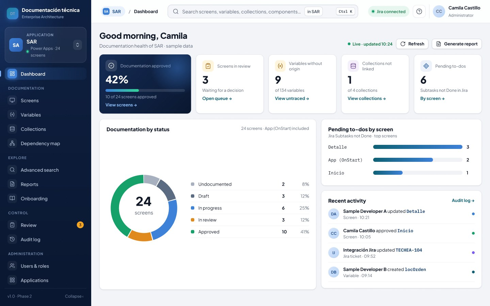

*Note.* Sidebar with the application card and the navigation of the role. Top bar with breadcrumb, quick search (Ctrl K), Jira status, and user. The indicators come from GET /dashboard/indicators (FR-19). Sample data.

### *7.3.2 Design System*

All screens are assembled from one design system (Table 54), so that the eleven modules share their visual and interaction language (NFR-07). Its tokens are delivered as tokens-figma.json and as the Design system page of the Figma file (Appendix F).

**Table 54**

*Foundations of the Design System*

| **Aspect**           | **Decision**                                                                                                                                                                                                                               | **Purpose**                                                 |
|----------------------|--------------------------------------------------------------------------------------------------------------------------------------------------------------------------------------------------------------------------------------------|-------------------------------------------------------------|
| Typography           | Plus Jakarta Sans for the interface (page title 24 px, section 18 px, card 15 px, body 13.5 px). IBM Plex Mono for Power Apps identifiers, formulas, usedIn values, and Jira keys.                                                         | Identifiers look as they do in Power Apps (NFR-09).         |
| Color                | Navy sidebar (#0e2041 to \#0a1730), teal primary (#0e6175, 7.0:1 on white) for primary buttons and links, blue accent (#3d81d9) for active navigation, charts, and focus, neutral ink scale for text, success, warning, and danger pairs.  | One primary action per view, readable text contrast.        |
| Documentation status | Five fixed colors and labels: Undocumented, Draft, In progress, In review, Approved.                                                                                                                                                       | The same tag in lists, details, dashboard, map, and search. |
| Size and spacing     | Controls 36 px (small 30 px), card padding 20 px, radius 12 px, icon tiles 40 px.                                                                                                                                                          | The same density in every module.                           |
| Layout               | Frame 1440 × 900, sidebar 268 px with the application selector, top bar 68 px with breadcrumb, search, Jira status, and user, content on 12 columns.                                                                                       | The selected application is visible on every page (NFR-16). |
| Icons                | Lucide (lucide-react in the implementation), one icon per element type: monitor (screen), braces (variable), database (collection), box (component).                                                                                       | Element types are recognized by shape as well as by label.  |
| Components           | Shell with navigation by role, application selector, page header, data table with filter bar and pagination, status tag, form fields, tabs, modal (small, medium, large), and feedback (banner, toast, empty state, skeleton, error page). | Every screen is built from these (Section 7.3.6).           |

### *7.3.3 Screens by Module*

Table 55 groups the 88 frames by module. A letter after the identifier marks another state of the same screen, r marks the Reader view, and d and j the Developer views. Figures 9 to 21 show the main screen of each module.

**Table 55**

*Screens of the Prototype by Module*

| **Module**                   | **Frames**                                                                                                                                                                         | **Purpose**                                                                                                        | **Req.**                       |
|------------------------------|------------------------------------------------------------------------------------------------------------------------------------------------------------------------------------|--------------------------------------------------------------------------------------------------------------------|--------------------------------|
| 1\. Authentication and users | S-01a–c Sign in (default, invalid credentials, field errors and rate limit), S-02 to S-06b Users & roles (list, filters, row actions, new, edit with 412, change role, deactivate) | Sign-in and user management, Administrator only, the reserved account is never listed (D-51)                       | FR-01 to FR-04, NFR-01, NFR-02 |
| Applications                 | S-07 to S-09b (list, register, archive, read-only banner)                                                                                                                          | Register, edit, and archive applications, an archived application is read-only (D-47)                              | FR-27, NFR-16                  |
| 2\. Variables                | S-10, S-10r, S-11, S-12a (New variable, modal), S-12b (edit, scope conflict), S-13                                                                                                 | List with the untraced filter, where-used detail, create and edit with the context-screen rule, delete with impact | FR-05 to FR-07, FR-19          |
| 3\. Collections              | S-14, S-14n (New collection, modal), S-15a–c (overview, fields, assignments), S-16 (edit), S-17                                                                                    | Creation condition, fields, environments, variable assignments, derivations                                        | FR-07 to FR-09                 |
| 4\. Screens                  | S-18, S-19, S-19r, P-03 (New screen, modal), S-20 to S-22 (edit tabs), S-23 to S-24c (Future to do and Jira), S-25a–b (workflow), S-26, P-01, P-02, P-04                           | Seven-field template, links, components, Jira Subtasks, documentation workflow, editing locked in review (D-53)    | FR-10 to FR-14, NFR-14         |
| 5\. Dependency map           | S-27, S-27b–c, S-28                                                                                                                                                                | Graph, side panel, edge legend, focus on a node                                                                    | FR-15, FR-16, NFR-11           |
| 6\. Advanced search          | S-29, S-29b–c, S-30                                                                                                                                                                | Text plus filters, filters only (D-48), quick search                                                               | FR-17, FR-18                   |
| 7\. Dashboard                | S-31, S-31r, S-31j                                                                                                                                                                 | Indicators, Reader overview, Jira unavailable                                                                      | FR-19, NFR-14                  |
| 8\. Audit                    | S-32, S-32d, S-32f                                                                                                                                                                 | All records (Administrator), own actions (Developer), date filter                                                  | FR-20, FR-21, NFR-20           |
| 9\. Reports                  | S-33, S-33r, S-34 (modal), P-05, P-06                                                                                                                                              | Background generation, publication, published reports for Readers                                                  | FR-22, NFR-12                  |
| 10\. Comments and review     | S-35, S-36, S-37, S-37b–c                                                                                                                                                          | Thread with review comments that cannot be edited (D-56), review queue, approve or return                          | FR-23, FR-24                   |
| 11\. Onboarding              | S-38a–c                                                                                                                                                                            | Five-step introduction to the application                                                                          | FR-25                          |
| States                       | S-39a to S-47                                                                                                                                                                      | Loading, empty, errors, validation, session, concurrent change, offline, feedback components                       | NFR-01, NFR-07, NFR-08, NFR-14 |

*Note.* S-xx = identifier in the UI Specification, P-01 to P-06 = frames added for the flows.

Sign-in is the only screen outside the shell (Figure 9). It never says whether the e-mail or the password failed, or that an account is inactive (D-27), and it rejects the e-mail of the reserved account with the same message (D-51).

**Figure 9**

*Sign In (S-01a)*

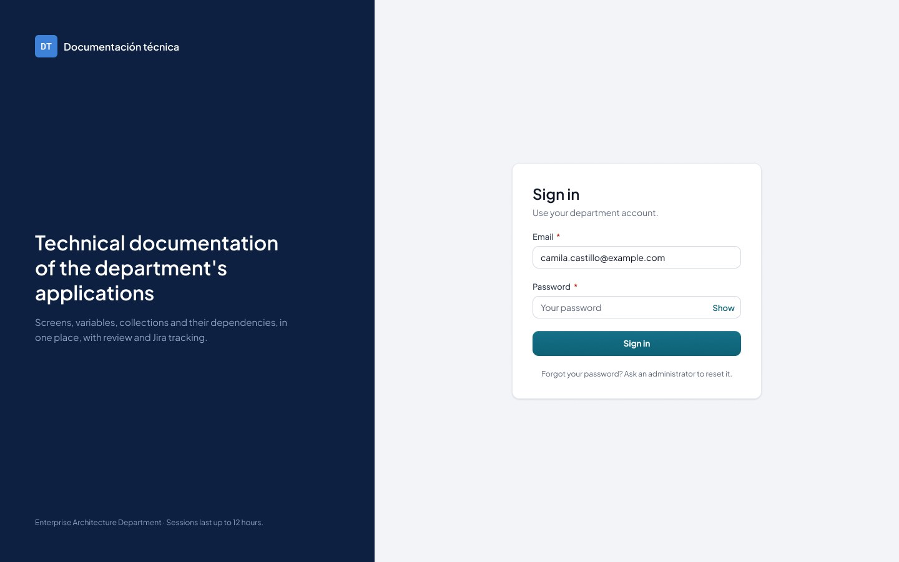

*Note.* POST /auth/login.

Lists share one pattern: page header with the main action, filter bar, sortable columns, and pagination of 20, 50, or 100 rows (Figure 10). Creating a screen, a variable, or a collection opens a modal over its list (Figures 11 to 13) that asks only for what identifies the element and, for variables and collections, its environments. The rest is completed in the detail or in the edit page (S-12b, S-16, S-20 to S-22), which keep the complete forms (D-57). The request is still the complete POST of Tables 48 to 50, with empty template fields and link lists, so the contract does not change. A screen created this way starts as Undocumented and becomes Draft when the first template field is saved (Table 61).

**Figure 10**

*Screen List (S-18)*

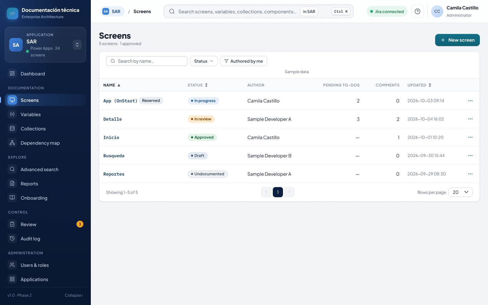

*Note.* GET /screens. App (OnStart) is always first, with the Reserved tag.

**Figure 11**

*New Screen Dialog (P-03)*

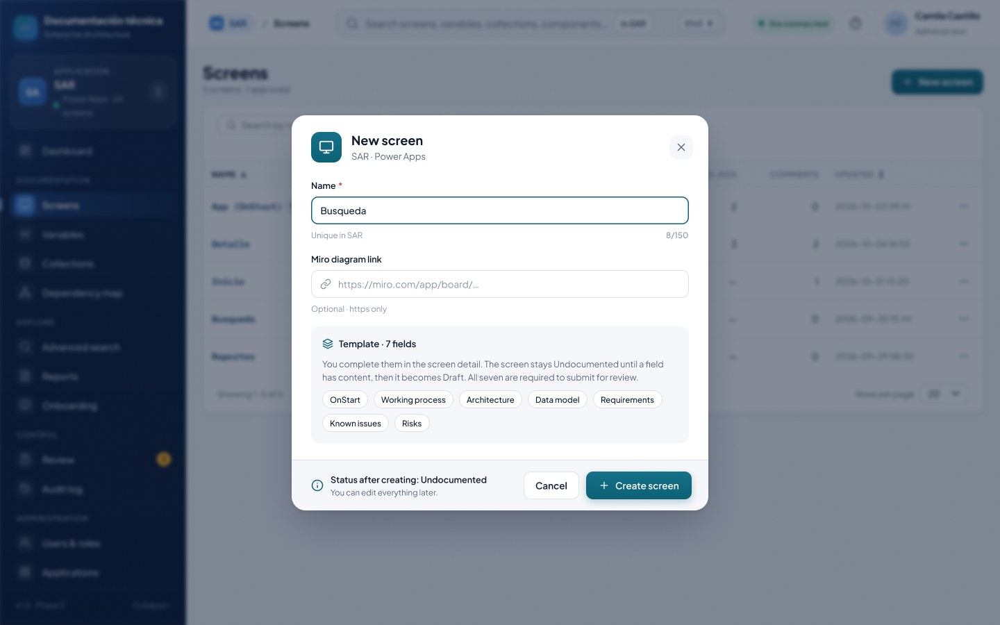

*Note.* POST /screens with name and Miro link. The seven template fields are completed in the screen detail.

**Figure 12**

*New Variable Dialog (S-12a)*

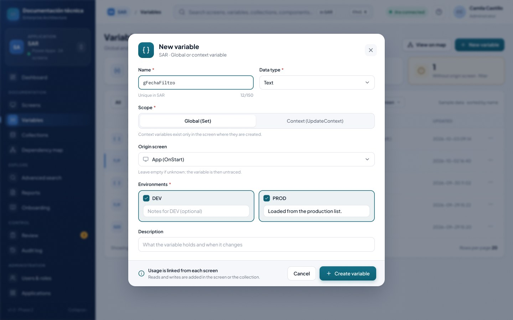

*Note.* POST /variables. Scope, origin screen, and environments follow FR-05 and FR-07. A context variable cannot use App (OnStart) as its origin.

**Figure 13**

*New Collection Dialog (S-14n)*

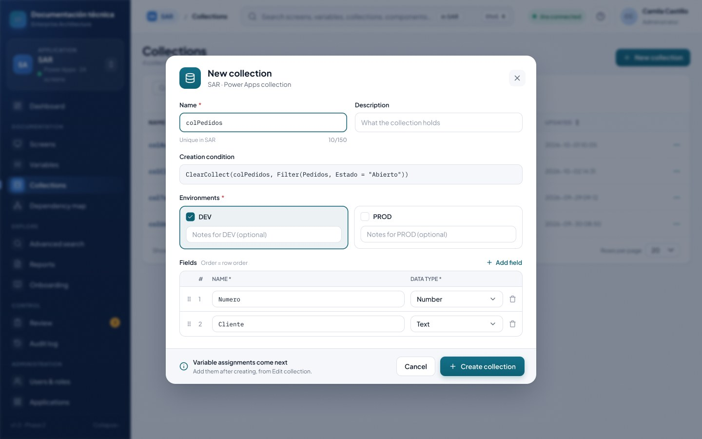

*Note.* POST /collections with fields. Variable assignments are added afterwards in S-16, where the context-screen rule is applied (D-52).

The screen detail is the center of the system (Figure 14). Its tabs follow the template of SRS Table 28: Template, Components & navigation, Variables & collections, Future to do, and Comments. The header shows only the workflow actions allowed in the current status (Table 61), and in review Edit is disabled with the reason. Future to do shows the screen's Epic, its Stories, and their Subtasks in Jira (Figure 15). If Jira does not answer, the tab shows the saved copy marked as stale and the rest of the screen keeps working (NFR-14).

**Figure 14**

*Screen Detail, Template Tab (S-19, Developer)*

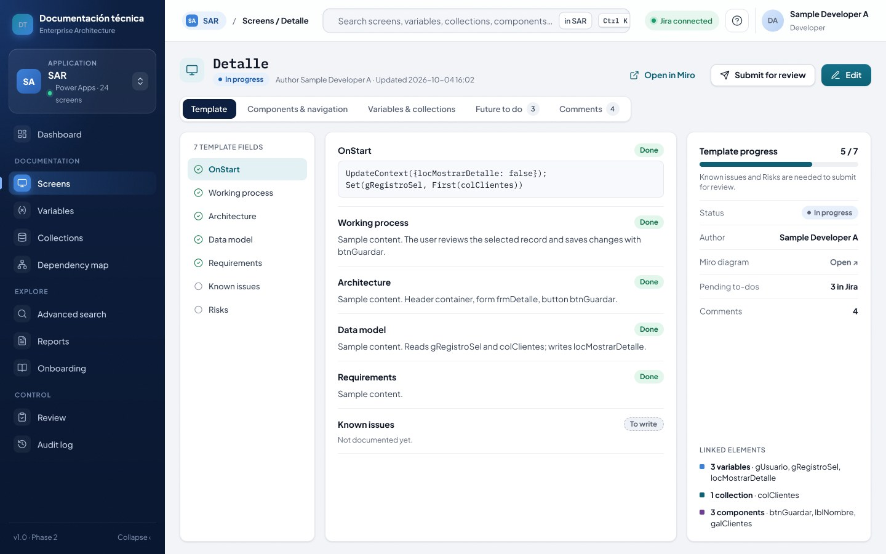

*Note.* GET /screens/:id. Template progress 5 of 7.

**Figure 15**

*Future To Do as Jira Subtasks (S-23)*

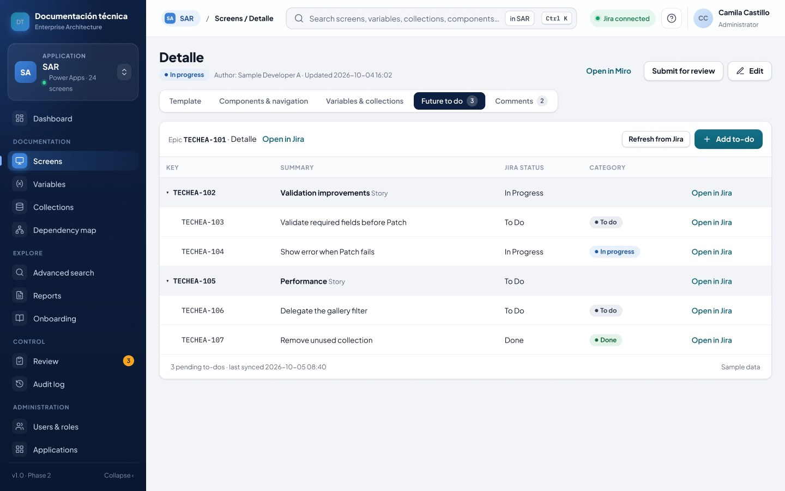

*Note.* GET /screens/:id/jira-tickets. Add to-do calls POST /screens/:id/jira-ticket (FR-12).

The dependency map draws the graph of the application with one shape per element type and one line style per relationship (Figure 16). Selecting a node opens a side panel with its connections and links to its page and to its Miro diagram (FR-16). The advanced search combines text with filters, or uses filters alone (Figure 17).

**Figure 16**

*Dependency Map (S-27)*

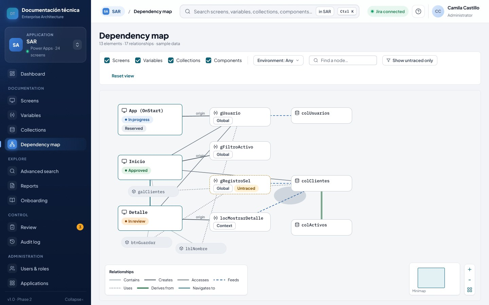

*Note.* GET /dependencies/graph rendered with React Flow. Untraced variables have a dashed border.

**Figure 17**

*Advanced Search with Text and Filters (S-29)*

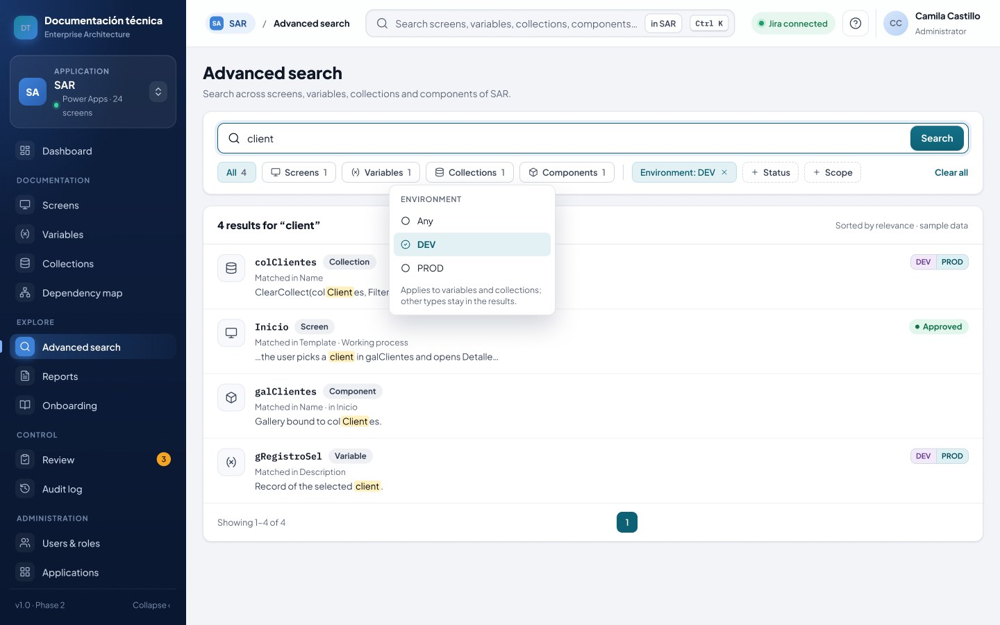

*Note.* GET /search. The environment filter restricts variables and collections and leaves the other types unfiltered (D-48).

Reports are generated in the background from a modal (Figure 18). The list shows them as pending and notifies when they are ready (NFR-12). Comments are a thread in each screen, where review decisions appear as distinct entries that cannot be edited (Figure 19), and the Administrator returns a screen only with a comment (Figure 20). The onboarding guides a new developer through the application in five steps (Figure 21).

**Figure 18**

*Generate Report Dialog (S-34)*

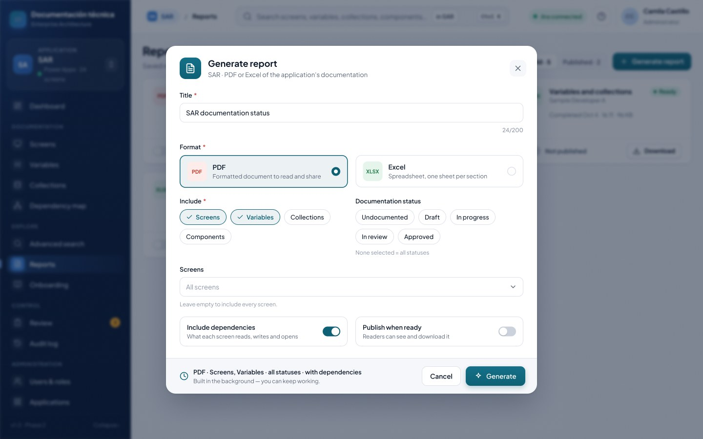

*Note.* POST /reports/pdf or /reports/excel returns 202.

**Figure 19**

*Comments of a Screen with a Review Comment (S-35)*

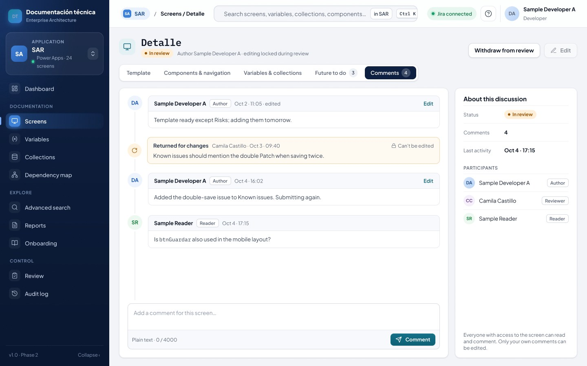

*Note.* GET and POST /screens/:id/comments. The “Returned for changes” entry is a review comment (D-56).

**Figure 20**

*Return for Changes (S-37b)*

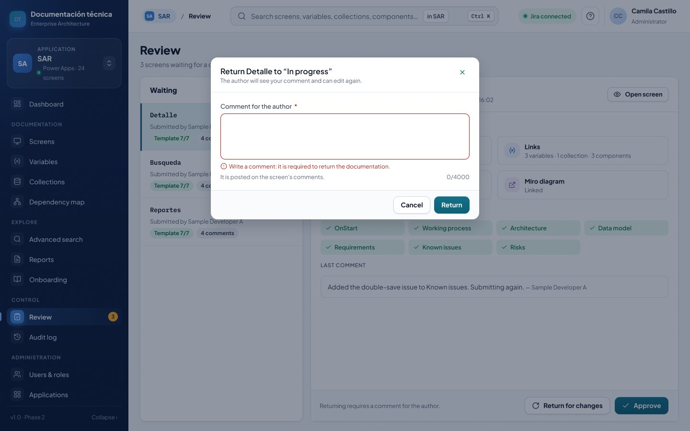

*Note.* POST /screens/:id/review with decision RETURN. The comment is required (FR-24).

**Figure 21**

*Technical Onboarding, Step 1 (S-38a)*

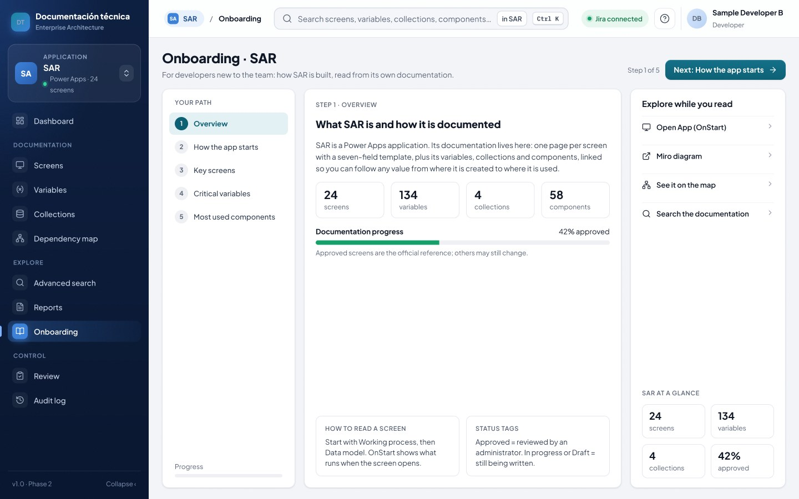

*Note.* GET /onboarding/summary (FR-25).

### *7.3.4 Views by Role*

Where a role changes what a screen shows, the prototype has a frame for that role (Table 56). The interface hides what the role cannot do and disables, with a tooltip, what the role may do but the current state prevents, such as editing a screen in review. This is only for usability: the API enforces every permission regardless (NFR-03, D-39). Figures 22 and 23 show the Reader's dashboard and the page shown when a role opens a route it does not have.

**Table 56**

*Views by Role*

| **Element**                     | **Administrator**                                                      | **Developer**                                  | **Reader**                                        |
|---------------------------------|------------------------------------------------------------------------|------------------------------------------------|---------------------------------------------------|
| Sidebar                         | 12 items, including Review, Audit log, Users & roles, and Applications | 10 items (no administration)                   | 8 items (no Review, Audit log, or administration) |
| Variables, collections, screens | Create, edit, delete                                                   | Same                                           | Read only (S-10r, S-19r)                          |
| Documentation workflow          | Every transition, approve and return in review                         | Submit, withdraw, reopen, no decision          | None                                              |
| Future to do (Jira)             | Add to-do, refresh                                                     | Same                                           | Query only                                        |
| Comments                        | Comment, edit own, except review comments                              | Same                                           | Same                                              |
| Dashboard                       | All indicators and recent activity                                     | Same                                           | Overview without recent activity (S-31r)          |
| Audit log                       | All records                                                            | Own actions only, filter locked (S-32d)        | Hidden, direct route shows No access (S-41b)      |
| Reports                         | Generate, publish, download                                            | Same                                           | Published reports only (S-33r)                    |
| Users and applications          | Full management                                                        | Hidden, applications only through the selector | Same as Developer                                 |
| Archived application            | Read only, with Unarchive                                              | Read only                                      | Read only                                         |

*Note.* Follows SRS Table 26 and the authorization matrix (Table 67).

**Figure 22**

*Dashboard, Reader View (S-31r)*

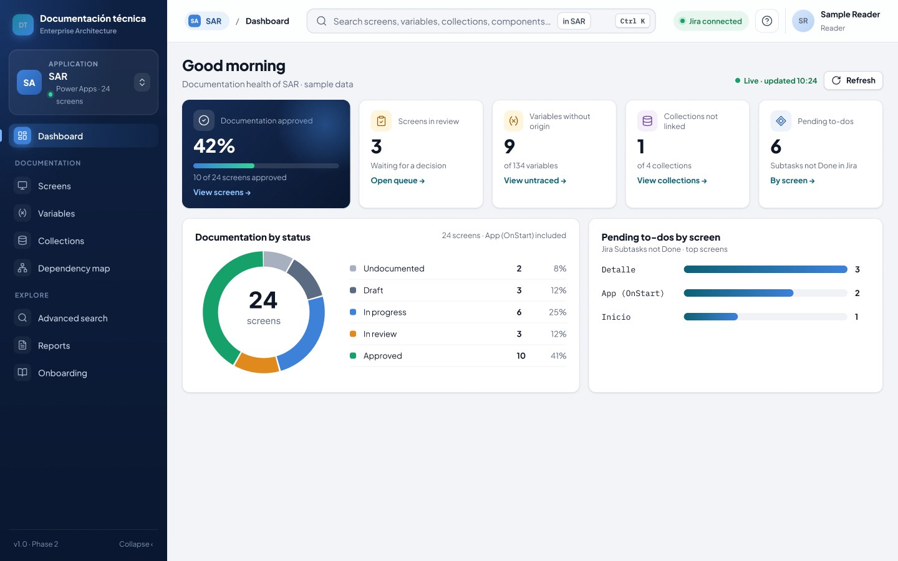

*Note.* The Reader receives the indicators without recent activity (D-34) and a sidebar without Review, Audit log, or administration.

**Figure 23**

*No Access Page (S-41b)*

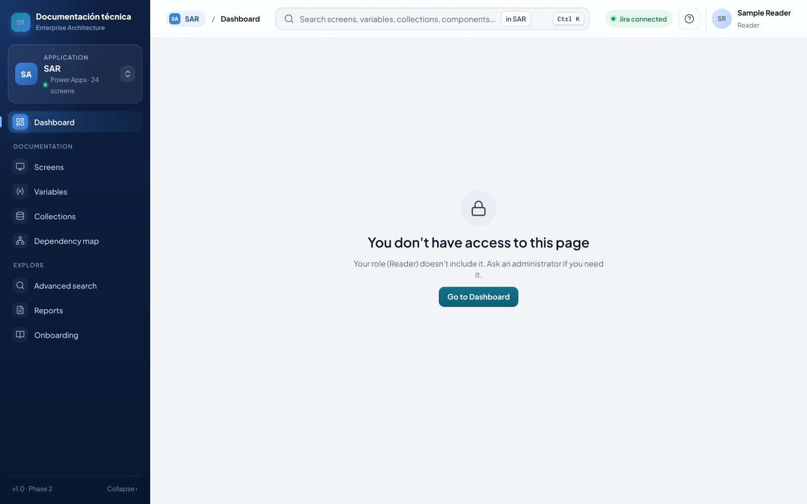

*Note.* Shown when a role opens a route it does not have. The API answers 403.

### *7.3.5 Navigation Flows*

The flows of Table 57 connect the main tasks of the department, including their error paths, and are the material of the validation session. Each one can be started from the presentation view of the Figma file.

**Table 57**

*Navigation Flows of the Prototype*

| **Flow (Start)**                         | **Path**                                                                                                                                       | **Req.**       |
|------------------------------------------|------------------------------------------------------------------------------------------------------------------------------------------------|----------------|
| 1 Sign in (S-01a)                        | Sign in → invalid credentials (S-01b) → field errors and too many attempts (S-01c) → Dashboard (S-31)                                          | FR-01, NFR-08  |
| 2 Screen and Jira ticket (S-18)          | Screens → New screen (P-03) → detail (S-19) → Future to do (S-23) → Add to-do (S-24a) → TECHEA-109 created (P-04)                              | FR-10, FR-12   |
| 3a Submit for review, Developer (S-19)   | Detail → Submit for review → template incomplete (S-25a) → save → In review, editing locked (P-01) → Comments (S-35)                           | FR-14, FR-24   |
| 3b Review decision, Administrator (S-36) | Review queue → Return (S-37b) → comment in the thread (S-35), or Approve (S-37c) → Approved (P-02)                                             | FR-24          |
| 4 Search (S-27)                          | Map → node selected (S-27b) → screen, quick search (S-30) → results (S-29) → filters only (S-29b) → variable (S-11) → focus on the node (S-28) | FR-15 to FR-18 |
| 5 Reports (S-31)                         | Dashboard → Generate report (S-34) → generating (P-05, advances after 3 seconds) → ready (S-33) → published (P-06)                             | FR-22, NFR-12  |
| 6 Reader view (S-31r)                    | Reader dashboard and sidebar: variables (S-10r), screen (S-19r), reports (S-33r), No access (S-41b)                                            | SRS Table 26   |
| 6b Developer view (S-31j)                | Developer dashboard with Jira unavailable, own audit records (S-32d)                                                                           | NFR-14, FR-21  |
| 7 States (S-39a)                         | Loading, empty, error, validation, session, and concurrent-change frames                                                                       | NFR-07, NFR-08 |

### *7.3.6 States and Messages*

Every screen uses the same patterns for loading, empty results, errors, and conflicts, built from the feedback components of the design system (Table 58), and every message comes from one catalog keyed by the error code of Table 45 (Table 59). Messages state what happened and what to do next (NFR-08).

**Table 58**

*States and Feedback Patterns*

| **Pattern**          | **Frames**          | **Behavior**                                                                                                              |
|----------------------|---------------------|---------------------------------------------------------------------------------------------------------------------------|
| Loading              | S-39a–b             | Skeletons with the shape of the content, shown only after 300 ms. Buttons that call the API show their own loading state. |
| Empty                | S-40a–c             | Icon, title, one sentence of help and, when the role can act, one action. “No results” offers to clear the filters.       |
| Page errors          | S-41a–c             | Not found, no access, and server error, with a way back. A failing block shows its error without breaking the page.       |
| Form validation      | S-42                | Errors under each field. Long forms summarize them at the top with links to each field.                                   |
| Session              | S-43a–b             | Warning 10 minutes before the 12-hour limit, a modal to sign in again, which returns to the same page.                    |
| Concurrent change    | S-44                | 412: the form keeps the user's edits and offers to reload the other person's version.                                     |
| Jira unavailable     | S-23b, S-24c, S-31j | Only Jira-dependent parts change: saved copy marked as stale, Add to-do disabled, no global alarm (NFR-14).               |
| Offline and archived | S-46, S-09b         | Banner under the top bar. Saving is disabled with the reason.                                                             |

**Table 59**

*Message Catalog*

| **Code**                | **HTTP** | **Message**                                                                                                            |
|-------------------------|----------|------------------------------------------------------------------------------------------------------------------------|
| VALIDATION_ERROR        | 400      | “Check the highlighted fields.” plus one message per field                                                             |
| INVALID_CREDENTIALS     | 401      | “The email or password is incorrect.”                                                                                  |
| REFRESH_INVALID         | 401      | “Your session ended. Sign in again to continue.”                                                                       |
| FORBIDDEN               | 403      | “Your role doesn't allow this action.”                                                                                 |
| NOT_FOUND               | 404      | “This \<element\> doesn't exist. It may have been deleted.”                                                            |
| DUPLICATE_NAME          | 409      | “A \<type\> named \<name\> already exists in \<application\>.”                                                         |
| EMAIL_TAKEN             | 409      | “A user with this email already exists.”                                                                               |
| PRECONDITION_FAILED     | 412      | “Someone else saved changes to this \<element\> after you opened it. Reload to see their version.”                     |
| PAYLOAD_TOO_LARGE       | 413      | “This is too much text to save at once. Shorten the longest fields and try again.”                                     |
| SCOPE_MISMATCH          | 422      | “Set applies to global variables and UpdateContext to context variables.”                                              |
| SCOPE_CONFLICT          | 422      | “You can't change the scope while collections assign this variable with \<function\>. Update those assignments first.” |
| CROSS_APPLICATION       | 422      | “You can only link elements of the same application.”                                                                  |
| INVALID_ORIGIN_SCREEN   | 422      | “Context variables are created inside a screen, not in App (OnStart).”                                                 |
| CONTEXT_SCREEN_MISMATCH | 422      | “\<variable\> belongs to \<screen\>. From here you can only write it with Navigate.”                                   |
| LAST_ACTIVE_ADMIN       | 422      | “There must be at least one active administrator. Promote another user first.”                                         |
| CANNOT_DEACTIVATE_SELF  | 422      | “You can't deactivate your own account.”                                                                               |
| RESERVED_ACCOUNT        | 422      | “This is a system account and can't be changed.”                                                                       |
| APPLICATION_ARCHIVED    | 422      | “This application is archived, so its documentation can't be changed.”                                                 |
| REPORT_NOT_READY        | 409      | “Only ready reports can be published or downloaded.”                                                                   |
| INVALID_TRANSITION      | 422      | “This screen changed status meanwhile. Reload to see its current status.”                                              |
| NOT_IN_REVIEW           | 422      | “This screen is no longer in review. Reload to see its status.”                                                        |
| SCREEN_IN_REVIEW        | 422      | “This screen is in review. Edit it after the review, or withdraw it from review.”                                      |
| TEMPLATE_INCOMPLETE     | 422      | “Complete all seven template fields to submit for review. Missing: \<fields\>.”                                        |
| COMMENT_REQUIRED        | 422      | “Write a comment: it is required to return the documentation.”                                                         |
| REVIEW_COMMENT_LOCKED   | 422      | “Review decisions can't be edited.”                                                                                    |
| APP_CONTEXT_PROTECTED   | 422      | “The App (OnStart) screen can't be deleted.”                                                                           |
| STORY_NOT_IN_SCREEN     | 422      | “That story doesn't belong to this screen. Refresh the list and pick again.”                                           |
| JIRA_UNAVAILABLE        | 502      | “Jira isn't responding. The to-do wasn't created. Try again in a few minutes.”                                         |
| JIRA_PARTIAL_FAILURE    | 502      | “The story \<key\> was created, but the to-do wasn't. Try again to add it to that story.”                              |
| RATE_LIMITED            | 429      | “Too many attempts. Try again in \<n\> minutes.”                                                                       |
| INTERNAL_ERROR          | 500      | “Something went wrong on our side. Try again in a moment. Reference: \<requestId\>.”                                   |

*Note.* UNAUTHENTICATED and TOKEN_EXPIRED trigger a silent token refresh, and INVALID_SIGNATURE is answered only to Jira, so none of them is shown. \<name\> and similar values are filled from details or from the page. Success messages follow one pattern: past tense, the object named, and an action when useful, for example “TECHEA-108 created. Open in Jira”.

### *7.3.7 Compatibility and Responsiveness*

NFR-18 and NFR-19 constrain the design and are verified during testing. The interface uses only standard web features supported by the current versions of Google Chrome and Microsoft Edge, the browsers named by NFR-18, and no action depends on hovering alone. The prototype is drawn at 1440 × 900. The UI Specification defines how each layout adapts to smaller desktop screens (for example, the sign-in panel collapses below 1280 px and the dashboard cards take half the width below 1440 px), and long pages scroll inside the fixed shell. Visual consistency (NFR-07) was reviewed against the design system on October 5, 2026. Six inconsistencies were found and corrected in the import files.

# 8. Interaction Viewpoint

This viewpoint shows the four interactions in which timing, failures, or several participants matter. The audited write, the fifth, is in Section 6.5. Each sequence has a figure. The decisions behind them are D-31, D-38, D-44, and D-45.

## 

## 

## 8.1 Creating a Jira Ticket from "Future To Do"

Figure 24 follows the hierarchy confirmed by the department: the screen's Epic is created the first time a ticket is needed, the Story is chosen or created by the user, and the item becomes a Subtask. Every issue is stored locally as soon as Jira confirms it, which is what makes a retry after a partial failure safe.

**Figure 24**

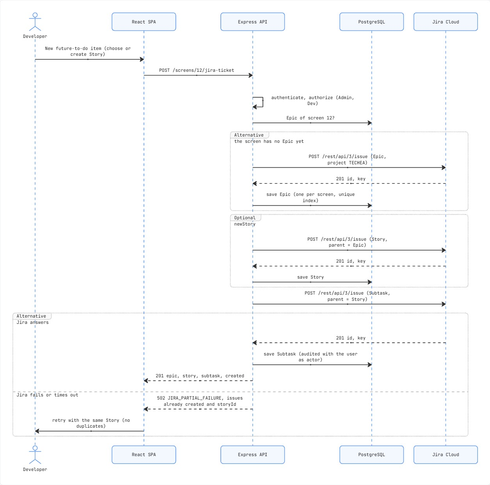*Sequence: Creating a Jira Ticket*

*Note.* Rendered from the Mermaid source in 05_diagramas/, the same source loaded in Miro.

[View the live, editable diagram on Miro →](https://miro.com/app/board/uXjVHm4trbw=/?moveToWidget=3458764685852863901)

## 8.2 Status Update from Jira

**Figure 25**

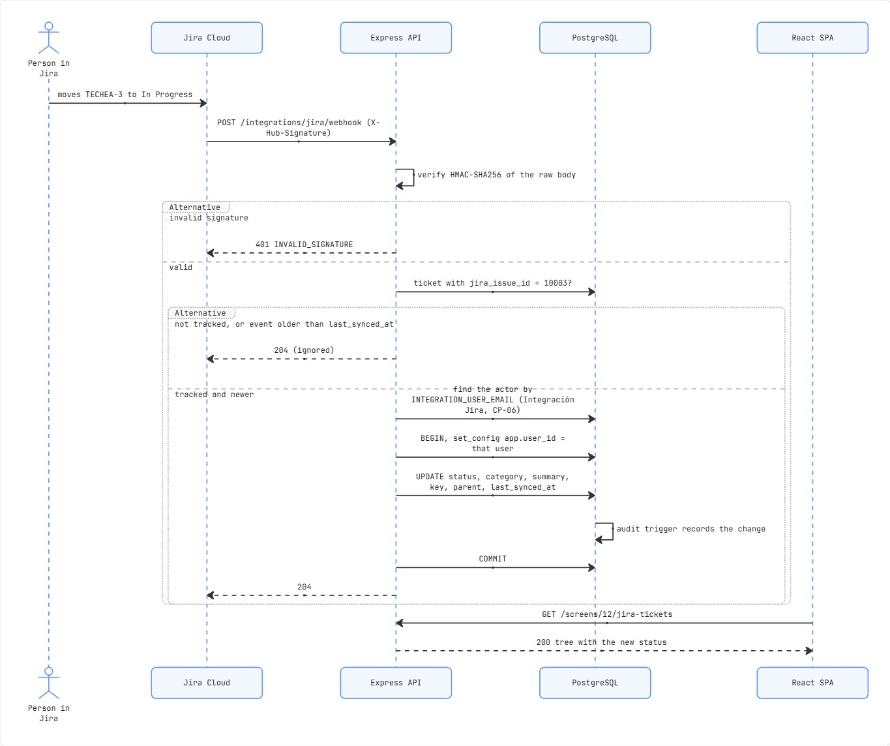*Sequence: Ticket Status Received Through the Webhook*

*Note.* Rendered from the Mermaid source in 05_diagramas/, the same source loaded in Miro.

[View the live, editable diagram on Miro →](https://miro.com/app/board/uXjVHm4trbw=/?moveToWidget=3458764685852863902)

The Jira client isolates the rest of the system from Jira's availability (Table 60). Creating issues is not retried automatically, because a retry after a timeout could duplicate an issue that Jira did create. Reads are retried. After repeated failures the client stops calling Jira for a minute and reports jiraAvailable = false, so screens and dashboards answer immediately with the local copy instead of waiting for timeouts (NFR-14).

**Table 60**

*Resilience of the Jira Client*

| **Mechanism**   | **Behavior**                                                                                                                                |
|-----------------|---------------------------------------------------------------------------------------------------------------------------------------------|
| Timeout         | 10 s per call. The request then fails with 502 JIRA_UNAVAILABLE (or JIRA_PARTIAL_FAILURE).                                                  |
| Retries         | Reads (JQL search): up to 2 retries with exponential backoff. Issue creation: none (not idempotent).                                        |
| Circuit breaker | After 5 consecutive failures, open for 60 s: calls fail at once and jiraAvailable = false. Then one trial call decides whether to close it. |
| Degraded reads  | Ticket lists and the dashboard use the local copy, marked stale, with lastSyncedAt (NFR-14).                                                |

*Note.* Thresholds are configuration values, adjustable after performance testing.

## 8.3 Session: Login, Refresh, and Logout

**Figure 26**

*Sequence: Login, Refresh, and Logout*

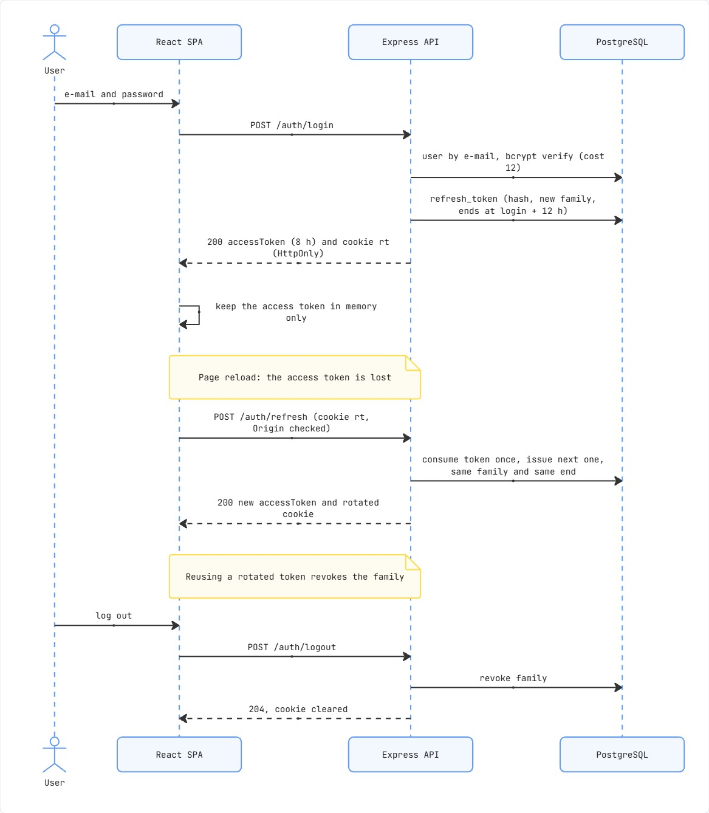

*Note.* Rendered from the Mermaid source in 05_diagramas/, the same source loaded in Miro.

[View the live, editable diagram on Miro →](https://miro.com/app/board/uXjVHm4trbw=/?moveToWidget=3458764685852863903)

## 

## 8.4 Asynchronous Report Generation

Reports are generated outside the request (NFR-12, Figure 27). The report table itself is the work queue: a worker inside the API process takes the next PENDING report with SELECT … FOR UPDATE SKIP LOCKED, which lets several API instances share the work without taking the same report twice, and no additional infrastructure such as a message broker is needed while the deployment environment is undefined (D-44).

**Figure 27**

*Sequence: Asynchronous Report*

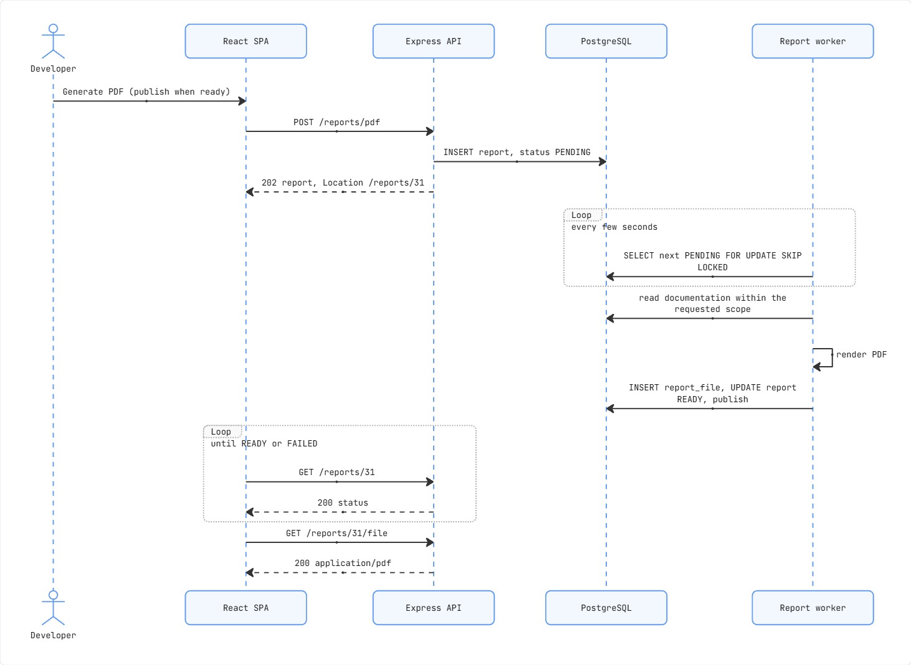

*Note.* Rendered from the Mermaid source in 05_diagramas/, the same source loaded in Miro.

[View the live, editable diagram on Miro →](https://miro.com/app/board/uXjVHm4trbw=/?moveToWidget=3458764685852863904)

# 9. State Dynamics Viewpoint

Figure 28 shows the documentation workflow of a screen (FR-14, FR-24) and Table 61 lists every allowed transition. The rules confirmed by the department are that moving back is allowed, that editing an approved screen returns it to IN_PROGRESS, and that the App (OnStart) screen follows the same workflow. APPROVED can only be reached through the Administrator's review, so the separation between PUT /screens/:id/status and POST /screens/:id/review in SRS Table 25 becomes a separation of permissions. The transitions are enforced in the service layer, which knows the caller's role and whether a comment was given. Each one is recorded by the audit trigger, and approvals and returns also as business events (D-30).

**Figure 28**

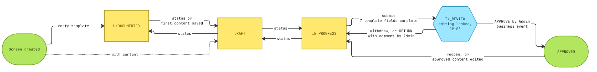*Documentation Workflow of a Screen*

*Note.* State diagram. Solid arrows: transitions. Dashed arrow: a screen created with template content starts in DRAFT.

[View the live, editable diagram on Miro →](https://miro.com/app/board/uXjVHm4trbw=/?moveToWidget=3458764685833212049)

**Table 61**

*Allowed Transitions of the Documentation Status*

| **From**     | **To**       | **Trigger**                                  | **Roles**  | **Condition**                      |
|--------------|--------------|----------------------------------------------|------------|------------------------------------|
| UNDOCUMENTED | DRAFT        | /status, or first content saved              | Admin, Dev | —                                  |
| DRAFT        | UNDOCUMENTED | /status                                      | Admin, Dev | —                                  |
| DRAFT        | IN_PROGRESS  | /status                                      | Admin, Dev | —                                  |
| IN_PROGRESS  | DRAFT        | /status                                      | Admin, Dev | —                                  |
| IN_PROGRESS  | IN_REVIEW    | /status (submit)                             | Admin, Dev | Seven template fields with content |
| IN_REVIEW    | IN_PROGRESS  | /status (withdraw)                           | Admin, Dev | —                                  |
| IN_REVIEW    | IN_PROGRESS  | /review RETURN                               | Admin      | Comment required                   |
| IN_REVIEW    | APPROVED     | /review APPROVE                              | Admin      | —                                  |
| APPROVED     | IN_PROGRESS  | /status (reopen), or approved content edited | Admin, Dev | —                                  |

*Note.* Any other combination returns 422 INVALID_TRANSITION (or NOT_IN_REVIEW for a review). Single source of truth in code: documentationWorkflow.ts, verified by tests W01–W15. W14 and W15 verify CP-08 (a screen IN_REVIEW cannot be edited until it is withdrawn from review). A screen IN_REVIEW cannot be edited: PUT /screens/:id returns 422 SCREEN_IN_REVIEW until the review ends or the screen is withdrawn (D-53). It is a rule on the edit, not a transition, so the diagram keeps its states and transitions.

**Table 62**

*Other Stateful Entities*

| **Entity**  | **States**                                                     | **Transitions**                                                                                                                                        |
|-------------|----------------------------------------------------------------|--------------------------------------------------------------------------------------------------------------------------------------------------------|
| report      | PENDING → READY \| FAILED, is_published                        | Created PENDING by POST, the background job sets READY (file stored) or FAILED (error message). Only READY can be published or downloaded.             |
| jira_ticket | Status mirrored from Jira, category TO_DO / IN_PROGRESS / DONE | The system never changes a ticket's status: Jira owns the workflow, and the webhook copies it (Section 7.2.8).                                         |
| app_user    | ACTIVE ↔ INACTIVE                                              | DELETE deactivates and revokes sessions. PUT can reactivate. The last active administrator cannot be deactivated.                                      |
| application | ACTIVE ↔ ARCHIVED                                              | Changed by PUT. An archived application's documentation is read-only for every role until it is unarchived, and reports can still be generated (D-47). |

# 10. Algorithm Viewpoint

Two algorithms are central to the system and are specified here: the assembly of the dependency graph (FR-15), and the capture of the audit (FR-20), whose mechanism was described in Section 6.5. Both run inside PostgreSQL, close to the data, and both were executed against the migrated database.

## 

## 10.1 Dependency Graph Assembly

The graph is not stored: it is computed on each request from the data that already exists, following the approved principle that nothing is recorded twice. One SQL query (03_backend/src/modules/dependencies/graph.sql) builds the nodes and the edges of an application and returns them as one JSON document in the { nodes, edges } shape of the contract, which React Flow consumes directly. Table 63 lists its parts.

**Table 63**

*Parts of the Dependency-Graph Query*

| **Part**                         | **Source**                              | **Rule**                                                                                                                            |
|----------------------------------|-----------------------------------------|-------------------------------------------------------------------------------------------------------------------------------------|
| Nodes                            | screen, variable, collection, component | Only rows of the requested application, key type:id (for example screen:12), variables carry untraced when they have no origin.     |
| CONTAINS                         | component.screen_id                     | Screen → component.                                                                                                                 |
| CREATES                          | variable.origin_screen_id               | Origin screen → variable.                                                                                                           |
| ACCESSES                         | screen_variable, screen_collection      | Screen → variable or collection, with access mode and usedIn. The origin rows are excluded because CREATES already represents them. |
| FEEDS                            | variable_collection                     | Collection → variable, with assignment function, table function, and usedIn.                                                        |
| USES, DERIVES_FROM, NAVIGATES_TO | dependency                              | What the associative entities cannot express (Section 6.4.1).                                                                       |

*Note.* Every part filters by application, so a graph never mixes applications (NFR-16). The neighborhood endpoint (GET /dependencies/:type/:id) applies the same query and then keeps the nodes reachable from the requested one within depth steps (at most 3), traversing edges in both directions.

The query was verified with two applications and a known data set (test 09_dependency_graph_tests.sql): it returned exactly the expected 9 nodes and 11 edges per kind, no origin row duplicated as ACCESSES, every edge pointing to nodes of the same graph, and no element of the other application (7 of 7 checks passed). Every join uses a primary key or one of the indexes of Section 6.6, so at department scale (hundreds of nodes, NFR-11) the cost is a few index lookups per edge kind.

## 10.2 Audit Capture

For each inserted, updated, or deleted row of an audited table, audit_row_change() performs these steps: (1) read OLD and NEW as JSON, (2) for an UPDATE, compute the list of changed columns, ignoring updated_at, and stop if it is empty, so no-op updates leave no record, (3) read the acting user from app.user_id, accepting only an integer, (4) determine the application of the row, directly or through documented_element, (5) remove the redacted columns (password_hash) from the stored values, keeping their names in changed_fields, and (6) insert one row into audit_log. Because the function runs as SECURITY DEFINER with a fixed search_path, it can write to a table that the API role can only read. The 24 SQL tests and 11 end-to-end tests of Section 6.5 verify each step.

# 11. Security Viewpoint

This user-defined viewpoint addresses the security concerns of NFR-01 to NFR-06 and NFR-20: who can use the system, what each role can do, how sessions are protected, and where secrets live. Everything specified here was implemented as reference code and verified against the migrated database, connected with the API role docs_app (Table 69).

## 11.1 Threats and Controls

**Table 64**

*Threats Considered and Their Controls*

| **Threat**                 | **Control**                                                                                                                                                                                | **Req.**       |
|----------------------------|--------------------------------------------------------------------------------------------------------------------------------------------------------------------------------------------|----------------|
| Password guessing          | bcrypt cost 12 (≈0.34 s per attempt). Login limited to 5 failures per IP and e-mail every 15 minutes (429).                                                                                | NFR-02, NFR-05 |
| Account enumeration        | Same 401 for unknown e-mail, wrong password, and inactive account. The bcrypt check runs even when the e-mail does not exist, so timing does not reveal it.                                | NFR-05         |
| Stolen access token (XSS)  | Short-lived (8 h) token kept only in frontend memory, never in localStorage. React escapes output by default. Strict Content-Security-Policy via Helmet.                                   | NFR-01, NFR-05 |
| Stolen refresh token       | HttpOnly cookie unreadable by JavaScript, stored server-side only as a SHA-256 hash, rotated on every use, reuse of a rotated token revokes the whole family.                              | NFR-01         |
| Cross-site request forgery | API calls authenticate with an Authorization header, which a foreign site cannot send. The two cookie endpoints (refresh, logout) require SameSite=Strict and the frontend's exact Origin. | NFR-05         |
| Forged or tampered token   | Only HS256 accepted (no "none", no algorithm switching). Issuer, audience, expiry, and key id validated.                                                                                   | NFR-01         |
| Privilege escalation       | Role checked on every endpoint from the contract (fail closed). Role and status read from the database on each request, so a role change or deactivation applies at once.                  | NFR-03         |
| SQL injection              | Prisma parameterized queries. Raw SQL only through tagged templates (parameterized).                                                                                                       | NFR-05         |
| Forged Jira notifications  | HMAC-SHA256 signature verified on the raw body before parsing (Section 7.2.8).                                                                                                             | NFR-06         |
| Eavesdropping              | HTTPS only (HSTS), cookies marked Secure, Jira API over HTTPS.                                                                                                                             | NFR-04         |
| Tampering with the audit   | Database triggers, API role without write access to audit_log, append-only trigger (Section 6.5).                                                                                          | NFR-20         |

## 11.2 Authentication

A successful login returns two credentials with different purposes (Table 65). The access token authorizes API calls for 8 hours (NFR-01, configurable). The frontend keeps it in memory only. The refresh token renews the session without asking for the password again. It travels in a cookie that JavaScript cannot read and that the browser sends only to /api/v1/auth. When the page is reloaded, the frontend calls POST /auth/refresh to obtain a new access token.

**Table 65**

*Session Credentials*

| **Property**   | **Access Token**                                                                                  | **Refresh Token**                                                                                                 |
|----------------|---------------------------------------------------------------------------------------------------|-------------------------------------------------------------------------------------------------------------------|
| Format         | JWT signed with HS256, header kid                                                                 | Opaque, 256 random bits (base64url)                                                                               |
| Contents       | sub (user id), iat, exp, iss, aud, jti. No role: authorization reads it from the database (D-25). | None (random)                                                                                                     |
| Lifetime       | 8 hours (JWT_ACCESS_TTL_SECONDS)                                                                  | Until the session ends: 12 hours after login, fixed at login and never extended by rotation (SESSION_MAX_SECONDS) |
| Client storage | JavaScript memory only                                                                            | Cookie rt: HttpOnly, Secure, SameSite=Strict, Path=/api/v1/auth, expires with the session                         |
| Server storage | None (stateless signature)                                                                        | refresh_token: SHA-256 hash, family, expiry, revocation                                                           |
| Sent with      | Authorization: Bearer on every API call                                                           | POST /auth/refresh and /auth/logout only                                                                          |
| Ends when      | It expires. Ignored at once if the user is deactivated                                            | Rotated, logout, reuse detected, role or password change, deactivation                                            |

*Note.* HS256 is sufficient because the same service issues and verifies the tokens. Keys of at least 256 bits are read from JWT_KEYS, and several can coexist by kid so a key can be rotated without closing sessions (D-36).

Refresh tokens rotate: each POST /auth/refresh consumes the presented token, with a conditional update so it can be used exactly once, and issues a new one in the same family that keeps the session's original end, so a session lasts at most one workday (12 hours) however often it is renewed, as confirmed by the department. If a token that was already rotated is presented again, someone else may hold a copy, so every token of that family is revoked and the user must log in again (D-38). Because two browser tabs refreshing at the same time would trigger this protection, the frontend performs at most one refresh at a time and shares the result between tabs (rule R-4, Bitácora 4).

## 11.3 Authorization

Authorization has two layers. The role gate runs in a middleware before any handler: it compares the caller's current role, read from the database, with the x-roles that the OpenAPI contract declares for the operation. The middleware is built from the contract when the server starts and refuses to start if any operation lacks x-roles, so a new endpoint cannot be published unprotected by omission (D-39). Rules that depend on the data are applied by the services and are declared in the contract as x-rule (Table 66). Table 67 lists the resulting permissions of the 50 operations. They reproduce SRS Table 26.

**Table 66**

*Data-Dependent Authorization Rules*

| **x-rule**            | **Meaning**                                                                                        | **Origin**                                 |
|-----------------------|----------------------------------------------------------------------------------------------------|--------------------------------------------|
| SELF_OR_ROLE          | A non-administrator may read only their own user.                                                  | Design                                     |
| AUTHOR_ONLY           | Only the author may edit a comment.                                                                | Design                                     |
| DEVELOPER_OWN_ACTIONS | A Developer sees only audit records where they are the actor. Asking for another user returns 403. | Table 26: "Partial (own actions)"          |
| READER_PUBLISHED_ONLY | A Reader sees only published reports. Others return 404.                                           | Table 26: "Already-published reports only" |
| READER_OVERVIEW       | A Reader receives the indicators without recent activity.                                          | Table 26: "Yes (overview)" (D-34)          |
| JIRA_SIGNATURE        | No user: the caller is Jira, authenticated by the webhook signature.                               | Section 7.2.8                              |

*Note.* "Configure Jira integration credentials" (SRS Table 26) has no endpoint: credentials are environment variables managed by the Administrator at deployment, as confirmed by the department (NFR-06).

**Table 67**

*Authorization Matrix by Operation (Generated from the Contract)*

| **Operation**                   | **Capability (SRS Table 26)**           | **Admin** | **Dev** | **Reader** |
|---------------------------------|-----------------------------------------|-----------|---------|------------|
| POST /auth/login                | Authentication (public)                 | —         | —       | —          |
| POST /auth/refresh              | Authentication (public)                 | —         | —       | —          |
| POST /auth/logout               | Authentication (public)                 | —         | —       | —          |
| GET /users                      | User management and role assignment     | Yes       | No      | No         |
| POST /users                     | User management and role assignment     | Yes       | No      | No         |
| GET /users/:id                  | User management and role assignment     | Yes       | Self    | Self       |
| PUT /users/:id                  | User management and role assignment     | Yes       | No      | No         |
| DELETE /users/:id               | User management and role assignment     | Yes       | No      | No         |
| PUT /users/:id/role             | User management and role assignment     | Yes       | No      | No         |
| GET /applications               | Manage applications                     | Yes       | Yes     | Yes        |
| POST /applications              | Manage applications                     | Yes       | No      | No         |
| GET /applications/:id           | Manage applications                     | Yes       | Yes     | Yes        |
| PUT /applications/:id           | Manage applications                     | Yes       | No      | No         |
| GET /variables                  | CRUD of variables and collections       | Yes       | Yes     | Yes        |
| POST /variables                 | CRUD of variables and collections       | Yes       | Yes     | No         |
| GET /variables/:id              | CRUD of variables and collections       | Yes       | Yes     | Yes        |
| PUT /variables/:id              | CRUD of variables and collections       | Yes       | Yes     | No         |
| DELETE /variables/:id           | CRUD of variables and collections       | Yes       | Yes     | No         |
| GET /variables/:id/dependencies | CRUD of variables and collections       | Yes       | Yes     | Yes        |
| GET /collections                | CRUD of variables and collections       | Yes       | Yes     | Yes        |
| POST /collections               | CRUD of variables and collections       | Yes       | Yes     | No         |
| GET /collections/:id            | CRUD of variables and collections       | Yes       | Yes     | Yes        |
| PUT /collections/:id            | CRUD of variables and collections       | Yes       | Yes     | No         |
| DELETE /collections/:id         | CRUD of variables and collections       | Yes       | Yes     | No         |
| GET /collections/:id/fields     | CRUD of variables and collections       | Yes       | Yes     | Yes        |
| GET /screens                    | Create and edit screens (template)      | Yes       | Yes     | Yes        |
| POST /screens                   | Create and edit screens (template)      | Yes       | Yes     | No         |
| GET /screens/:id                | Create and edit screens (template)      | Yes       | Yes     | Yes        |
| PUT /screens/:id                | Create and edit screens (template)      | Yes       | Yes     | No         |
| DELETE /screens/:id             | Create and edit screens (template)      | Yes       | Yes     | No         |
| PUT /screens/:id/status         | Create and edit screens (template)      | Yes       | Yes     | No         |
| POST /screens/:id/jira-ticket   | Create and query Jira tickets           | Yes       | Yes     | No         |
| GET /screens/:id/jira-tickets   | Create and query Jira tickets           | Yes       | Yes     | Yes        |
| GET /screens/:id/comments       | Comment on screens                      | Yes       | Yes     | Yes        |
| POST /screens/:id/comments      | Comment on screens                      | Yes       | Yes     | Yes        |
| PUT /comments/:id               | Comment on screens                      | Author    | Author  | Author     |
| POST /screens/:id/review        | Approve documentation (review workflow) | Yes       | No      | No         |
| GET /dependencies/graph         | View dependency map                     | Yes       | Yes     | Yes        |
| GET /dependencies/:type/:id     | View dependency map                     | Yes       | Yes     | Yes        |
| GET /search                     | Advanced search                         | Yes       | Yes     | Yes        |
| GET /dashboard/indicators       | Indicator dashboard                     | Yes       | Yes     | Yes\*      |
| GET /audit-log                  | Query audit history                     | Yes       | Own     | No         |
| POST /reports/pdf               | Generate and export reports             | Yes       | Yes     | No         |
| POST /reports/excel             | Generate and export reports             | Yes       | Yes     | No         |
| GET /reports                    | Generate and export reports             | Yes       | Yes     | Yes\*      |
| GET /reports/:id                | Generate and export reports             | Yes       | Yes     | Yes\*      |
| GET /reports/:id/file           | Generate and export reports             | Yes       | Yes     | Yes\*      |
| PUT /reports/:id/publication    | Generate and export reports             | Yes       | Yes     | No         |
| GET /onboarding/summary         | Onboarding (FR-25, no row in Table 26)  | Yes       | Yes     | Yes        |
| POST /integrations/jira/webhook | Jira integration (signed webhook)       | —         | —       | —          |

*Note.* Yes\* = with the data rule of the previous table. "—" = no user role: login and refresh/logout (session cookie) and the Jira webhook (signature). Extracted from x-roles in 04_api/openapi.yaml. Test A23 verified the 132 combinations of protected operation and role. GET /users/:id declares x-roles ADMINISTRATOR with x-rule SELF_OR_ROLE, which lets any user read their own record (test A24). The reserved account answers 404 to everyone (D-51). The interface does not need it: “My profile” uses the user returned at sign-in.

## 11.4 Secrets and Integration Accounts

**Table 68**

*Secrets and Configuration (Environment Variables)*

| **Variable**                                                         | **Purpose**                                                                                          | **Used By**                  |
|----------------------------------------------------------------------|------------------------------------------------------------------------------------------------------|------------------------------|
| DATABASE_URL                                                         | Connection as docs_owner                                                                             | Prisma CLI (migrations) only |
| APP_DATABASE_URL                                                     | Connection as docs_app                                                                               | API                          |
| JWT_KEYS                                                             | kid:base64 signing keys (≥ 256 bits), the first one signs                                            | API                          |
| JWT_ACCESS_TTL_SECONDS, SESSION_MAX_SECONDS                          | Access-token lifetime and absolute session length (default 28 800 and 43 200)                        | API                          |
| BCRYPT_COST                                                          | Hash cost (default 12)                                                                               | API                          |
| FRONTEND_ORIGIN                                                      | Only Origin accepted by CORS and by the cookie endpoints                                             | API                          |
| JIRA_BASE_URL, JIRA_EMAIL, JIRA_API_TOKEN                            | Jira Cloud REST API with the department's technical account                                          | API                          |
| JIRA_PROJECT_KEY, JIRA_ISSUETYPE_EPIC_ID, …\_STORY_ID, …\_SUBTASK_ID | TECHEA and the ids of its issue types                                                                | API                          |
| JIRA_WEBHOOK_SECRET                                                  | Secret shared with the Jira admin webhook                                                            | API                          |
| INTEGRATION_USER_EMAIL                                               | E-mail of the reserved user “Integración Jira”, required, the API refuses to start without it (D-51) | API (login, users, webhook)  |

*Note.* Values are never committed to Git. The repository contains only .env.example with placeholders (NFR-06). In production they are injected by the deployment environment or a secrets manager.

Two accounts represent the integration with Jira, and neither belongs to a person (D-40). In Jira Cloud, a technical account of the department, inside the official Atlassian site, owns the API token. It needs permission only to create and browse issues in TECHEA, so tickets do not appear as created by an individual and the integration does not depend on any employee remaining in the department. In this system, the reserved user "Integración Jira" is the actor recorded in the audit log for the changes that arrive through the webhook. It is created inactive by the initial load (FR-26) and cannot log in (test A05). It is identified by INTEGRATION_USER_EMAIL and cannot be modified, listed, or queried through the user administration (Table 46). Who asked for each ticket is still recorded in jira_ticket.created_by and in the audit log.

## 11.5 Verification

**Table 69**

*Security Verification (Express 4.22, Prisma Client 7.10, PostgreSQL 18)*

| **ID**  | **Verified Behavior**                                                                                                                                                                                                                                                                                                                     | **Result** |
|---------|-------------------------------------------------------------------------------------------------------------------------------------------------------------------------------------------------------------------------------------------------------------------------------------------------------------------------------------------|------------|
| A01–A06 | Login returns token, user, and cookie with HttpOnly/Secure/SameSite=Strict/Path. JWT is HS256 with kid, iss/aud, 8 h, no role. The same 401 for unknown e-mail, wrong password, and inactive account. The integration account cannot log in. Login is audited.                                                                            | PASS       |
| A07–A12 | Missing, expired, foreign-key, "none", and wrong-audience tokens rejected. A valid one accepted.                                                                                                                                                                                                                                          | PASS       |
| A26–A29 | The session ends 12 h after login. Rotation keeps that end and the cookie expires with it. A refresh after the end returns 401.                                                                                                                                                                                                           | PASS       |
| A13–A17 | Refresh rotates the token. Reusing a rotated one revokes the family. Another Origin is rejected. Logout invalidates the session. Only hashes are stored.                                                                                                                                                                                  | PASS       |
| A18–A21 | A role change turns an issued token from 200 to 403 at once and revokes refresh tokens. A deactivation turns it to 401. An administrator cannot deactivate themself.                                                                                                                                                                      | PASS       |
| A22     | The sixth failed login within 15 minutes returns 429.                                                                                                                                                                                                                                                                                     | PASS       |
| A23–A25 | Full matrix: 44 protected operations × 3 roles (132 checks) enforced as declared, SELF_OR_ROLE. All 50 operations carry x-roles.                                                                                                                                                                                                          | PASS       |
| J0–J8   | Jira webhook signature (Section 7.2.8).                                                                                                                                                                                                                                                                                                   | PASS       |
| A30–A35 | Reserved integration account (CP-06, INTEGRATION_USER_EMAIL): login receives the same 401 INVALID_CREDENTIALS as an unknown e-mail. PUT /users/:id, PUT /users/:id/role, and DELETE /users/:id return 422 RESERVED_ACCOUNT and the role does not change. GET /users never lists it and its total excludes it. GET /users/:id returns 404. | PASS       |

*Note.* Script: 03_backend/tests/07_auth_rbac.test.ts (35/35), run against a copy of the migrated database. The matrix of test A23 is unchanged: 44 protected operations × 3 roles = 132 checks, and the contract still has 50 operations (A25). bcrypt timings measured with bcryptjs 3.0.3: cost 10 ≈ 0.09 s, cost 12 ≈ 0.34 s, cost 13 ≈ 0.68 s per verification. Cost 12 was chosen as the balance between attack cost and NFR-10 (D-41).

# 12. Design Rationale

Table 70 records the decisions taken in this design that are not in the approved database-decision record, or that correct it. Approved decisions are applied as given and are not repeated.

**Table 70**

*Design Decision Log*

| **ID** | **Decision**                                                                                                                                                                                                                                                                                         | **Rationale / Alternatives Considered**                                                                                                                                                                                                                                                                                                                                                                                                                                      | **Req.**              |
|--------|------------------------------------------------------------------------------------------------------------------------------------------------------------------------------------------------------------------------------------------------------------------------------------------------------|------------------------------------------------------------------------------------------------------------------------------------------------------------------------------------------------------------------------------------------------------------------------------------------------------------------------------------------------------------------------------------------------------------------------------------------------------------------------------|-----------------------|
| D-01   | User table named app_user.                                                                                                                                                                                                                                                                           | user is reserved in PostgreSQL.                                                                                                                                                                                                                                                                                                                                                                                                                                              | FR-01                 |
| D-02   | Native enums for closed vocabularies, CHECK for multi-column rules, formats, and audit domains.                                                                                                                                                                                                      | Compile-time safety through Prisma types and a single definition, CHECK kept where an enum cannot express the rule (6.3.1).                                                                                                                                                                                                                                                                                                                                                  | FR-03, FR-07, FR-14   |
| D-03   | Add application. Every documented element belongs to one application. Names unique per application. One App (OnStart) screen per application, created automatically.                                                                                                                                 | Realizes NFR-16 now. Adding it later would change keys and uniqueness in every table (a structural redesign). Cross-application links are rejected by trigger.                                                                                                                                                                                                                                                                                                               | NFR-16                |
| D-04   | Environment as presence: each variable/collection is documented once, and element_environment records whether it exists in DEV, PROD, or both (with notes on differences).                                                                                                                           | Alternatives: one row per environment (duplicates documentation and dependencies, which drift apart), an array column (no per-environment notes, weaker integrity). Presence keeps a single source of truth and supports the environment filter (FR-17).                                                                                                                                                                                                                     | FR-07, FR-17          |
| D-05   | data_type as the enum of Power Fx data types, component type as free text.                                                                                                                                                                                                                           | Data types are a short, documented, stable list. Control types are many, change with new Power Apps controls, and include custom components, so a closed list would reject valid data.                                                                                                                                                                                                                                                                                       | FR-05                 |
| D-06   | "Future to do" has no text column: each item is a Jira Subtask. Hierarchy Epic (one per screen) → Story → Subtask, stored in jira_ticket with hierarchy_level and a real parent FK.                                                                                                                  | Confirmed by the department. The level comes from Jira's hierarchyLevel, which does not depend on localized type names. The composite parent FK plus a CHECK makes the hierarchy impossible to break (T20–T24). It replaces the earlier loose parent_issue_key text column.                                                                                                                                                                                                  | FR-10, FR-12          |
| D-07   | variable_collection.screen_id (NN).                                                                                                                                                                                                                                                                  | Without it, used_in = OnStart does not say which screen. With it, used_in has the same meaning in the three associative entities.                                                                                                                                                                                                                                                                                                                                            | FR-09                 |
| D-08   | COMPONENT → COLLECTION allowed in dependency.                                                                                                                                                                                                                                                        | Same nature as the approved COMPONENT → VARIABLE. Without it, the graph could not show which control consumes a collection.                                                                                                                                                                                                                                                                                                                                                  | FR-15                 |
| D-09   | Users are deactivated (status INACTIVE), never physically deleted. FKs to app_user are RESTRICT.                                                                                                                                                                                                     | Physical deletion would break authorship, comments, and audit identity (NFR-20). Deactivation also revokes refresh tokens.                                                                                                                                                                                                                                                                                                                                                   | FR-02, NFR-20         |
| D-10   | Saved reports (report, report_file) with a publication flag, binaries stored in PostgreSQL (BYTEA).                                                                                                                                                                                                  | Confirmed by the department (Readers see published reports). The deployment infrastructure is undefined, so a database store avoids depending on a file server.                                                                                                                                                                                                                                                                                                              | FR-22, NFR-12         |
| D-11   | Corrections to approved sketches: the origin trigger deletes the previous origin row, subtypes delete their supertype row, the App (OnStart) index becomes per application.                                                                                                                          | The sketch left stale rows when the origin changed, and orphan supertype rows after cascades. The per-application index follows from D-03.                                                                                                                                                                                                                                                                                                                                   | FR-05, FR-19          |
| D-12   | audit_log gains the action EVENT, event_name, and application_id. Business events are written through a SECURITY DEFINER function.                                                                                                                                                                   | The API has SELECT-only rights on audit_log, so it could not record events such as approval without a controlled entry point (detailed in 6.5).                                                                                                                                                                                                                                                                                                                              | FR-20, FR-24          |
| D-13   | collection_field for the field structure of collections.                                                                                                                                                                                                                                             | FR-08 and GET /collections/:id/fields require it and the conceptual diagram has no place for it. Attributes confirmed by the department.                                                                                                                                                                                                                                                                                                                                     | FR-08                 |
| D-14   | Dashboard definitions: an undocumented collection has no screen_collection row, a pending ticket is a Subtask whose status category is not DONE.                                                                                                                                                     | Confirmed by the department (first) and derived from D-06 (second: future-to-do items are Subtasks). Both are direct queries on indexed columns.                                                                                                                                                                                                                                                                                                                             | FR-19                 |
| D-15   | Ticket creation from "future to do": the user picks an existing Story of the screen's Epic or creates a new one, and the item is created as a Subtask of it. The screen's Epic is created automatically the first time a ticket is generated for that screen, not when the screen is created.        | Confirmed by the department. Creating the Epic lazily avoids filling TECHEA with Epics of screens that are still undocumented. No schema change is needed: the parent FK and the one-Epic-per-screen index already guarantee that every Story belongs to the screen's Epic. The Epic summary defaults to the screen name \[SUPUESTO\]. The multi-call sequence with Jira (Epic, Story, Subtask) and its partial-failure handling are specified in the Interaction viewpoint. | FR-12                 |
| D-16   | Supertype completeness: a deferred constraint trigger requires every documented_element row to have its subtype row.                                                                                                                                                                                 | Found while validating the supertype: the FKs go from subtype to supertype, so nothing prevented a phantom element that dependencies could reference. Checked at COMMIT so Prisma nested writes keep working.                                                                                                                                                                                                                                                                | FR-15                 |
| D-17   | audit_log.id and refresh_token.id are BIGSERIAL instead of identity columns.                                                                                                                                                                                                                         | Prisma does not declare GENERATED ... AS IDENTITY. BIGSERIAL gives the same 64-bit range, and the API role has no rights on the audit sequence.                                                                                                                                                                                                                                                                                                                              | NFR-20                |
| D-18   | documented_element, report_file, and refresh_token are not audited.                                                                                                                                                                                                                                  | Their information is either duplicated in an audited row, binary, or security material. Auditing them would add noise or risk without adding traceability.                                                                                                                                                                                                                                                                                                                   | FR-20                 |
| D-19   | updated_at is also maintained by a database trigger.                                                                                                                                                                                                                                                 | Prisma's @updatedAt covers only writes made through Prisma Client. The trigger keeps the column correct for raw SQL and scripts, consistent with the non-bypassable audit.                                                                                                                                                                                                                                                                                                   | FR-10                 |
| D-20   | Rule R-1: every write is awaited inside the request context. Multi-step and raw SQL writes use auditedTransaction().                                                                                                                                                                                 | Prisma queries are lazy. An un-awaited query escapes the context and loses the actor (test E11). Enforced during development with ESLint no-floating-promises.                                                                                                                                                                                                                                                                                                               | NFR-20                |
| D-21   | The grant on \_prisma_migrations is guarded by an existence check.                                                                                                                                                                                                                                   | Unguarded, it fails in the shadow database of prisma migrate dev (error P3006), which does not contain that table.                                                                                                                                                                                                                                                                                                                                                           | NFR-17                |
| D-22   | No indexes on display-only FKs to app_user, and no trigram indexes for text search.                                                                                                                                                                                                                  | Users are never deleted and no requirement queries by those columns. At department scale a sequential scan answers in milliseconds. Revisited with the performance measurements taken during testing.                                                                                                                                                                                                                                                                        | NFR-10, NFR-11        |
| D-23   | API JSON in camelCase with { data } envelopes, element listings require applicationId, the routes of SRS Table 25 stay flat.                                                                                                                                                                         | camelCase is the JavaScript convention of SRS Table 27 and matches Prisma. The envelope adds pagination metadata without changing the shape of the data. Requiring the application keeps applications apart (NFR-16) without renaming the 41 routes.                                                                                                                                                                                                                         | NFR-16, NFR-17        |
| D-24   | Status codes 202, 204, 409, 412, 422, 429, and 502 added to those of SRS 3.7. Optional optimistic concurrency with ETag/If-Match.                                                                                                                                                                    | Each covers a case the SRS list cannot express precisely (asynchronous work, deletion without body, conflict, concurrent edit, rule violation, rate limit, Jira failure), which makes errors clear and actionable for the frontend (NFR-08).                                                                                                                                                                                                                                 | NFR-08                |
| D-25   | The authorization middleware reads the user's current role and status from the database on every request instead of trusting the role in the token.                                                                                                                                                  | With an 8-hour token, a role change or a deactivation would otherwise take up to 8 hours to apply. The cost is one indexed primary-key lookup per request (NFR-10). Detailed in Section 11.                                                                                                                                                                                                                                                                                  | NFR-03                |
| D-26   | Variable–collection assignments are written through PUT /collections/:id, screen links through the screen resource. Nested items are matched by id.                                                                                                                                                  | Each link has exactly one writer and the inventory of SRS Table 25 needs no new routes. Matching by id keeps one audit history per item instead of delete-and-recreate.                                                                                                                                                                                                                                                                                                      | FR-09, FR-11          |
| D-27   | Login returns the same 401 for unknown e-mail, wrong password, and inactive account, and /auth/\* is rate limited.                                                                                                                                                                                   | Prevents enumerating the department's accounts and slows down password guessing.                                                                                                                                                                                                                                                                                                                                                                                             | FR-01, NFR-05         |
| D-28   | New resource /applications with four operations (list, create, get, update/archive) and no DELETE.                                                                                                                                                                                                   | Required by D-03 (NFR-16). It is the only addition to SRS Table 25 in Modules 1 to 3 and must be recorded in SRS v1.2.                                                                                                                                                                                                                                                                                                                                                       | NFR-16                |
| D-29   | Components, component uses, and screen navigations are written in PUT /screens/:id, collection derivations in PUT /collections/:id. Module 5 only reads the graph.                                                                                                                                   | SRS Table 25 has no route to write components or dependencies, yet FR-11 and FR-15 need them. Writing each fact through the resource it belongs to needs no new routes and keeps one writer per fact (as D-26).                                                                                                                                                                                                                                                              | FR-11, FR-15          |
| D-30   | Documentation workflow (Section 9): APPROVED only through /review by an Administrator. RETURN requires a comment. Submitting requires the seven template fields. Edits change the status automatically. Enforced in the service layer.                                                               | Implements the rules confirmed by the department and turns the two routes of SRS Table 25 into a separation of permissions. A database trigger was not chosen because the rule depends on the caller's role and on the comment. The audit trigger still records every change.                                                                                                                                                                                                | FR-14, FR-24          |
| D-31   | Jira: each created issue is saved locally as soon as Jira confirms it. A partial failure returns 502 with what was created. The webhook is verified by HMAC, ignores events older than the local copy, and writes as a reserved integration account (inactive, cannot log in).                       | Jira issue creation is not transactional with the database, so the design makes retries safe instead. Comparing timestamps makes duplicated or reordered deliveries harmless without a deliveries table. The integration account gives the audit a meaningful actor for webhook changes. It is seeded with the initial load (FR-26).                                                                                                                                         | FR-12, NFR-14, NFR-20 |
| D-32   | Reports are asynchronous (202 + polling) and four operations are added: list, get, download, and publish.                                                                                                                                                                                            | NFR-12 forbids blocking on generation. The department confirmed saved reports with publication for Readers. Unpublished reports return 404 to Readers so their existence is not disclosed.                                                                                                                                                                                                                                                                                   | FR-22, NFR-12         |
| D-33   | The dependency graph is returned as { nodes, edges } with typed edges, without pagination. The neighborhood endpoint is limited to depth 3.                                                                                                                                                          | React Flow consumes nodes and edges directly. At department scale (NFR-11) one response is small enough, and the depth limit bounds the neighborhood query.                                                                                                                                                                                                                                                                                                                  | FR-15, NFR-11         |
| D-34   | Reader "overview" of the dashboard = aggregate indicators without the recent-activity list.                                                                                                                                                                                                          | Recent activity is audit data, which SRS Table 26 does not grant to Readers.                                                                                                                                                                                                                                                                                                                                                                                                 | FR-19                 |
| D-35   | Search uses q plus one parameter per filter instead of the query/filters placeholders of SRS Table 25.                                                                                                                                                                                               | Same pattern as every other listing, and each filter is validated individually.                                                                                                                                                                                                                                                                                                                                                                                              | FR-17                 |
| D-36   | Access tokens signed with HS256, keys of at least 256 bits from JWT_KEYS, selected by kid.                                                                                                                                                                                                           | A single service issues and verifies the tokens, so an asymmetric algorithm adds key management without benefit. The kid header allows rotating a key without closing sessions.                                                                                                                                                                                                                                                                                              | NFR-01                |
| D-37   | Access token in frontend memory, refresh token in an HttpOnly, Secure, SameSite=Strict cookie limited to /api/v1/auth. Cookie endpoints check the Origin.                                                                                                                                            | Keeps the long-lived credential out of reach of scripts (XSS) and the short-lived one out of cookies (CSRF).                                                                                                                                                                                                                                                                                                                                                                 | NFR-01, NFR-05        |
| D-38   | Refresh tokens rotate on every use, with reuse detection per family. A session lasts at most 12 hours from login and rotation never extends it. Sessions are revoked on logout, role or password change, and deactivation.                                                                           | Confirmed by the department: one login per workday. A stolen refresh token is useless as soon as either party uses it again, and at most until the end of that workday. The frontend serializes refreshes (rule R-4) to avoid false alarms with several tabs.                                                                                                                                                                                                                | NFR-01                |
| D-39   | The authorization middleware is generated from x-roles/x-rule of the OpenAPI contract and fails closed.                                                                                                                                                                                              | Document and code cannot diverge, and an endpoint without declared roles prevents the server from starting.                                                                                                                                                                                                                                                                                                                                                                  | NFR-03                |
| D-40   | Jira is accessed with a technical account of the department in the official Atlassian site. Webhook changes are attributed to the reserved inactive user "Integración Jira".                                                                                                                         | Confirmed by the department. Tickets do not depend on a person's account, and the audit names the real origin of each change.                                                                                                                                                                                                                                                                                                                                                | NFR-06, NFR-20        |
| D-41   | bcrypt cost 12.                                                                                                                                                                                                                                                                                      | Measured ≈0.34 s per verification: expensive for an attacker and well within the 2 s of NFR-10.                                                                                                                                                                                                                                                                                                                                                                              | NFR-02, NFR-10        |
| D-42   | Backend organized as one folder per functional module with four layers (routes, controller, service, repository) behind a fixed middleware chain.                                                                                                                                                    | Mirrors the eleven modules for independent maintenance (NFR-15) and keeps business rules out of HTTP and data code. Modules call each other only through services.                                                                                                                                                                                                                                                                                                           | NFR-15                |
| D-43   | Requests are validated against openapi.yaml (express-openapi-validator). Composed request bodies declare unevaluatedProperties: false.                                                                                                                                                               | One contract drives documentation, authorization, and validation. Testing it revealed that allOf bodies accepted undeclared properties, which would have allowed changing a screen's status through PUT. Fixed and verified (V1–V11).                                                                                                                                                                                                                                        | NFR-05, NFR-08        |
| D-44   | The report table is the work queue of an in-process worker (FOR UPDATE SKIP LOCKED).                                                                                                                                                                                                                 | Meets NFR-12 without a message broker while the infrastructure is undefined, and still allows several API instances.                                                                                                                                                                                                                                                                                                                                                         | NFR-12                |
| D-45   | Jira client with 10 s timeouts, retries only for reads, and a circuit breaker (5 failures, 60 s).                                                                                                                                                                                                    | A Jira outage must not slow down or block the rest of the system (NFR-14). Not retrying creations avoids duplicate issues.                                                                                                                                                                                                                                                                                                                                                   | NFR-14                |
| D-46   | Every diagram is kept as Mermaid source (05_diagramas/\*.mmd). The same source is rendered for this document and loaded in Miro.                                                                                                                                                                     | The printed and the editable versions cannot drift apart, and diagrams are versioned in Git like code.                                                                                                                                                                                                                                                                                                                                                                       | NFR-17                |
| D-47   | An archived application's documentation is read-only for every role until it is unarchived. Writes return 422 APPLICATION_ARCHIVED. Reports can still be generated.                                                                                                                                  | Archiving keeps the record of an application that is no longer maintained, and letting it change would make that record unreliable. Reports only read. Enforced in every write service, not only hidden in the interface (CP-01).                                                                                                                                                                                                                                            | FR-27, NFR-16         |
| D-48   | In GET /search, q is optional. With neither q nor a filter the request returns 400. Filters that apply only to some element types do not exclude the others.                                                                                                                                         | Allows questions such as “everything in DEV” without inventing a text, and the 400 avoids listing a whole application by accident (CP-03).                                                                                                                                                                                                                                                                                                                                   | FR-17                 |
| D-49   | Interface and API messages in English. The product is named “Documentación técnica”. Clients act on the error code, never on the message.                                                                                                                                                            | Applies to the whole interface (CP-04). The code keeps behavior independent of wording. The texts are fixed in the message catalog (Table 59).                                                                                                                                                                                                                                                                                                                               | NFR-08                |
| D-50   | GET /onboarding/summary returns topComponents: up to 10 components ordered by the variables and collections they use, with their screen.                                                                                                                                                             | FR-25 asks for the most used components. The ranking is computed from the existing USES rows, so nothing new is stored (CP-05).                                                                                                                                                                                                                                                                                                                                              | FR-25                 |
| D-51   | The reserved user “Integración Jira” (Reader, inactive) is identified by INTEGRATION_USER_EMAIL. It cannot sign in, and cannot be modified, listed, or queried through the user administration (422 RESERVED_ACCOUNT, 404 on GET /users/:id). The webhook finds it through the same variable.        | Protects the actor of the changes received from Jira in the audit. Identifying it by configuration needs no schema change and works in every environment (CP-06).                                                                                                                                                                                                                                                                                                            | FR-26, NFR-20         |
| D-52   | A context variable belongs to its origin screen: UpdateContext assignments and READ or READ_WRITE links from other screens are rejected (422 CONTEXT_SCREEN_MISMATCH). WRITE links from other screens are allowed. Enforced by a deferred constraint trigger in a new migration.                     | Mirrors how Power Apps scopes context variables (Microsoft, n.d.). Navigate can set them from another screen. Deferred because one PUT can change scope and origin together. An origin cleared by deleting the screen is skipped so the deletion succeeds (CP-07).                                                                                                                                                                                                           | FR-05, FR-11          |
| D-53   | A screen IN_REVIEW cannot be edited (422 SCREEN_IN_REVIEW) until the review ends or it is withdrawn.                                                                                                                                                                                                 | The Administrator decides on the version that was submitted. The rule lives in the service next to the workflow, so it cannot be bypassed through the API (CP-08).                                                                                                                                                                                                                                                                                                           | FR-14, FR-24          |
| D-54   | pendingSubtasks is an allowed sort of GET /screens.                                                                                                                                                                                                                                                  | The dashboard lists the screens with the most pending to-dos without downloading every screen (CP-09).                                                                                                                                                                                                                                                                                                                                                                       | FR-19                 |
| D-55   | GET /reports/:id returns the report's parameters (the list does not). “Generate again” creates a new report with them and the failed one stays.                                                                                                                                                      | Keeps the history of failed attempts and needs no new operation (CP-10).                                                                                                                                                                                                                                                                                                                                                                                                     | FR-22                 |
| D-56   | New enum review_decision (APPROVE, RETURN) and nullable column comment.review_decision, written only by POST /screens/:id/review. Review comments cannot be edited (422 REVIEW_COMMENT_LOCKED). An approval without a comment creates no comment row.                                                | Review comments are recognized in the thread and protected. An enum follows D-02, and comment.text stays required (CP-11).                                                                                                                                                                                                                                                                                                                                                   | FR-23, FR-24          |
| D-57   | Frontend routes: /login, /dashboard, /screens and /screens/:id (tabs in the URL), /variables, /collections and their details, /dependency-map, /search, /reports, /review, /audit, /onboarding, /admin/users, /admin/applications. Creation opens a modal over its list. Editing keeps its own page. | Every view can be linked and shared, and the route guard hides what a role cannot use (Section 4.2). Creation needs only the identifying fields, while the complete forms stay in edit mode.                                                                                                                                                                                                                                                                                 | NFR-07, NFR-03        |
| D-58   | Design system of tokens and components (Table 54). The prototype is built by importing into Figma the HTML mock-ups generated from it and connecting them with interactions.                                                                                                                         | One source keeps the 88 frames consistent (NFR-07) and makes changes repeatable: a correction is made once and every frame is regenerated.                                                                                                                                                                                                                                                                                                                                   | NFR-07, NFR-17        |
| D-59   | The CP-07 trigger skips the check on variable when the origin went from S to NULL and screen S no longer exists.                                                                                                                                                                                     | Lets the origin screen be deleted (ON DELETE SET NULL) while new links to the variable are still rejected. pg_trigger_depth() \> 1 was considered and discarded: AFTER triggers queued by a referential cascade run at depth 1, the same as a direct UPDATE (verified on PostgreSQL 18.3).                                                                                                                                                                                   | FR-05, FR-19          |

*Note.* Decisions D-03, D-04, D-06, D-09, D-10, D-14, and D-15 derive from answers given by the department on September 28, 2026, and require updating the SRS to version 1.2. Decisions D-47 to D-58 come from the interface design and were approved on October 12, 2026. Those that change requirements are incorporated into SRS v1.3.

# 13. Design Validation

The design was validated with the Enterprise Architecture Department on Tuesday, October 13, 2026. The session presented the navigable prototype through its flows (Table 57), the physical data model (Section 6), and the API contracts together with the interface changes CP-01 to CP-11 (Section 7). The department made four observations, all on the interface. It requested no change to the requirements, the data model, or the contracts. Each observation was accepted and applied to the prototype before this version (Table 71), and the figures of Section 7.3 already show the adjusted design.

**Table 71**

*Observations of the Validation Session (October 13, 2026)*

| **\#** | **Observation**                                                  | **Decision** | **Adjustment Applied**                                                                                                                                                                                                                      | **Artifacts Changed**                                     |
|--------|------------------------------------------------------------------|--------------|---------------------------------------------------------------------------------------------------------------------------------------------------------------------------------------------------------------------------------------------|-----------------------------------------------------------|
| 1      | Make the selected application more noticeable.                   | Accepted     | The application selector moved from the top bar to a card at the top of the sidebar, with the application's initials, name, platform, and number of screens. The breadcrumb starts with the application.                                    | Prototype (every frame), design system (Table 54, Layout) |
| 2      | Adjust the size of the components and use representative colors. | Accepted     | One scale for every module (controls 36 px, card padding 20 px, radius 12 px, icon tiles 40 px), one fixed color per documentation status and per element type in lists, dashboard, and map, navy sidebar and teal primary actions.         | Prototype, design system (Table 54), tokens-figma.json    |
| 3      | Change the creation dialogs.                                     | Accepted     | Creating a screen, a variable, or a collection opens a modal over its list with only the identifying fields (P-03, S-12a, S-14n). The report dialog was redesigned with format cards, selectable chips, and a summary of the choice (S-34). | Prototype, decision D-57, contract unchanged              |
| 4      | Change the design of the comments screen.                        | Accepted     | Comments became a thread with author initials and role tags, review decisions shown as distinct entries that cannot be edited, the composer at the bottom, and a side panel with the screen's status and participants (S-35).               | Prototype, D-56 unchanged                                 |

*Note.* None of the observations changes a requirement, the data model, or the API contract, so the traceability matrix (Table 72) is not affected.

# 14. Traceability Matrix

**Table 72**

*Requirements-to-Design Traceability*

| **Req.** | **Tables / Columns**                                                                                                                 | **Endpoint**                                                                                  | **UI Screen**                                                       |
|----------|--------------------------------------------------------------------------------------------------------------------------------------|-----------------------------------------------------------------------------------------------|---------------------------------------------------------------------|
| FR-01    | app_user, refresh_token                                                                                                              | POST /auth/login                                                                              | S-01a–c                                                             |
| FR-02    | app_user (status)                                                                                                                    | GET/POST /users, GET/PUT/DELETE /users/:id                                                    | S-02 to S-04, S-06                                                  |
| FR-03    | app_user.role                                                                                                                        | PUT /users/:id/role                                                                           | S-03, S-05                                                          |
| FR-04    | app_user.role                                                                                                                        | /users/\* (Admin only)                                                                        | S-02 to S-09 (Admin only), sidebar by role                          |
| FR-05    | variable, documented_element, variable.origin_screen_id, check_context_screen_links                                                  | /variables, /variables/:id                                                                    | S-10 to S-13                                                        |
| FR-06    | documented_element, screen_variable, variable_collection                                                                             | GET /variables/:id/dependencies                                                               | S-11, S-27                                                          |
| FR-07    | variable.scope, element_environment                                                                                                  | /variables and /collections (scope, environments)                                             | S-12a–b, S-14n, S-16                                                |
| FR-08    | collection, collection_field                                                                                                         | /collections, /collections/:id, GET /collections/:id/fields                                   | S-14 to S-17                                                        |
| FR-09    | variable_collection                                                                                                                  | PUT /collections/:id (variableAssignments)                                                    | S-15c, S-16, S-11                                                   |
| FR-10    | screen (template columns), jira_ticket                                                                                               | POST/PUT /screens (template)                                                                  | S-18 to S-20, P-03                                                  |
| FR-11    | screen_variable, screen_collection, component, dependency                                                                            | PUT /screens/:id (links, components, navigations)                                             | S-21, S-22                                                          |
| FR-12    | jira_ticket                                                                                                                          | POST /screens/:id/jira-ticket, GET /screens/:id/jira-tickets, POST /integrations/jira/webhook | S-23, S-24a–c, P-04                                                 |
| FR-13    | screen.miro_link                                                                                                                     | POST/PUT /screens (miroLink)                                                                  | S-19, S-20, P-03                                                    |
| FR-14    | screen.documentation_status                                                                                                          | PUT /screens/:id/status, PUT /screens/:id (SCREEN_IN_REVIEW)                                  | S-19, S-25a–b, P-01, P-02                                           |
| FR-15    | documented_element, dependency, screen_variable, screen_collection, variable_collection, component.screen_id                         | GET /dependencies/graph                                                                       | S-27, S-27c                                                         |
| FR-16    | documented_element.type, screen.miro_link                                                                                            | GET /dependencies/:type/:id                                                                   | S-27b, S-28                                                         |
| FR-17    | screen, variable, collection, component, element_environment                                                                         | GET /search                                                                                   | S-29, S-29b–c, S-30                                                 |
| FR-18    | (API pagination)                                                                                                                     | page, pageSize (all listings)                                                                 | S-29 and every list                                                 |
| FR-19    | screen.documentation_status, variable.origin_screen_id, screen_collection, jira_ticket (hierarchy_level, status_category), audit_log | GET /dashboard/indicators, GET /screens (sort pendingSubtasks)                                | S-31, S-31r, S-31j                                                  |
| FR-20    | audit_log, audit_row_change()                                                                                                        | (database trigger)                                                                            | S-32 (what was recorded)                                            |
| FR-21    | audit_log                                                                                                                            | GET /audit-log                                                                                | S-32, S-32d, S-32f                                                  |
| FR-22    | report, report_file                                                                                                                  | /reports/\*                                                                                   | S-33, S-33r, S-34, P-05, P-06                                       |
| FR-23    | comment                                                                                                                              | GET/POST /screens/:id/comments, PUT /comments/:id                                             | S-35                                                                |
| FR-24    | screen.documentation_status, comment.review_decision, audit_log (EVENT)                                                              | POST /screens/:id/review                                                                      | S-36, S-37, S-37b–c                                                 |
| FR-25    | screen, variable, component, dependency                                                                                              | GET /onboarding/summary                                                                       | S-38a–c                                                             |
| FR-26    | application, screen.is_app_context, all domain tables, reserved user                                                                 | — (initial load), INTEGRATION_USER_EMAIL                                                      | — (load by script)                                                  |
| FR-27    | application, documented_element.application_id                                                                                       | /applications                                                                                 | S-07 to S-09b, application selector                                 |
| NFR-01   | refresh_token                                                                                                                        | POST /auth/login, /auth/refresh, /auth/logout                                                 | S-43a–b                                                             |
| NFR-02   | app_user.password_hash                                                                                                               | POST /users, PUT /users/:id (bcrypt)                                                          | S-03, S-04 (password policy)                                        |
| NFR-03   | app_user.role                                                                                                                        | All (role check from x-roles)                                                                 | Views by role (Table 56)                                            |
| NFR-04   | (HTTPS, HSTS, Secure cookies, Section 11.1)                                                                                          | All (HTTPS only)                                                                              | —                                                                   |
| NFR-05   | (Prisma parameterized queries, Section 11.1)                                                                                         | All (Section 11.1)                                                                            | S-01c (rate limit)                                                  |
| NFR-06   | (environment variables, Section 11.4)                                                                                                | Environment variables (Table 68)                                                              | —                                                                   |
| NFR-07   | —                                                                                                                                    | —                                                                                             | Design system (Table 54), every frame                               |
| NFR-08   | error catalog (Section 7.1), messages in English                                                                                     | { code, message, details }                                                                    | Message catalog (Table 59), S-39 to S-46                            |
| NFR-09   | Power Apps vocabulary in tables and enums                                                                                            | —                                                                                             | Power Apps names and identifiers in mono, S-38                      |
| NFR-10   | secondary indexes (Section 6.6)                                                                                                      | —                                                                                             | — (verified during testing)                                         |
| NFR-11   | secondary indexes (Section 6.6)                                                                                                      | graph not paginated (D-33)                                                                    | S-27 (fit, minimap), S-28                                           |
| NFR-12   | report.status                                                                                                                        | POST /reports/\* (202), report worker                                                         | S-33 pending state, P-05                                            |
| NFR-13   | (no 24/7 scheme, verified during testing)                                                                                            | —                                                                                             | —                                                                   |
| NFR-14   | jira_ticket.last_synced_at                                                                                                           | GET /screens/:id/jira-tickets (sync.stale)                                                    | S-23b, S-24c, S-31j                                                 |
| NFR-15   | module folders (Section 4.1)                                                                                                         | src/modules/\<module\>                                                                        | —                                                                   |
| NFR-16   | application, documented_element.application_id                                                                                       | /applications, applicationId                                                                  | Application selector, S-07 to S-09b                                 |
| NFR-17   | versioned migrations (Section 6.7)                                                                                                   | OpenAPI 3.1 contract                                                                          | Design system and prototype (Appendix F)                            |
| NFR-18   | —                                                                                                                                    | —                                                                                             | Standard web features (Section 7.3.7), verified during testing      |
| NFR-19   | —                                                                                                                                    | —                                                                                             | Layout rules below 1440 px (Section 7.3.7), verified during testing |
| NFR-20   | audit_log, audit_row_change(), log_business_event(), roles and grants (Sections 6.5, 6.7)                                            | —                                                                                             | S-32 (read-only)                                                    |

*Note.* Every functional and non-functional requirement maps to at least one design element. NFR-10, NFR-13, NFR-18, and NFR-19 are also verified during testing. Table numbers refer to this document.

# 15. Conclusions

This version gathers the complete design of the system. It specifies the physical data model, the contracts of the eleven modules and the Jira webhook, the security design, the architecture, and the user interface, all traceable to SRS v1.3 (Section 14). The interface was specified screen by screen and turned into a navigable prototype of 88 frames in Figma, with a view for each role and the main flows connected. Designing it surfaced eleven interface changes, approved on October 12, 2026 (CP-01 and CP-03 to CP-11), which this version incorporates into the model, the contracts, and the decision log (D-47 to D-58), including two changes to the database: the review_decision enum and the trigger that binds context variables to their origin screen. Every element of the design that could be executed was executed: the schema and its first four migrations were applied to PostgreSQL 18.3 with Prisma ORM 7.10.0, and 131 automated checks passed on the development machine (Windows, PostgreSQL 18.3, Node.js 22), with no difference between the migrations and schema.prisma.

Executing the design, and not only writing it, found and corrected defects that a document review would probably have missed: orphan rows in the approved origin and supertype sketches, a migration that broke prisma migrate dev, request bodies that accepted undeclared properties and could have bypassed the review workflow, and a coding pitfall with lazy Prisma queries that would have left audit records without an actor. Each one is recorded in the design rationale (Section 12). The interface design worked the same way: connecting the flows in the prototype exposed rules that the contract did not express, such as editing a screen in review or editing a review comment, and each one became a contract rule instead of a convention of the interface.

> The design was validated with the department on October 13, 2026. Its four observations concerned the interface and were applied to the prototype, with no change to the requirements, the data model, or the contracts (Section 13). The eleven interface changes approved on October 12, 2026 (CP-01 and CP-03 to CP-11) were applied to the contract, the model, and the reference code without editing any applied migration: one generated migration adds the review decision of comments, and one manual migration enforces that context variables belong to their origin screen. The complete verification was repeated from scratch on PostgreSQL 18.3: the 153 checks passed (131 previous and 22 new, Table 74), the drift check reported no difference, and the contract, now version 0.3.0 with its error messages in English, is valid and consistent with the database. Applying the rule of CP-07 also showed that pg_trigger_depth() cannot recognize a referential cascade inside an AFTER trigger, so the exception for deleted origin screens is detected from the data instead (D-59). The service logic that these changes require (archived-application guard, reserved-account service, search without q, report parameters, most used components, and review comments) is listed in 03_backend/TODO_FASE3.md for the development of the system. With this, the technical design is complete and validated.

# Appendices

**Table 73**

*Machine-Readable Design Artifacts*

| **Appendix** | **File**                                                                                                                                                                               | **Contents**                                                                     |
|--------------|----------------------------------------------------------------------------------------------------------------------------------------------------------------------------------------|----------------------------------------------------------------------------------|
| A            | 03_backend/prisma/schema.prisma                                                                                                                                                        | Physical model in Prisma (Section 6).                                            |
| B            | 03_backend/prisma/migrations/\*, 03_backend/bootstrap/\*                                                                                                                               | Generated and manual migrations, roles bootstrap (Sections 6.3, 6.5, 6.7).       |
| C            | 04_api/openapi.yaml                                                                                                                                                                    | OpenAPI 3.1 contract, importable in Bruno (Section 7).                           |
| D            | 03_backend/tests/\*, 03_backend/test-results/\*, 04_api/check_contract_vs_db.py                                                                                                        | Verification scripts and their expected results.                                 |
| E            | 05_diagramas/\*                                                                                                                                                                        | Mermaid and Graphviz sources of every figure, and their images.                  |
| F            | Figma file “Documentación técnica — Prototype” (https://www.figma.com/design/zZNDo3yEXP6UubLzEWAHe5), figma/00-design-system.html to 08-prototype-extras.html, figma/tokens-figma.json | Navigable prototype, its HTML import files, and the design tokens (Section 7.3). |

*Note.* The appendices are delivered as files versioned with this document rather than printed, so that they remain executable. 00_LEEME.md explains how to run each one and in what order.

Table 74 summarizes the final clean run, executed from scratch after the interface changes.

**Table 74**

*Results of the Clean Run After the Interface Changes (October 12, 2026)*

| **File**                          | **Scope**                                  | **Before (v0.11)** | **Now (v1.0)**                  |
|-----------------------------------|--------------------------------------------|--------------------|---------------------------------|
| 01_integrity_tests.sql            | Model integrity (Table 34)                 | 27                 | 37                              |
| 02_audit_privilege_tests.sql      | Audit and privileges as docs_app           | 21                 | 22                              |
| 03_owner_immutability_tests.sql   | Append-only even for docs_owner            | 3                  | 3                               |
| 04_prisma_audit_e2e.test.ts       | End-to-end audit with Prisma               | 11                 | 11                              |
| 05_jira_signature.test.ts         | Jira webhook signature                     | 9                  | 9                               |
| 06_documentation_workflow.test.ts | Documentation workflow                     | 13                 | 15                              |
| 07_auth_rbac.test.ts              | Authentication, session, and RBAC          | 29                 | 35                              |
| 08_request_validation.test.mjs    | Request validation against the contract    | 11                 | 14                              |
| 09_dependency_graph_tests.sql     | Dependency-graph query                     | 7                  | 7                               |
| **Total**                         |                                            | **131**            | **153**                         |
| 10_polymorphic_comparison.sql     | Polymorphic baseline vs. adopted model     | Expected table     | Same table                      |
| prisma migrate diff               | Drift between migrations and schema.prisma | No difference      | No difference                   |
| redocly lint                      | OpenAPI contract                           | Valid (0.2.0)      | Valid, 0 warnings (0.3.0)       |
| check_contract_vs_db.py           | Enums and lengths, contract vs. database   | 8 enums, 9 lengths | 15 enums, 9 lengths: consistent |

*Note.* Run from scratch (new roles and database) on Windows 11 with Git Bash, PostgreSQL 18.3, Node.js 22.17, and Prisma ORM 7.10.0, following 00_LEEME.md. Evidence: 03_backend/test-results/01.txt to 10.txt and RESUMEN.md (Appendix D).

# 

# References

Atlassian. (n.d.). *Webhooks* \[Jira Cloud platform developer documentation\]. https://developer.atlassian.com/cloud/jira/platform/webhooks/

Castillo Porras, C. (2026). *Software requirements specification (SRS): Web application for managing technical documentation of enterprise applications (Version 1.3).* Universidad Latina de Costa Rica.

Figma. (n.d.). *Figma help center: Prototyping*. https://help.figma.com/hc/en-us/categories/360002051613

Institute of Electrical and Electronics Engineers. (1998). *IEEE recommended practice for software requirements specifications* (IEEE Std 830-1998). IEEE.

Institute of Electrical and Electronics Engineers. (2009). *IEEE standard for information technology—Systems design—Software design descriptions* (IEEE Std 1016-2009). IEEE. https://doi.org/10.1109/IEEESTD.2009.5167255

Lucide Contributors. (n.d.). *Lucide icons*. https://lucide.dev

Microsoft. (2025). *Data types*. Microsoft Learn. https://learn.microsoft.com/power-platform/power-fx/data-types

Microsoft. (n.d.). *UpdateContext function*. Microsoft Learn. https://learn.microsoft.com/power-platform/power-fx/reference/function-updatecontext

Node.js. (n.d.). *Asynchronous context tracking: AsyncLocalStorage*. Node.js documentation. https://nodejs.org/api/async_context.html

OpenAPI Initiative. (2021). *OpenAPI specification* (Version 3.1.0). https://spec.openapis.org/oas/v3.1.0

PostgreSQL Global Development Group. (n.d.). *PostgreSQL 18 documentation*. https://www.postgresql.org/docs/18/

Prisma Data. (n.d.). *Prisma ORM documentation*. https://www.prisma.io/docs
