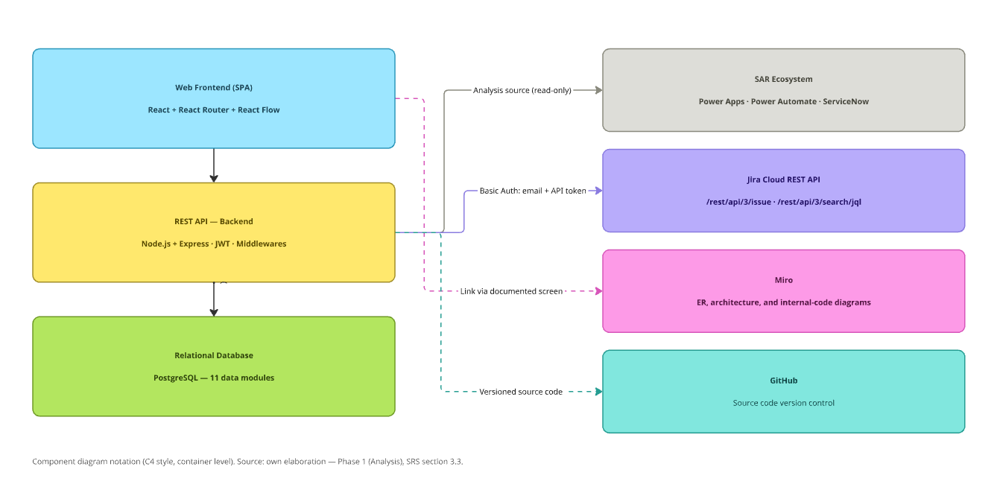
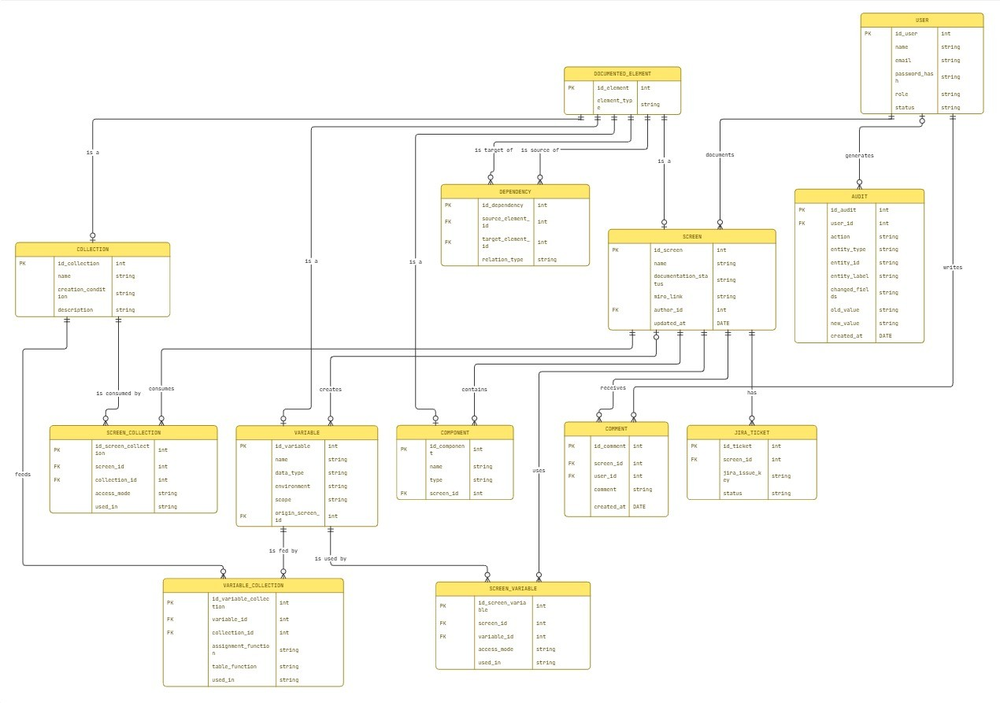

**Software Requirements Specification (SRS):**

**Web Application for Managing Technical Documentation of Enterprise Applications**

Analysis Document (Version 1.3)

Camila Castillo Porras

October 12, 2026

Version 1.3

**Table 1**

*Document Version History*

| **Version** | **Date**       | **Description of Change**                                                                                                                                                                                                                                                                                                                                                                                                                                                                                                                                                                                                  | **Author**             |
|-------------|----------------|----------------------------------------------------------------------------------------------------------------------------------------------------------------------------------------------------------------------------------------------------------------------------------------------------------------------------------------------------------------------------------------------------------------------------------------------------------------------------------------------------------------------------------------------------------------------------------------------------------------------------|------------------------|
| 0.1         | Sept. 12, 2026 | Initial SRS structure, functional and non-functional requirements, base architecture.                                                                                                                                                                                                                                                                                                                                                                                                                                                                                                                                      | Camila Castillo Porras |
| 1.0         | Sept. 19, 2026 | Added conceptual data model, API inventory, roles and permissions, development standards, screen documentation template, and Jira API evaluation.                                                                                                                                                                                                                                                                                                                                                                                                                                                                          | Camila Castillo Porras |
| 1.1         | Sept. 26, 2026 | Aligned the SRS with the database decisions taken after the requirements review: comments restricted to screens, attributes of the relationships between screens, variables, and collections, non-bypassable audit logging with records retained after deletion, origin screen of each variable and definition of full traceability, Documented Element generalization, and removal of the polymorphic-reference design note, whose physical implementation moves to the SDD, and a reserved screen record representing App.OnStart, so that variables created outside any screen also have a complete, recordable origin. | Camila Castillo Porras |
| 1.2         | Sept. 28, 2026 | Incorporated the department's design decisions: documentation of several departmental applications, environment presence for variables and collections, Jira hierarchy (one Epic per screen, Story, Subtask) and technical account, saved and published reports, documentation-workflow rules, 12-hour session and password policy, users deactivated instead of deleted, API inventory extended to 50 operations.                                                                                                                                                                                                         | Camila Castillo Porras |
| 1.3         | Oct. 12, 2026  | Incorporated the interface decisions approved on October 12, 2026: English interface, archived applications read-only, protected integration account, context-variable rule, editing locked during review, review comments, search with filters only, saved-report parameters, and onboarding components.                                                                                                                                                                                                                                                                                                                  | Camila Castillo Porras |

# **Table of Contents**

**1. Introduction 4**

> 1.1 Purpose 4
>
> 1.2 Scope 4
>
> 1.3 Definitions, Acronyms, and Abbreviations 5
>
> 1.4 Overview of the Remaining Sections 6

**2. Overall Description 7**

> 2.1 Product Perspective 7
>
> 2.2 Product Functions 8
>
> 2.3 User Characteristics 8
>
> 2.4 Constraints 9
>
> 2.5 Assumptions and Dependencies 10

**3. Specific Requirements 11**

> 3.1 Functional Requirements 11
>
> 3.2 Non-Functional Requirements 15
>
> 3.3 Base Architecture of the Solution 17
>
> 3.4 Conceptual Data Model 19
>
> 3.5 REST API Resource Inventory 22
>
> 3.6 Roles and Permissions Scheme 24
>
> 3.7 Development and Documentation Standards 24
>
> 3.8 Standardized Per-Screen Documentation Template 27
>
> 3.9 Jira API Evaluation and Integration Scope 27
>
> 3.10 External Interfaces 30

**4. Conclusions 32**

**Appendix A: Extended Glossary 34**

**References 35**

# **1. Introduction**

## **1.1 Purpose**

This document is the Software Requirements Specification (SRS) for the project “Design and Development of a Web Application for Managing Technical Documentation of Enterprise Applications,” carried out in the Enterprise Architecture Department during the third quarter of 2026, as part of the Supervised Business Practice of the Bachelor's Degree in Software Engineering at Universidad Latina de Costa Rica.

Its purpose is to formalize, completely and without ambiguity, the functional and non-functional requirements of the system, the base architecture of the solution, the conceptual data model, the REST API resource inventory, the roles and permissions scheme, the development and documentation standards, the standardized per-screen documentation template, and the technical scope of the Jira API integration. This document is the formal requirements specification of the project and serves as the reference baseline for the design of the system.

The intended audience for this document includes the Enterprise Architecture Department team, the Faculty Advisor and External Coordinator of the Supervised Business Practice, and any developer who joins the project later.

## **1.2 Scope**

The system to be specified is a web application for the centralized management of technical documentation of the department's enterprise applications, whose initial use case is the SAR application (built in Microsoft Power Apps, with automation flows in Power Automate and requests originating in ServiceNow). The system will feature a React frontend, a Node.js/Express backend, and a PostgreSQL relational database, and will integrate eleven functional modules: authentication and user management, variable management, collection management, screen management, an interactive dependency map, advanced search, an indicator dashboard, version control and auditing, report generation, comment and review management, and technical onboarding.

This document covers the analysis scope of the project: requirements, base architecture, conceptual model, API inventory, roles, standards, and evaluation of the Jira integration. The physical data model, interface prototypes, and detailed REST API contracts are specified in the Software Design Document (SDD) and are outside the scope of this document.

## **1.3 Definitions, Acronyms, and Abbreviations**

**Table 2**

*Glossary of Terms Used in This Document*

| **Term**             | **Definition**                                                                                                                                                                                                                                 |
|----------------------|------------------------------------------------------------------------------------------------------------------------------------------------------------------------------------------------------------------------------------------------|
| SRS                  | Software Requirements Specification.                                                                                                                                                                                                           |
| SAR                  | Application built in Microsoft Power Apps, the initial use case for the system. Manages internal requests.                                                                                                                                     |
| REST API             | An Application Programming Interface that follows the REST (Representational State Transfer) architectural style.                                                                                                                              |
| JWT                  | JSON Web Token, an authentication mechanism based on signed tokens.                                                                                                                                                                            |
| RBAC                 | Role-Based Access Control.                                                                                                                                                                                                                     |
| CRUD                 | Create, Read, Update, Delete: the basic data persistence operations.                                                                                                                                                                           |
| JQL                  | Jira Query Language, used by the Jira API to filter issues.                                                                                                                                                                                    |
| ADF                  | Atlassian Document Format, a structured JSON format Jira uses for rich-text fields (e.g., an issue description).                                                                                                                               |
| ORM                  | Object-Relational Mapping, an abstraction layer between application code and the relational database.                                                                                                                                          |
| Power Automate       | A Microsoft workflow-automation platform that transfers data from ServiceNow into SAR.                                                                                                                                                         |
| ServiceNow           | The platform from which medical and administrative staff submit the requests that feed SAR.                                                                                                                                                    |
| OnSelect             | A Power Apps component property that defines the behavior triggered when a user selects the component.                                                                                                                                         |
| Documented element   | Any element the system documents: a screen, a variable, a collection, or a component. A dependency relates two documented elements.                                                                                                            |
| Dependency           | A recorded relationship between two documented elements (variable, collection, screen, or component) indicating that one uses, modifies, or depends on the other.                                                                              |
| Full traceability    | A variable has full traceability when its origin is known, that is, when the screen in which it is created is recorded (see Section 3.4).                                                                                                      |
| App (OnStart) screen | A reserved Screen record, one per application, representing App.OnStart, the initialization logic that runs at the application level before any screen loads. Used as the origin screen for variables not created within an individual screen. |

*Note.* Terms are listed in order of first appearance in this document.

## **1.4 Overview of the Remaining Sections**

The remainder of this document is organized into three blocks, following the structure recommended by IEEE Std 830-1998 (IEEE, 1998). Section 2 (Overall Description) presents the product context, its main functions, its users, and the constraints identified. Section 3 (Specific Requirements) details the functional and non-functional requirements, the base architecture, the conceptual data model, the API resource inventory, the roles scheme, the development standards, the per-screen documentation template, the evaluation of the Jira integration, and the system's external interfaces. Section 4 (Conclusions) closes the analysis document and establishes the transition to the design of the system. The appendices include an extended glossary, and the References section lists the full citations for the standards and technical sources used.

# **2. Overall Description**

## **2.1 Product Perspective**

The Enterprise Architecture Department currently relies on SAR, an application built in Microsoft Power Apps that serves as the central platform for managing and handling internal requests. Requests originate in ServiceNow and are automatically transferred into SAR through Power Automate flows, which feed SAR's screens, collections, and variables.

No system, platform, or structured repository currently documents, in a traceable and sustainable way, the variables, collections, screens, and dependencies within SAR. The only existing resource is a general diagram in Miro showing the overall process flow, without technical depth. The system specified in this document is a new, independent product that relates to its environment as follows:

- It is seeded, as initial validation content, with the technical documentation gathered on SAR, Power Automate, and ServiceNow, with these three platforms acting strictly as read-only analysis sources (they are not modified).

- It integrates with the Jira Cloud REST API to create and query tracking tickets associated with each documented screen.

- Its interactive dependency map complements each element with links to detailed diagrams hosted in Miro.

- Its source code is version-controlled in GitHub, independently of the SAR environment.

The system is a standalone product: it does not replace or modify SAR. It documents SAR's internal structure and may, in the future, be extended into a technical documentation system for other applications in the department.

## **2.2 Product Functions**

The system integrates eleven functional modules that together cover the full cycle of recording, querying, maintaining, and tracing the department's technical documentation:

**Table 3**

*Summary of the System's Functional Modules*

| **No.** | **Module**                         | **Main Function**                                                                                          |
|---------|------------------------------------|------------------------------------------------------------------------------------------------------------|
| 1       | Authentication and User Management | JWT-based login, user registration, and role assignment.                                                   |
| 2       | Variable Management                | CRUD of variables with data type, environment, scope, and origin screen, linked to the dependency map.     |
| 3       | Collection Management              | CRUD of collections, their field structure, and their link to variables and screens.                       |
| 4       | Screen Management                  | Central module: digitizes the standardized per-screen documentation template and integrates with Jira.     |
| 5       | Dependency Map                     | Interactive visualization of the relationship graph among variables, collections, screens, and components. |
| 6       | Advanced Search                    | Global search engine with combinable filters and paginated results.                                        |
| 7       | Indicator Dashboard                | Real-time metrics on the state of departmental documentation.                                              |
| 8       | Version Control and Auditing       | Automatic logging of every creation, edit, or deletion operation.                                          |
| 9       | Reports and Export                 | Dynamic generation of reports exportable to PDF and Excel.                                                 |
| 10      | Comment and Review Management      | Comments and a formal review workflow prior to official publication.                                       |
| 11      | Technical Onboarding               | Progressive introductory view for new developers joining the department.                                   |

## **2.3 User Characteristics**

The system defines three user profiles, confirmed during requirements gathering, detailed further in Section 3.6 (Roles and Permissions Scheme):

**Table 4**

*User Roles and Expected Interaction*

| **Role**      | **Typical Profile**                                                               | **Expected Level of Interaction**                                              |
|---------------|-----------------------------------------------------------------------------------|--------------------------------------------------------------------------------|
| Administrator | Technical lead or enterprise-architecture owner within the department.            | High: manages users, approves documentation, and configures integrations.      |
| Developer     | Development staff who build and maintain SAR and other departmental applications. | High: records and edits technical documentation on a daily, operational basis. |
| Reader        | Department staff or other teams who consult documentation without modifying it.   | Medium-low: search, browsing, and comments.                                    |

*Note.* Roles were confirmed with the department during the requirements-gathering sessions.

## **2.4 Constraints**

The following constraints, identified in the preliminary project document, condition the analysis, design, and development of the system:

- No detailed prior technical documentation of SAR exists. The only available resource is a general Miro diagram with no depth on variables, collections, components, or screens, so the requirements gathering had to rely on direct exploration and inspection of the application.

- The deployment infrastructure for the web application was not defined at the time of the preliminary project document. Its definition depends on organizational resources and policies and will be addressed during analysis, which may condition architecture and configuration decisions.

- There is no access to ServiceNow's internal configuration, which is managed by a team outside the department. The gathering of SAR variables is limited to what is observable from Power Automate and the application itself.

- There is no test environment isolated and dedicated exclusively to this project. The DEV environment is shared with the rest of the development team, which may require adjustments to documentation already recorded.

- No per-screen documentation template or development standard previously existed within the department. The template was designed as part of this analysis (see Section 3.8), and development standards were likewise formalized as part of this document (see Section 3.7).

- The confirmed technology stack (React, Node.js with Express, PostgreSQL) and supporting tools (Miro, Jira, GitHub, Figma, Bruno) are fixed and are not subject to re-evaluation during design or development.

## **2.5 Assumptions and Dependencies**

- It is assumed that the department team will be available for validation sessions during design and development.

- It is assumed that the credentials and permissions needed to inspect Power Apps, Power Automate, and the Jira API will be provided by the department in a timely manner.

- The system depends on the availability of the Jira Cloud service for ticket creation and querying. An outage in Jira must not prevent use of the rest of the system (graceful degradation, not total failure).

- It is assumed that the definition of the deployment infrastructure (noted above as a constraint) will be resolved before the system is put into operation, without blocking design and development.

# **3. Specific Requirements**

This section is the core of the analysis document. Each functional requirement is identified with the prefix FR and each non-functional requirement with the prefix NFR, for traceability into design, development, and testing.

## **3.1 Functional Requirements**

Functional requirements are derived directly from the description of the system's eleven modules in the department's preliminary project document and from the analysis of the SAR ecosystem carried out during this analysis.

### ***Module 1 — Authentication and User Management***

**Table 5**

*Functional Requirements — Module 1*

| **ID** | **Requirement**                                                                                          | **Priority** |
|--------|----------------------------------------------------------------------------------------------------------|--------------|
| FR-01  | The system shall allow users to log in with validated credentials, issuing a JWT token.                  | High         |
| FR-02  | The system shall allow registration of new users, restricted to the Administrator role.                  | High         |
| FR-03  | The system shall allow assigning and changing each user's role (Administrator, Developer, Reader).       | High         |
| FR-04  | The system shall restrict access to the user administration panel exclusively to the Administrator role. | High         |

### ***Module 2 — Variable Management***

**Table 6**

*Functional Requirements — Module 2*

| **ID** | **Requirement**                                                                                                                                                                                             | **Priority** |
|--------|-------------------------------------------------------------------------------------------------------------------------------------------------------------------------------------------------------------|--------------|
| FR-05  | The system shall support full CRUD of variables (name, data type, environment, scope, description) and shall record, for each variable, the screen in which it is created (its origin screen).              | High         |
| FR-06  | The system shall automatically link each registered variable to the dependency map (Module 5).                                                                                                              | High         |
| FR-07  | The system shall allow classifying each variable and each collection by the environments in which it exists (DEV, PROD, or both), documenting the element once, and each variable by type (global/context). | High         |

### ***Module 3 — Collection Management***

**Table 7**

*Functional Requirements — Module 3*

| **ID** | **Requirement**                                                                                                                                                                                                                                                                                                                                                | **Priority** |
|--------|----------------------------------------------------------------------------------------------------------------------------------------------------------------------------------------------------------------------------------------------------------------------------------------------------------------------------------------------------------------|--------------|
| FR-08  | The system shall support full CRUD of collections, including their creation conditions and the field structure of each collection (name, data type, description, and order of each field).                                                                                                                                                                     | High         |
| FR-09  | The system shall allow linking a collection to the variables that compose it, recording for each link the assignment function used (Set or UpdateContext), the aggregation or table-selection function applied to the collection, and the screen and event or property where the assignment occurs, and to the screens that consume it, as specified in FR-11. | High         |

### ***Module 4 — Screen Management***

**Table 8**

*Functional Requirements — Module 4*

| **ID** | **Requirement**                                                                                                                                                                                                                                                                                                                                     | **Priority** |
|--------|-----------------------------------------------------------------------------------------------------------------------------------------------------------------------------------------------------------------------------------------------------------------------------------------------------------------------------------------------------|--------------|
| FR-10  | The system shall digitize the standardized per-screen documentation template defined in Section 3.8.                                                                                                                                                                                                                                                | High         |
| FR-11  | The system shall allow linking each screen to the variables and collections registered in the system, recording for each link the access mode (read, write, or read-write) and where in the screen the access occurs (for example, a screen event or a component property).                                                                         | High         |
| FR-12  | The system shall create Jira tickets in project TECHEA from a screen's “future to do” items. Each screen has one Epic, created automatically the first time a ticket is generated for it. The user selects an existing Story of that Epic or creates a new one, and each item is created as a Subtask of that Story.                                | High         |
| FR-13  | The system shall allow associating each screen with a direct link to its corresponding Miro diagram.                                                                                                                                                                                                                                                | Medium       |
| FR-14  | The system shall manage each screen's documentation status (undocumented, draft, in progress, in review, approved). Moving a screen back to an earlier status is allowed. Editing the template of an approved screen returns it to “in progress”. A screen in review cannot be edited until the review ends or the screen is withdrawn from review. | High         |

### 

### 

### ***Module 5 — Dependency Map***

**Table 9**

*Functional Requirements — Module 5*

| **ID** | **Requirement**                                                                                                                                                        | **Priority** |
|--------|------------------------------------------------------------------------------------------------------------------------------------------------------------------------|--------------|
| FR-15  | The system shall automatically generate an interactive graph of relationships among variables, collections, screens, and components, based on already-registered data. | High         |
| FR-16  | The system shall allow, from any node in the graph, navigating to the corresponding element in the platform or to its associated Miro diagram.                         | Medium       |

### ***Module 6 — Advanced Search***

**Table 10**

*Functional Requirements — Module 6*

| **ID** | **Requirement**                                                                                                                                                                                                                                                             | **Priority** |
|--------|-----------------------------------------------------------------------------------------------------------------------------------------------------------------------------------------------------------------------------------------------------------------------------|--------------|
| FR-17  | The system shall provide a global search engine with combinable filters by name, type, environment, documentation status, and other registered attributes. A search may use filters only, without text. Filters that apply to some element types do not exclude the others. | Medium       |
| FR-18  | The system shall present search results in paginated form, with direct navigation to the element found.                                                                                                                                                                     | Medium       |

### ***Module 7 — Indicator Dashboard***

**Table 11**

*Functional Requirements — Module 7*

| **ID** | **Requirement**                                                                                                                                                                                                                                                                                                                                                                                              | **Priority** |
|--------|--------------------------------------------------------------------------------------------------------------------------------------------------------------------------------------------------------------------------------------------------------------------------------------------------------------------------------------------------------------------------------------------------------------|--------------|
| FR-19  | The system shall display, in real time: the percentage of screens documented per status, variables lacking full traceability (variables with no recorded origin screen), undocumented collections (collections not associated with any screen), pending Jira tickets per screen (Subtasks whose status category is not “done”), and recent team activity. The App (OnStart) screen counts in the indicators. | Medium       |

### ***Module 8 — Version Control and Auditing***

**Table 12**

*Functional Requirements — Module 8*

| **ID** | **Requirement**                                                                                                                                                                                                                         | **Priority** |
|--------|-----------------------------------------------------------------------------------------------------------------------------------------------------------------------------------------------------------------------------------------|--------------|
| FR-20  | The system shall automatically log every creation, edit, or deletion operation, capturing the action type, the user, the date, the changed fields, the old and new values, and a human-readable identification of the affected element. | High         |
| FR-21  | The system shall provide an interface for querying the audit history, filterable by date, user, and element type.                                                                                                                       | Medium       |

### ***Module 9 — Reports and Export***

**Table 13**

*Functional Requirements — Module 9*

| **ID** | **Requirement**                                                                                                                                                                                                                                                                                                                                                                                                                                                                                     | **Priority** |
|--------|-----------------------------------------------------------------------------------------------------------------------------------------------------------------------------------------------------------------------------------------------------------------------------------------------------------------------------------------------------------------------------------------------------------------------------------------------------------------------------------------------------|--------------|
| FR-22  | The system shall generate reports exportable to PDF and Excel with information selected by the user regarding variables, collections, screens, or the overall documentation status. Generated reports are saved and can be downloaded again. Administrators and Developers can publish them, and published reports are available to the Reader role. Generation runs in the background (NFR-12). A failed report can be generated again with the same parameters. The failed attempt remains saved. | Medium       |

### ***Module 10 — Comment and Review Management***

**Table 14**

*Functional Requirements — Module 10*

| **ID** | **Requirement**                                                                                                                                                                                                                                                                                                                                                                           | **Priority** |
|--------|-------------------------------------------------------------------------------------------------------------------------------------------------------------------------------------------------------------------------------------------------------------------------------------------------------------------------------------------------------------------------------------------|--------------|
| FR-23  | The system shall allow users to comment on screens. Each comment is attached directly to one screen.                                                                                                                                                                                                                                                                                      | Medium       |
| FR-24  | The system shall implement a formal review workflow (undocumented → draft → in progress → in review → approved) before publishing documentation as an official reference. Only an Administrator can approve. Returning a screen to “in progress” requires a comment. The comment given when approving or returning is recorded on the screen as a review comment, which cannot be edited. | High         |

### ***Module 11 — Technical Onboarding***

**Table 15**

*Functional Requirements — Module 11*

| **ID** | **Requirement**                                                                                                                                                                                                                                                                                                                                                                                                                    | **Priority** |
|--------|------------------------------------------------------------------------------------------------------------------------------------------------------------------------------------------------------------------------------------------------------------------------------------------------------------------------------------------------------------------------------------------------------------------------------------|--------------|
| FR-25  | The system shall automatically generate an introductory view for new developers, progressively presenting the selected application's main screens, its most critical variables, the integration flow, and the most frequently used components. The integration flow is the documentation of the application's App (OnStart) screen, and the most frequently used components are those that use the most variables and collections. | Low          |

### 

### 

### ***Initial Load of SAR Documentation and Application Management***

**Table 16**

*Functional Requirements — Initial Data Load and Application Management*

| **ID** | **Requirement**                                                                                                                                                                                                                                                                                                                                                                                                                                                                                                                                                                                                                                                                                                    | **Priority** |
|--------|--------------------------------------------------------------------------------------------------------------------------------------------------------------------------------------------------------------------------------------------------------------------------------------------------------------------------------------------------------------------------------------------------------------------------------------------------------------------------------------------------------------------------------------------------------------------------------------------------------------------------------------------------------------------------------------------------------------------|--------------|
| FR-26  | The system shall support the initial loading of SAR's technical documentation (variables, collections, screens, dependencies, and components) as validation baseline content using real department data, including, for each application, one reserved screen record that represents App.OnStart, used as the origin of variables that are created at the application level rather than within any individual screen, and the reserved inactive user “Integración Jira”, to which changes received from Jira are attributed. The reserved user “Integración Jira” has the Reader role, is identified by configuration, cannot sign in, and cannot be modified, listed, or queried through the user administration. | High         |
| FR-27  | The system shall allow the Administrator to register, edit, and archive the departmental applications whose documentation it manages. Every screen, variable, collection, and component belongs to exactly one application, and names are unique within their application. SAR is the first application. An archived application's documentation is read-only for every role until it is unarchived. Reports can still be generated.                                                                                                                                                                                                                                                                               | High         |

## **3.2 Non-Functional Requirements**

The following non-functional requirements were defined considering the system's real context of use: an internal departmental tool documenting an ecosystem built on Microsoft Power Platform (Power Apps, Power Automate) and ServiceNow, serving a bounded number of internal users, without enterprise-grade external high-availability demands.

### ***Security***

**Table 17**

*Non-Functional Requirements — Security*

| **ID** | **Requirement**                                                                                                                                                                                                                    |
|--------|------------------------------------------------------------------------------------------------------------------------------------------------------------------------------------------------------------------------------------|
| NFR-01 | Authentication shall use JWT with a configurable expiration (recommended: 8 hours) and a renewal mechanism (refresh token). A session lasts at most 12 hours (one workday) from login. Renewing the access token never extends it. |
| NFR-02 | Passwords shall be stored using a strong hashing algorithm (bcrypt), never in plain text. Passwords shall have at least 12 characters and contain letters and digits.                                                              |
| NFR-03 | Role-based access control (RBAC) shall be validated on every API endpoint, not only in the user interface.                                                                                                                         |
| NFR-04 | All communication among the frontend, backend, and external services (Jira) shall occur over HTTPS.                                                                                                                                |
| NFR-05 | The system shall be protected against common vulnerabilities: SQL injection (via an ORM or parameterized queries), XSS, and CSRF.                                                                                                  |
| NFR-06 | Credentials for external integrations (Jira API token) shall be stored in environment variables or a secrets manager, never in source code.                                                                                        |

### ***Usability***

**Table 18**

*Non-Functional Requirements — Usability*

| **ID** | **Requirement**                                                                                                                                                                      |
|--------|--------------------------------------------------------------------------------------------------------------------------------------------------------------------------------------|
| NFR-07 | The interface shall maintain a consistent visual and interaction language across the eleven modules.                                                                                 |
| NFR-08 | Error and validation messages shall be clear and action-oriented. The interface and its messages are in English. The product name is “Documentación técnica”.                        |
| NFR-09 | The learning curve for a developer already familiar with SAR shall be shallow, since the system's vocabulary (variables, collections, screens) directly mirrors Power Apps concepts. |

### ***Performance***

**Table 19**

*Non-Functional Requirements — Performance*

| **ID** | **Requirement**                                                                                                                                                      |
|--------|----------------------------------------------------------------------------------------------------------------------------------------------------------------------|
| NFR-10 | Standard CRUD operations over the API shall respond in under 2 seconds under normal conditions (estimated up to 30 concurrent users).                                |
| NFR-11 | The dependency-map visualization shall remain smooth for department-scale graphs (hundreds of nodes), without requiring optimization for a thousands-of-nodes scale. |
| NFR-12 | Report generation (PDF/Excel) shall not block the user interface while the request is processed.                                                                     |

### ***Availability and Reliability***

**Table 20**

*Non-Functional Requirements — Availability*

| **ID** | **Requirement**                                                                                                                                      |
|--------|------------------------------------------------------------------------------------------------------------------------------------------------------|
| NFR-13 | The system shall be available at least 99% of the department's business hours. An enterprise-grade 24/7 high-availability scheme is not required.    |
| NFR-14 | An outage of Jira Cloud shall not prevent use of the rest of the system's modules (graceful degradation of ticket functionality, not total failure). |

### 

### 

### ***Maintainability and Scalability***

**Table 21**

*Non-Functional Requirements — Maintainability*

| **ID** | **Requirement**                                                                                                                                                                        |
|--------|----------------------------------------------------------------------------------------------------------------------------------------------------------------------------------------|
| NFR-15 | Code shall be organized modularly, mirroring the separation into the eleven functional modules, to facilitate independent maintenance of each one.                                     |
| NFR-16 | The architecture shall allow, in the future, incorporating other departmental applications besides SAR as new use cases, without requiring a structural redesign. (Realized by FR-27.) |
| NFR-17 | System code and technical documentation shall follow the development standards defined in Section 3.7.                                                                                 |

### ***Compatibility***

**Table 22**

*Non-Functional Requirements — Compatibility*

| **ID** | **Requirement**                                                                                                                  |
|--------|----------------------------------------------------------------------------------------------------------------------------------|
| NFR-18 | The system shall operate correctly on standard corporate modern browsers (current versions of Google Chrome and Microsoft Edge). |
| NFR-19 | The interface shall be responsive to accommodate different desktop screen sizes. A native mobile application is not required.    |

### ***Auditability***

**Table 23**

*Non-Functional Requirement — Auditability*

| **ID** | **Requirement**                                                                                                                                                                                                                                                                                                                                                                                                                                                                                                                       |
|--------|---------------------------------------------------------------------------------------------------------------------------------------------------------------------------------------------------------------------------------------------------------------------------------------------------------------------------------------------------------------------------------------------------------------------------------------------------------------------------------------------------------------------------------------|
| NFR-20 | Every write operation (creation, edit, deletion) on any entity in the system shall be automatically and immutably logged, per Module 8. The logging shall not be bypassable: it shall capture writes regardless of the path they take, including operations that do not go through the application, and it shall identify who performed each operation (the application user when the operation comes from the application, or the database account otherwise). Audit records shall be retained after the audited element is deleted. |

## 

## 

## **3.3 Base Architecture of the Solution**

The solution's architecture is defined over the technology stack confirmed in the department's preliminary project document: a React frontend, a Node.js/Express backend, and PostgreSQL persistence. The detailed technical specification of each layer (API contracts, folder structure, deployment configuration) belongs to the Software Design Document (SDD). This section formalizes the architecture at the component level and its relationships.

- Frontend (React): a single-page application (SPA) user interface, with React Router for navigation across the eleven modules and a UI component library (Tailwind) for visual consistency. The dependency-map module uses a graph-visualization library (React Flow).

- Backend (Node.js + Express): exposes the REST API that centralizes business logic, JWT authentication, role-based access control, automatic audit logging, and the Jira API integration. It is structured with validation middleware, centralized error handling, and logging.

- Database (PostgreSQL): persists the system's relational model, including the many-to-many relationships needed to trace dependencies among variables, collections, screens, and components.

- External integrations: the Jira Cloud REST API (ticket creation and querying), Miro (per-screen links to detailed diagrams), and GitHub (source code version control).

**Figure 1**

*Architecture Diagram of the System (Component Diagram, Container Level)*

*Note.* Component-diagram notation (C4 style, container level). Built and maintained live as an editable diagram on the project's Miro board (see link below). The image above is a snapshot for this document.

[<u>View the live, editable diagram on Miro →</u>](https://miro.com/app/board/uXjVHm4trbw=/?moveToWidget=3458764683854329416)

This diagram formalizes, at the analysis level, the relationship between the system's internal layers and the external systems it interacts with. Because it was authored directly in Miro rather than as a static picture, the department team can keep editing it in place alongside the rest of the project's architecture diagrams, as called for in the preliminary project document.

## **3.4 Conceptual Data Model**

The conceptual model identifies the domain entities, their main attributes, and the relationships among them, based on the analysis of the SAR ecosystem (variables, collections, screens, components, and their dependencies) and on the functional needs of the eleven modules. This model is the basis on which the Software Design Document (SDD) specifies the physical model in PostgreSQL (tables, data types, primary and foreign keys, bridge tables, and indexes).

**Figure 2**

*Conceptual Entity-Relationship Diagram*

*Note.* Conceptual model at a high level. Screen–Variable, Screen–Collection, and Variable–Collection are shown as associative entities because they carry their own attributes. Documented Element generalizes Screen, Variable, Collection, and Component. Audit identifies the audited element by type and identifier so that its records survive the element’s deletion. A comment may record the review decision it belongs to (approve or return). Keys, constraints, data types, and indexes are specified in the SDD.

[<u>View the live, editable diagram on Miro →</u>](https://miro.com/app/board/uXjVHm4trbw=/?moveToWidget=3458764683854329427)

### ***Relationships That Carry Their Own Information***

Three relationships in the model carry information of their own, so they are represented as associative entities instead of plain links. Screen–Variable and Screen–Collection record the access mode (read, write, or read-write) and where in the screen the access occurs, such as a screen event or a component property. Variable–Collection records how a variable is fed from a collection: the assignment function used (Set for a global variable, UpdateContext for a context variable), the aggregation or table-selection function applied to the collection, and where the assignment occurs.

Dependencies relate two documented elements, where a documented element is a screen, a variable, a collection, or a component. The model expresses this with a generalization, Documented Element, so that a dependency can start and end at any of the four types. Each variable also records the screen in which it is created (its origin screen). This is what allows the system to report whether a variable has full traceability. A context variable can be read or assigned with UpdateContext only in its origin screen. Other screens can only write it through Navigate. How these relationships and the audit records are implemented in the database (keys, constraints, and the mechanisms that enforce them) is a design matter specified in the Software Design Document (SDD), not in this document. A variable is not always created within a screen: in Power Apps, a global variable may instead be created in App.OnStart, which runs at the application level before any screen loads. To keep every variable's origin recordable, each application has one reserved Screen record that represents its App.OnStart. A variable created there records that reserved screen as its origin, the same way any other variable does.

### ***Description of the Main Entities***

**Table 24**

*Main Entities of the Conceptual Model*

| **Entity**          | **Description**                                                                                                                                                                                                                                                                                                    | **Main Relationships**                                                                                                                                        |
|---------------------|--------------------------------------------------------------------------------------------------------------------------------------------------------------------------------------------------------------------------------------------------------------------------------------------------------------------|---------------------------------------------------------------------------------------------------------------------------------------------------------------|
| Application         | A departmental application whose technical documentation is managed in the system (SAR is the first).                                                                                                                                                                                                              | 1:N with Documented Element and Report.                                                                                                                       |
| User                | A person who accesses the system with an assigned role (Administrator, Developer, or Reader). Users are deactivated, never physically deleted, so authorship and audit history are preserved.                                                                                                                      | 1:N with Screen (author) and Comment. 1:N with Audit Log (a record has no user when the change is made outside the application).                              |
| Screen              | The central documentation unit: represents a SAR screen together with its standardized template (Section 3.8). Each application has one reserved Screen record that represents its App.OnStart, so that variables created at the application level, not within any individual screen, also have a recorded origin. | 1:N with Component, Comment, Jira Ticket, and Variable (origin screen), linked to Variable and Collection through associative entities, a Documented Element. |
| Variable            | A SAR variable, classified by data type, environment (DEV/PROD), and scope (global/context), with the screen in which it is created (its origin screen).                                                                                                                                                           | N:1 with Screen (origin), linked to Screen and Collection through associative entities, a Documented Element.                                                 |
| Collection          | A SAR data collection, with its field structure and creation conditions.                                                                                                                                                                                                                                           | Linked to Variable and Screen through associative entities, a Documented Element.                                                                             |
| Component           | A UI element within a screen (button, field, gallery), with its OnSelect behavior.                                                                                                                                                                                                                                 | N:1 with Screen, a Documented Element.                                                                                                                        |
| Documented Element  | Generalization of the four elements the system documents: screen, variable, collection, and component.                                                                                                                                                                                                             | Specialized as Screen, Variable, Collection, or Component, source or target of many Dependencies.                                                             |
| Screen–Variable     | Associative entity: how a screen uses a variable (access mode, and where the access occurs).                                                                                                                                                                                                                       | Links Screen and Variable (N:M).                                                                                                                              |
| Screen–Collection   | Associative entity: how a screen uses a collection (access mode, and where the access occurs).                                                                                                                                                                                                                     | Links Screen and Collection (N:M).                                                                                                                            |
| Variable–Collection | Associative entity: how a variable is fed from a collection (assignment function, aggregation or table-selection function, and where the assignment occurs).                                                                                                                                                       | Links Variable and Collection (N:M).                                                                                                                          |
| Dependency          | A recorded relationship between two documented elements (variable, collection, screen, or component).                                                                                                                                                                                                              | N:1 with Documented Element as source and N:1 with Documented Element as target.                                                                              |
| Jira Ticket         | A Jira ticket created or linked from a screen's “future to do” field.                                                                                                                                                                                                                                              | N:1 with Screen.                                                                                                                                              |
| Comment             | A comment recorded on a screen. It may record the review decision it belongs to (approve or return).                                                                                                                                                                                                               | N:1 with User and N:1 with Screen.                                                                                                                            |
| Audit Log           | An immutable record of every creation, edit, or deletion performed in the system, retained even after the audited element is deleted.                                                                                                                                                                              | N:1 with User (optional), identifies the audited element by type and identifier, without depending on it.                                                     |

*Note.* Entities correspond to the elements the preliminary project document asks the system to manage: variables, collections, screens, components, and their dependencies. The associative entities and the Documented Element generalization were added during the analysis.

## **3.5 REST API Resource Inventory**

The following inventory identifies the resources and operations the REST API will expose, derived directly from the system's eleven functional modules. Detailed contracts (exact request/response structures, status codes, and validations) are specified in the Software Design Document (SDD). This table formalizes the resource scope corresponding to the analysis.

**Table 25**

*REST API Resource Inventory by Module*

| **Module**                   | **Base Resource**  | **Main Operations**                                                                                                                                                                       |
|------------------------------|--------------------|-------------------------------------------------------------------------------------------------------------------------------------------------------------------------------------------|
| 1\. Authentication and Users | /auth, /users      | POST /auth/login · POST /auth/refresh · POST /auth/logout · GET/POST /users · GET/PUT/DELETE /users/:id · PUT /users/:id/role. DELETE /users/:id deactivates the user (logical deletion). |
| 2\. Variables                | /variables         | GET/POST /variables · GET/PUT/DELETE /variables/:id · GET /variables/:id/dependencies                                                                                                     |
| 3\. Collections              | /collections       | GET/POST /collections · GET/PUT/DELETE /collections/:id · GET /collections/:id/fields                                                                                                     |
| 4\. Screens                  | /screens           | GET/POST /screens · GET/PUT/DELETE /screens/:id · PUT /screens/:id/status · POST /screens/:id/jira-ticket · GET /screens/:id/jira-tickets                                                 |
| 5\. Dependency Map           | /dependencies      | GET /dependencies/graph · GET /dependencies/:type/:id                                                                                                                                     |
| 6\. Advanced Search          | /search            | GET /search?query=&filters=                                                                                                                                                               |
| 7\. Dashboard                | /dashboard         | GET /dashboard/indicators                                                                                                                                                                 |
| 8\. Auditing                 | /audit-log         | GET /audit-log?filters=                                                                                                                                                                   |
| 9\. Reports                  | /reports           | POST /reports/pdf · POST /reports/excel · GET /reports · GET /reports/:id · GET /reports/:id/file · PUT /reports/:id/publication                                                          |
| 10\. Comments and Review     | /comments, /review | GET/POST /screens/:id/comments · PUT /comments/:id · POST /screens/:id/review                                                                                                             |
| 11\. Onboarding              | /onboarding        | GET /onboarding/summary                                                                                                                                                                   |
| Applications                 | /applications      | GET /applications · POST /applications · GET /applications/:id · PUT /applications/:id (archive through status, no DELETE)                                                                |

*Note.* Endpoint names follow the kebab-case convention defined in Section 3.7. The design (SDD) adds nine operations to this inventory (4 for applications, 4 for saved reports, and the Jira webhook): 50 operations in total.

Additional proposed resource — not explicitly listed in the preliminary project document, but identified as necessary during this analysis:

- POST /integrations/jira/webhook — an endpoint to receive status-change notifications from Jira (via webhook) instead of relying solely on periodic polling. This reduces the number of outbound calls to the Jira API and more efficiently satisfies Module 4's requirement to show ticket status “in real time” (FR-12). Confirmed during design: an admin webhook on project TECHEA (issue updated and deleted), signed with HMAC-SHA256 through a shared secret.

## **3.6 Roles and Permissions Scheme**

Three user roles are confirmed: Administrator, Developer, and Reader. The following matrix formalizes, at the analysis level, the scope of actions allowed to each role over the system's main capabilities. The technical enforcement of these permissions (per-endpoint authorization middleware) is specified in the Software Design Document (SDD).

**Table 26**

*Roles and Permissions Matrix*

<table>
<colgroup>
<col style="width: 39%" />
<col style="width: 17%" />
<col style="width: 21%" />
<col style="width: 21%" />
</colgroup>
<thead>
<tr class="header">
<th><strong>Capability</strong></th>
<th><strong>Administrator</strong></th>
<th><strong>Developer</strong></th>
<th><strong>Reader</strong></th>
</tr>
</thead>
<tbody>
<tr class="odd">
<td>User management and role assignment</td>
<td>Full</td>
<td>No access</td>
<td>No access</td>
</tr>
<tr class="even">
<td>Manage applications</td>
<td>Full</td>
<td>Read-only</td>
<td>Read-only</td>
</tr>
<tr class="odd">
<td>CRUD of variables and collections</td>
<td>Full</td>
<td>Full</td>
<td>Read-only</td>
</tr>
<tr class="even">
<td>Create and edit screens (template)</td>
<td>Full</td>
<td>Full</td>
<td>Read-only</td>
</tr>
<tr class="odd">
<td>Approve documentation (review workflow)</td>
<td>Full</td>
<td>No access</td>
<td>No access</td>
</tr>
<tr class="even">
<td>Create and query Jira tickets</td>
<td>Full</td>
<td>Full</td>
<td>Query only</td>
</tr>
<tr class="odd">
<td>View dependency map</td>
<td>Yes</td>
<td>Yes</td>
<td>Yes</td>
</tr>
<tr class="even">
<td>Advanced search</td>
<td>Yes</td>
<td>Yes</td>
<td>Yes</td>
</tr>
<tr class="odd">
<td>Indicator dashboard</td>
<td>Yes</td>
<td>Yes</td>
<td>Yes (overview)</td>
</tr>
<tr class="even">
<td>Query audit history</td>
<td>Full</td>
<td>Partial (own actions)</td>
<td>No access</td>
</tr>
<tr class="odd">
<td>Generate and export reports</td>
<td>Full</td>
<td>Full</td>
<td>Already-published reports only</td>
</tr>
<tr class="even">
<td>Comment on screens</td>
<td>Yes</td>
<td>Yes</td>
<td>Yes</td>
</tr>
<tr class="odd">
<td>
Configure Jira integration credentials

<em>Through environment variables at deployment (no user interface), using a technical account of the department.</em>
</td>
<td>Full</td>
<td>No access</td>
<td>No access</td>
</tr>
</tbody>
</table>

*Note.* This matrix formalizes the three roles confirmed with the department during requirements gathering.

## 

## 

## 

## 

## **3.7 Development and Documentation Standards**

The department did not previously have a defined development standard. As part of this analysis, the standard that will guide the system's construction is defined below, covering naming conventions, version control, API structure, error handling, and code documentation.

### ***Naming Conventions***

**Table 27**

*Naming Conventions by Element Type*

| **Element**                                  | **Convention**                     | **Example**              |
|----------------------------------------------|------------------------------------|--------------------------|
| Variables and functions (JavaScript/Node.js) | camelCase                          | getScreenById()          |
| React components                             | PascalCase                         | ScreenDetail.jsx         |
| Tables and columns in PostgreSQL             | snake_case                         | updated_at               |
| REST API routes                              | kebab-case, plural for collections | /screens/:id/jira-ticket |
| Constants                                    | UPPER_SNAKE_CASE                   | MAX_SEARCH_RESULTS       |

### ***Version Control (GitHub)***

- Commit convention: Conventional Commits (feat:, fix:, docs:, refactor:, test:, chore:), to keep a readable and traceable history.

- Branching strategy: a simplified GitFlow-style flow — a main branch (stable release), a develop branch (integration), and feature/module-name branches for each module under development.

- Every pull request into develop must reference the module or requirement (FR-xx / NFR-xx) it implements.

- Source code is version-controlled in GitHub from the start of development, as established in the department's preliminary project document.

### ***REST API Standard***

- Explicit API versioning under the /api/v1/ prefix.

- Standard HTTP status codes: 200 (success), 201 (created), 202 (accepted, asynchronous), 204 (no content), 400 (bad request), 401 (unauthenticated), 403 (unauthorized), 404 (not found), 409 (conflict), 412 (precondition failed), 422 (business-rule violation), 429 (too many requests), 500 (internal error), 502 (Jira unavailable).

- Uniform error format on every failed response: { "code": "string", "message": "string", "details": "object\|null" }.

- Error messages are written in English and say what to do next.

- Every successful collection response shall include explicit pagination (page, pageSize, total).

- JSON field names use camelCase.

- Optional optimistic concurrency with ETag / If-Match.

### ***Code Documentation***

- Backend functions and modules documented with JSDoc comments (description, parameters, return value).

- React components documented with a header comment describing their purpose and main props.

- Every API endpoint shall have a corresponding test collection in Bruno, version-controlled alongside the source code in the same repository, following the per-module folder structure.

### ***Project-Level Technical Documentation Standard***

- All technical documentation produced during the project (this SRS, the Software Design Document, the user documentation) shall be versioned and dated, following the version-control format established in this document (title-page/version-control tables).

- Documentation for each SAR screen, loaded as initial content, shall strictly follow the standardized template defined in Section 3.8, with no fields omitted.

## **3.8 Standardized Per-Screen Documentation Template**

This template was designed during the analysis and will be digitized as a structured form in Module 4 (Screen Management) during development. It defines the mandatory fields that documentation for each SAR screen — and for any future application the system documents — must contain.

**Table 28**

*Standardized Per-Screen Documentation Fields*

| **Field**       | **Purpose**                                                                                                                                                |
|-----------------|------------------------------------------------------------------------------------------------------------------------------------------------------------|
| OnStart         | Documents the initialization logic that runs when the screen loads (variables that are set, collections that are collected, conditions evaluated on load). |
| Working process | Describes the screen's functional workflow: what the user does, in what order, and what result each action produces.                                       |
| Architecture    | Documents the screen's internal technical structure: main components, containers, and their organization.                                                  |
| Data model      | Describes the variables and collections the screen uses or modifies, and their relationship to the system's conceptual data model.                         |
| Requirements    | Records the functional or business requirements the screen must satisfy, as defined by the department.                                                     |
| Known issues    | Documents known errors or unexpected behaviors, to prevent them from being reintroduced or re-diagnosed.                                                   |
| Risks           | Identifies technical risks associated with the screen (e.g., fragile dependencies, untraced variables, undocumented third-party logic).                    |
| Future to do    | A list of pending improvements or tasks for the screen. Each item can be linked to a Jira ticket through the Module 4 integration.                         |

*Note.* The eight fields above were confirmed with the department during requirements gathering.

Beyond these eight fields, each documented screen includes control metadata already reflected in the conceptual model (Section 3.4): documentation status (five values), a link to the corresponding Miro diagram, author, and last-updated date.

## **3.9 Jira API Evaluation and Integration Scope**

This section documents the results of the technical evaluation performed during the analysis of the Jira Cloud REST API, in the specific context of this project: the base application, SAR, is built in Power Apps with Power Automate, and the new system exposes its own Node.js/Express backend, from which it must create and query Jira tickets from each documented screen's “future to do” field (Module 4).

### ***3.9.1 Required Endpoints***

**Table 29**

*Required Jira REST API Endpoints*

| **Operation**                | **Method and Endpoint**              | **Use in the System**                                                                                                                                                                                                                                                                      |
|------------------------------|--------------------------------------|--------------------------------------------------------------------------------------------------------------------------------------------------------------------------------------------------------------------------------------------------------------------------------------------|
| Create issue                 | POST /rest/api/3/issue               | Invoked from the backend when the user creates a ticket from a screen's “future to do” field.                                                                                                                                                                                              |
| Query issue status           | GET /rest/api/3/issue/{issueIdOrKey} | Invoked to reflect the linked ticket's current status on the screen.                                                                                                                                                                                                                       |
| List issues by project (JQL) | POST /rest/api/3/search/jql          | Invoked to list and synchronize tickets associated with the department's Jira project. Note: this is the current endpoint. The previous GET/POST /rest/api/3/search endpoint was retired by Atlassian between May and October 2025 and must not be used in this project (Atlassian, 2025). |

### 

### 

### ***3.9.2 Authentication Mechanism***

For a server-to-server integration like this project's (the Node.js/Express backend calls Jira, not an individual user from the browser), the recommended mechanism is Basic Auth with the Atlassian account email and an API token, generated from the Atlassian account's security settings (the account password must not be used, since password-based authentication is deprecated).

- The token is Base64-encoded together with the email (email:token) and sent in the Authorization: Basic \<encoded-string\> header.

- OAuth 2.0 (3LO) is the mechanism Atlassian recommends only if the system will, in the future, need to act on behalf of individual Jira users (for example, so each ticket is created under the name of the developer who requested it). For Module 4's current scope, where the application creates tickets under a departmental service account, Basic Auth with an API token is sufficient and simpler to implement and maintain.

- The API token must be stored as a backend environment variable, never in source code or the repository (see NFR-06).

- The integration uses a technical account of the department in the official Atlassian site (not a personal account).

### ***3.9.3 Data Sent and Received***

When creating a ticket (POST /rest/api/3/issue), the request must include, at minimum:

- project: the key or ID of the department's Jira project.

- issuetype: the ticket type. Defined in the design: project TECHEA, Epic (one per screen) → Story → Subtask, “future to do” items are Subtasks.

- summary: the ticket title, generated from the text entered in the “future to do” field.

- description: additional context, in ADF (Atlassian Document Format), including a reference to the source documented screen.

A successful creation response returns id, key (for example, DOC-123), and self (the resource URL), which the system must store in the Jira Ticket entity of the conceptual model (Section 3.4) together with the source screen_id.

When querying a ticket (GET /rest/api/3/issue/{issueIdOrKey}), the response includes the full issue object, from which the system must primarily extract the status field (to reflect the real-time status on the documented screen, per FR-12).

### ***3.9.4 Limitations, Quotas, and Technical Risks***

**Table 30**

*Jira API Risks and Mitigations*

| **Risk / Limitation**                | **Consideration for the Project**                                                                                                                                                                                                                                                                                                                                                                                                                     |
|--------------------------------------|-------------------------------------------------------------------------------------------------------------------------------------------------------------------------------------------------------------------------------------------------------------------------------------------------------------------------------------------------------------------------------------------------------------------------------------------------------|
| Burst rate limiting                  | Jira Cloud enforces per-endpoint requests-per-second limits. Exceeding them returns 429 Too Many Requests with a Retry-After header. The backend shall implement retries with backoff before surfacing the error to the user.                                                                                                                                                                                                                         |
| New points-based quota model         | Starting in March 2026, Atlassian applies an hourly points-based quota system to apps using Forge, Connect, or OAuth 2.0 (3LO) (Atlassian, 2026). This project, using Basic Auth with an API token for an internal integration (not a published app), is not subject to this new scheme and remains under the existing burst-rate limits — which simplifies implementation but should be revisited if the integration is later migrated to OAuth 2.0. |
| Availability of the external service | The system depends on Jira Cloud's availability. Per NFR-14, a Jira outage must not block the rest of the system's modules.                                                                                                                                                                                                                                                                                                                           |
| API token validity and rotation      | The token does not expire automatically but can be manually revoked by the account owner. A departmental service account (not an individual developer's personal account) is recommended so the integration does not break if that person leaves the team.                                                                                                                                                                                            |
| Jira project permissions             | The authenticating account must hold the “Browse projects” permission on the department's Jira project, plus issue-creation permission. Without these, the API returns an authorization error even when authentication itself succeeds.                                                                                                                                                                                                               |
| Deprecated endpoints                 | As noted in 3.9.1, the old search endpoints (/rest/api/3/search) were retired. Any code example or library consulted during development must be verified against current documentation before use.                                                                                                                                                                                                                                                    |

## **3.10 External Interfaces**

The system interacts with the following external systems and tools, whose integration scope is summarized below (expanded in Sections 3.3 and 3.9 for architecture and Jira, respectively):

**Table 31**

*External Interfaces and Their Integration Scope*

| **External System** | **Type of Interaction**       | **Scope in This Project**                                                                                                                                  |
|---------------------|-------------------------------|------------------------------------------------------------------------------------------------------------------------------------------------------------|
| SAR (Power Apps)    | Read-only analysis source     | Manual inspection for documentation gathering, no automated calls are made to SAR.                                                                         |
| Power Automate      | Read-only analysis source     | Inspection of automation flows to document variables and the origin of SAR's data.                                                                         |
| ServiceNow          | Indirect analysis source      | No access to its internal configuration. Its behavior is documented only from what is observable in Power Automate and SAR (see Constraints, Section 2.4). |
| Jira Cloud          | Active integration (REST API) | Ticket creation and querying from Module 4, per the detail in Section 3.9.                                                                                 |
| Miro                | Reference link (not an API)   | Each documented screen stores a link to its detailed Miro diagram. No programmatic integration with the Miro API is implemented in the current scope.      |
| GitHub              | Source code version control   | The project repository, not part of the running system (not a runtime integration).                                                                        |

*Note.* Miro also functions, in this document, as the authoring platform for Figures 1 and 2 (Sections 3.3 and 3.4), created and maintained live via the Miro connector rather than as static images alone.

# **4. Conclusions**

This document formalizes the findings of the analysis of the project “Design and Development of a Web Application for Managing Technical Documentation of Enterprise Applications,” closing the requirements-gathering cycle that began on September 12 and was consolidated on September 21, 2026.

During the analysis, twenty-seven functional requirements and twenty non-functional requirements were determined for the system, distributed across the eleven modules confirmed in the department's preliminary project document, the base architecture was defined over React, Node.js with Express, and PostgreSQL, the conceptual data model was built from the analysis of the SAR ecosystem, the preliminary REST API resource inventory was established, the roles and permissions scheme among Administrator, Developer, and Reader was defined, development and documentation standards were formalized for the department for the first time, the standardized per-screen documentation template was designed, and the technical scope of the Jira API integration was evaluated. In addition, both diagrams supporting this analysis were authored directly as live, editable content on the project's Miro board rather than as static files, and the database decisions taken after the requirements review (comments restricted to screens, relationships that carry their own information, non-bypassable audit logging, and the origin screen of each variable) were incorporated into this document, with their physical implementation deferred to the SDD.

With this analysis document, the project removes the ambiguities identified prior to the start of design, consistent with the scope defined in the preliminary project document. The elements explicitly left outside the scope of this document, and which constitute the design workstream, are:

- User interface design through navigable prototypes in Figma, validated with the department team.

- The physical data model in PostgreSQL: tables, columns, data types, primary and foreign keys, bridge tables for many-to-many relationships, and indexes — including how dependencies reference any documented element and how audit records are captured and protected.

- Detailed REST API contracts: exact routes, request/response structures, response codes, and role-based authentication/authorization mechanisms at the implementation level.

- The final versions of the architecture, entity-relationship, and per-screen internal-code diagrams within Miro, building on Figures 1 and 2 of this document.

This document remains available as a formal reference for the Enterprise Architecture Department team, the Faculty Advisor, and the External Coordinator, and must be kept up to date as relevant adjustments are identified during the design and development of the system.

# **Appendix A: Extended Glossary**

**Table 32**

*Extended Glossary of Project-Specific Terms*

| **Term**                   | **Definition**                                                                                                                                                        |
|----------------------------|-----------------------------------------------------------------------------------------------------------------------------------------------------------------------|
| Module                     | An independent functional unit of the system, of which there are eleven, each with a scope defined in Section 2.2.                                                    |
| Documentation status       | The review-workflow value of a screen: undocumented, draft, in progress, in review, approved.                                                                         |
| Initial validation content | SAR technical documentation loaded into the system once development is complete, to validate its operation with real department data.                                 |
| Webhook                    | A mechanism by which an external service (such as Jira) proactively notifies a system of an event, instead of the system having to poll for it periodically.          |
| Backoff                    | A retry strategy for a failed request that progressively increases the wait time between attempts.                                                                    |
| Conceptual model           | A representation of the domain's entities, main attributes, and relationships, without physical implementation detail.                                                |
| Physical model             | A database-engine-level data specification: tables, data types, keys, and indexes (outside the scope of this document, specified in the SDD).                         |
| Access mode                | How a screen uses a variable or a collection: read, write, or read-write.                                                                                             |
| Origin screen              | The screen in which a variable is created. Recording it gives the variable full traceability.                                                                         |
| Associative entity         | An entity that represents a relationship between two other entities when that relationship carries information of its own, for example, how a screen uses a variable. |
| Application                | A departmental application documented in the system. SAR is the first one.                                                                                            |
| Environment presence       | The environments (DEV, PROD) in which a variable or collection exists. The element is documented once.                                                                |
| Integration account        | Reserved, inactive user that represents Jira in the audit log.                                                                                                        |

# **References**

Atlassian. (n.d.). Jira Cloud platform REST API (v3). Atlassian Developer. https://developer.atlassian.com/cloud/jira/platform/rest/v3/

Atlassian. (2025). Migrate to the new JQL search endpoints. Atlassian Developer. https://developer.atlassian.com/cloud/jira/platform/changelog/

Atlassian. (2026). Rate limiting on Jira Cloud platform. Atlassian Developer. https://developer.atlassian.com/cloud/jira/platform/rate-limiting/

Institute of Electrical and Electronics Engineers. (1998). IEEE recommended practice for software requirements specifications (IEEE Std 830-1998). IEEE.

International Organization for Standardization, International Electrotechnical Commission, & Institute of Electrical and Electronics Engineers. (2018). Systems and software engineering — Life cycle processes — Requirements engineering (ISO/IEC/IEEE 29148:2018).
